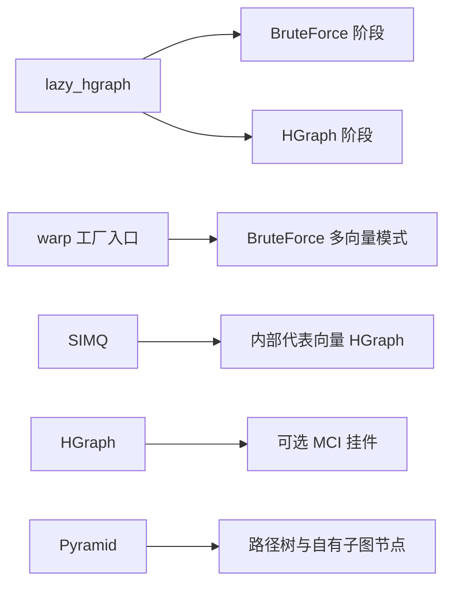

# 索引实现总览

本目录以当前工厂注册为准，共覆盖 9 个索引入口，并额外讲解 MCI 挂件。每个子目录包含 `visual_guide.md` 直观图解、`README.md` 设计说明和带真实源码摘录的 `code_walkthrough.md`；先看图和例子，再读设计与代码。

从 [图解地图](visual_map.md) 进入全部索引。要重点理解 HGraph 的图结构与遍历，先读 [HGraph 构成图](hgraph/visual_guide.md)，再读 [路由与底层遍历专章](hgraph/traversal_walkthrough.md)。

## 1. 按“怎样减少计算”理解索引

| 入口 / 组件 | 数据形态 | 候选生成方式 | 主要成本或误差来源 |
| --- | --- | --- | --- |
| [brute_force](brute_force/README.md) | 单向量 | 全量扫描 | 计算量随数据规模增长；量化时存在表示误差 |
| [hgraph](hgraph/README.md) | 稠密向量 | 多层图导航和底层扩展 | 图构建、邻接存储、路径漏召回 |
| [lazy_hgraph](lazy_hgraph/README.md) | FP32 稠密输入 | 先全量扫描，达到阈值后转图 | 同步切换开销，前后查询精度语义变化 |
| [ivf](ivf/README.md) | 稠密向量 | 先选桶，再做桶内搜索 | 中心训练、桶分布偏斜、未选桶漏召回 |
| [pyramid](pyramid/README.md) | 向量加路径 | 路径路由到子范围，再图搜或扫描 | 多层结构维护及路径分布 |
| [sindi](sindi/README.md) | 稀疏向量 | 窗口倒排累加 | 高频词 posting、剪枝和量化误差 |
| [sindi_v2](sindi_v2/README.md) | 稀疏向量 | 按词项读取，再按窗口累加 | term IO、解码、增量模式限制 |
| [warp](warp/README.md) | 多向量文档 | BruteForce 多向量全量扫描 | token 两两匹配量 |
| [simq](simq/README.md) | 多向量文档 | 代表图粗排，再文档级 MaxSim | 候选覆盖、精排 IO 和计算 |
| [mci](mci/README.md) | HGraph 的辅助结构 | 过滤场景下基于团的搜索 | 额外团存储和维护成本 |

这张表描述实现结构，不是跨数据集的性能排名。规模、维度、过滤比例、数据分布、精度目标和硬件都可能改变结果。

## 2. 容易误读的关系

- `warp` 有单独入口，但没有独立 `src/algorithm/warp` 实现。
- `mci` 有源码子目录，但没有独立工厂入口。
- Pyramid 复用图搜索与构图组件，不应简单理解成“每个路径放一个完整 HGraph 对象”。
- HGraph 的多层是近邻导航层；Pyramid 的路径层是业务划分，两者不是同一种层级。
- IVF 的倒排按聚类中心组织；SINDI 的倒排按稀疏词项组织，两者的分桶含义不同。

## 3. 源码比文档名字更重要

[index_creators.cpp](../../src/factory/index_creators.cpp) 是入口关系的依据。每篇参数说明只挑影响设计的字段，完整默认值和约束请回到该索引的参数映射与官方页面。代码摘录基于 `fd363937`，只保留解释所需的连续片段，不是可独立编译的程序。
