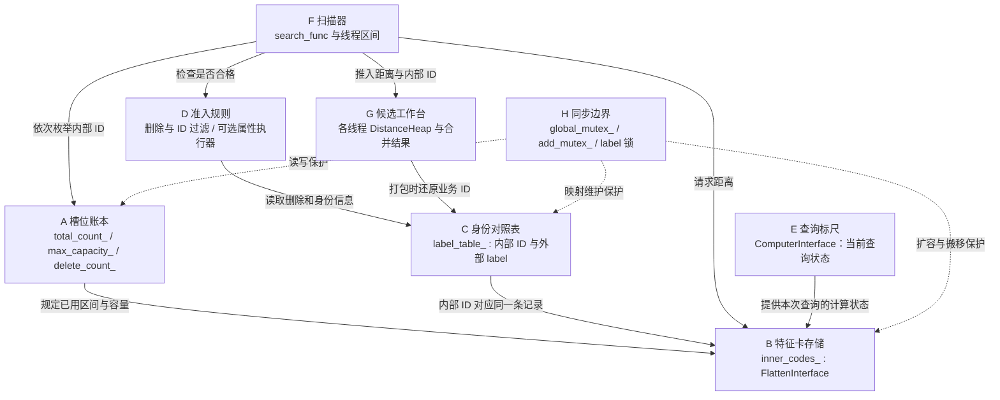

# BruteForce 图解：拿着标尺检查每一个货位

[设计说明](README.md) · [代码逐段导读](code_walkthrough.md) · [索引总览](../README.md)

源码基线：`fd363937`。本篇以普通单向量、FP32、平方 L2、KNN 为主线；多向量模式与自定义距离只在边界处说明。文中的数字是帮助理解的手算示例，不是性能实测。设计动机中标注“工程分析”的内容是从实现推导的解释。

## 1. 先把它想成一排仓库货位

仓库里每件商品都有一个业务编号，但这个编号可能是 10086、900001，并不适合作为货架数组下标。
仓管员给每件商品另外分配一个紧凑的货位号：0、1、2……；货位上放着描述商品的特征卡。
顾客拿着自己的需求卡到来后，仓管员逐个货位比较“这张特征卡与需求卡差多少”，在桌上只保留最接近的 k 张卡。
已经下架、或者不符合顾客条件的商品，在检查规则允许时直接跳过。
最后把货位号翻译回业务编号，顾客得到的是能识别的商品 ID。

这几个角色分别对应：内部 ID、向量编码、查询 Computer、结果堆、过滤器和 label 表。
BruteForce 的关键特点是没有用于挑选候选的近邻图或聚类分区：候选来源就是整个已使用槽位区间。

**类比边界：**

- “货架是一排”只表示内部 ID 可枚举，底层 IO 可以分块管理，不能由此推断所有数据在一段连续内存中。
- “标尺”可能测量原始 FP32，也可能测量量化表示；扫描完整不等于对原始数据绝对精确。
- 真实向量往往有数百维，近与远由配置的距离定义决定，不是业务编号大小，也不是物理地址远近。
- 多线程像多个仓管员分区检查，但它们仍然覆盖全量候选，不会凭空获得图索引的导航能力。

## 2. 主要构成图：有哪些对象一起工作

[查看 PNG 图片](figures/visual_guide-01.png)

查看可编辑 Mermaid 源码

**图例：** 实线表示数据引用、调用或数据转换，具体含义写在边上；虚线表示同步保护关系。
A、B、C 和可选属性索引属于索引长期保存的状态；E、F 的调用状态和 G 属于一次查询的临时工作。
图中箭头不代表全部操作按从左到右的单一流水线发生，例如 F 会反复调用 B 和 D。

## 3. 把每个节点映射到源码

| 节点 | 真实对象与源码 | 保存什么、负责什么 | 为什么需要它 |
| --- | --- | --- | --- |
| A | [BruteForce 成员](../../../src/algorithm/bruteforce/bruteforce.h) 与父类的 `total_count_` | 已用槽位、分配容量、逻辑删除计数 | 防止把容量当成有效记录数，也为扩容和删除提供边界 |
| B | `inner_codes_`，[构造与扫描实现](../../../src/algorithm/bruteforce/bruteforce.cpp) | 向量编码及按 ID 评分能力 | 把扫描规则与 FP32、量化、多向量存储实现分开 |
| C | 父类 `label_table_`，[InnerIndexInterface](../../../src/algorithm/inner_index_interface.h) | 内外 ID 映射及删除状态 | 业务 ID 不连续时仍能高效枚举紧凑槽位 |
| D | `create_search_filter`、局部 `ft`、`attr_filter`，可选 `attr_filter_index_` | 本次查询的有效记录判定；属性索引是持久组件 | 提前排除不合法记录，减少无效距离计算 |
| E | `make_search_computer` 创建的 `ComputerInterfacePtr` | 查询向量及编码需要的查询预处理状态 | 复用查询准备结果，不在每个槽位重复初始化 |
| F | `SearchWithRequest` 的局部 `search_func`；父类 `thread_pool_` | 当前扫描区间和线程任务 | 为大扫描提供可分段执行的工作单位 |
| G | 局部 `heaps` 和 `DistanceHeap::MakeInstanceBySize` | `(distance, inner_id)` 候选 | 只保存需要的最佳结果，避免保留和排序全部距离 |
| H | `global_mutex_`、`add_mutex_`、父类 label 锁 | 共享读、修改、映射操作之间的同步 | 保证扩容、压紧槽位与查询访问不会破坏彼此假设 |

### A：三个“数量”不能混用

`max_capacity_` 是已经分配的槽位上限，扩容可能预留尚未使用的空间。
`total_count_` 是当前已使用槽位数量，扫描范围取这个数量，而不是只循环 `GetNumElements()` 次。
`delete_count_` 记录软删除数量；`GetNumElements()` 返回 `max(total - deleted, 0)` 的语义。
若槽位 1 被标记删除，而槽位 4 仍有效，就不能只扫描前 4 个位置：否则会漏掉末尾的有效记录。

### B 与 E：一边是全库表示，一边是本次查询

`inner_codes_` 在构造时由 `FlattenInterface::MakeInstance(...)` 创建。
它回答“ID=i 的记录怎样编码、在哪里读取、如何与查询计算距离”。
Computer 则回答“本次 q 的数据或查表结果是什么”，生命周期与查询相关。
普通扫描调用 `inner_codes_->Query(&dist, computer, &i, 1, ...)`，最后的 `1` 表示这次只给一个内部 ID。
这不排斥距离核在一个向量的维度上使用 SIMD；但不能把普通扫描描述为每次提交一大批记录。

### C 与 D：身份、删除状态和业务筛选不是同一个概念

C 负责让业务 label 和存储槽位一致；D 使用这些信息形成“能否返回”的判定。
属性表达式存在时先由执行器生成 `attr_filter`，普通循环先检查它，再检查 `ft`。
通过规则后才执行普通距离计算，因此被这些规则直接拒绝的记录没有正常扫描评分成本。
过滤减少的是进入距离核的记录数；扫描循环仍要推进当前区间的槽位编号。

### F 与 G：扫描范围大，工作台可以很小

若 `k=10`，每个线程只需维护最优 10 条，而不是保存其负责区间内所有距离。
堆顶是当前保留项中最差的一项，便于更好的候选到来时将它淘汰。
多个线程有自己的堆，所有任务完成后合并；没有必要让每一次 Push 都争抢同一个堆。
工程分析：这种设计减少共享写竞争，但最终吞吐还会受到内存带宽和距离核成本限制。

## 4. 数据怎样进入这张图

1. `Build(data)` 先调用 `Train(data)`，再调用 `Add(data)`。
2. Train 让 B 完成编码所需准备；FP32 不需要学习聚类中心，训练型量化器则可能需要统计或模型。
3. Add 检查数据、外部 label 和重复 ID；失败 ID 通过返回列表表达。
4. 根据 A 判断是否扩容，为新记录分配内部槽位。
5. 将向量写入 B，维护 C 中同一槽位对应的外部 label，并写入配置启用的额外信息或属性。
6. 更新记录计数；后续查询就能在枚举范围中遇到它。

这里没有“给新点找邻居”和“修图边”步骤。
工程分析：省掉导航结构让新增与更新相对直接，代价是每个查询都承担大范围扫描。
具体提交顺序和各锁范围请沿 [Add 实现](../../../src/algorithm/bruteforce/bruteforce.cpp) 阅读，以上是职责顺序，不是把所有分支化成事务保证。

## 5. 一次查询怎样让构成图运转

1. `SearchWithRequest` 校验参数并取得全局共享锁，防止扫描期间结构性修改破坏读取。
2. 创建 E；准备 D 的删除、外部过滤与属性判定。
3. 根据 KNN 的 k 或 RangeSearch 的数量限制创建 G。
4. F 将 `[0, total_count_)` 分成若干区间；未启用线程池、单线程或 reasoning 开启时走串行分支。
5. 对区间内每个 i，先做 D 的检查；通过后用 E 请求 B 计算距离。
6. RangeSearch 还需检查半径；合格项以 `(dist, i)` 进入本线程 G。
7. 等待所有线程任务完成并合并局部堆，KNN 如有额外阈值再过滤结果。
8. 打包函数借助 C 把内部 ID 转回外部 label，输出距离、ID、可选额外信息和统计。

自定义距离回调分支会先收集一批外部 label，再调用 `distance_batch_func_`，不要与第 5 步的普通逐记录路径混淆。

## 6. 能手算的小例子：5 个槽位选最接近的 2 个

配置：单线程、FP32、平方 L2，无属性过滤；查询 `q=(1,1)`，`k=2`。
slot 1 已经标记删除，其余槽位有效。这里用 BruteForce 自身的 MARK_REMOVE 语义。

| 内部槽位 | 外部 label | 向量 | 有效性 | 平方 L2 距离 |
| --- | --- | --- | --- | --- |
| 0 | 101 | `(0,0)` | 有效 | `(1-0)^2+(1-0)^2=2` |
| 1 | 700 | `(1,0)` | 已删除 | 实际扫描跳过，不调用普通距离核 |
| 2 | 302 | `(1,1)` | 有效 | `0` |
| 3 | 999 | `(4,1)` | 有效 | `9` |
| 4 | 205 | `(2,1)` | 有效 | `1` |

下表用“按距离升序列出堆内容”的方式方便阅读，真实堆内数组不是这个排序。

| 扫描到哪 | 操作 | 当前保留的 `(距离,槽位)` | 当前最差保留距离 |
| --- | --- | --- | --- |
| 初始 | 创建容量 2 的堆 | `[]` | 尚无 |
| 0 | 评分 2，堆未满 | `[(2,0)]` | 2 |
| 1 | 删除过滤拒绝 | `[(2,0)]` | 2 |
| 2 | 评分 0，堆未满 | `[(0,2),(2,0)]` | 2 |
| 3 | 评分 9，不如堆内最差项 | `[(0,2),(2,0)]` | 2 |
| 4 | 评分 1，替换距离 2 的项 | `[(0,2),(1,4)]` | 1 |

最后通过 label 表，槽位 2 和 4 变成业务 ID 302 和 205，返回距离 0 和 1。
实际执行了 4 次正常距离计算，扫描了 5 个槽位；这两个数量并不相等。
如果只循环 `GetNumElements()==4` 个位置，就会错误地漏掉槽位 4，这说明 A 和 D 的分工为何必要。

## 7. 删除时为什么图中好几个节点都要动

标记删除主要改变 C 的删除状态和 A 的删除计数，B 的原编码仍存在，查询由 D 隐藏该记录。
强制删除则可能取最后一条记录覆盖被删除槽位，将后面的“货位”补到洞里。
被搬移记录的向量 B、label 映射 C、额外信息必须一起更新，A 的数量也随之减少。
H 的独占保护用于避免查询恰好读到“旧 label 配新向量”的中间状态。
这也解释了为什么强制删除不能仅把 `total_count_` 减一。

多向量模式只支持标记删除；单向量属性过滤启用时还有删除限制，以源码检查为准。
[Remove 实现](../../../src/algorithm/bruteforce/bruteforce.cpp) 展示了这些分支，不应把本例的删除能力泛化到所有配置。

## 8. 设计取舍与容易看错的地方

- **全量扫描的保证范围。** 对全部合法候选使用同一精确距离才构成相应精确基线；若 B 是有损量化编码，候选覆盖完整也仍可能排序错误。
- **“没有索引结构”不等于没有数据结构。** 没有导航图，但编码、ID 表、过滤结构、锁、容量和堆都必须存在。
- **更多线程不等于更高总吞吐。** 单查询占用更多核可缩短其时间，也可能挤占其他并发查询或碰到带宽瓶颈。
- **更新向量无需修边。** 它主要覆盖记录表示；若换成 HGraph，同一个点移动后邻接关系是否仍合理就成为额外问题。
- **堆是候选状态，不是全库内容。** 序列化索引需要保存持久数据；每次查询的堆由当前请求重建。
- **复杂度分两部分看。** 稠密普通评分约 `O(ND)`，有界候选维护可按 `O(N log k)` 理解；过滤、并行和编码改变实际工作量。

继续阅读：[DataCell 接口](../../../src/datacell/flatten_interface.h)、[Flatten 实现](../../../src/datacell/flatten_datacell.h)、[距离堆](../../../src/impl/heap/distance_heap.h)、[完整代码导读](code_walkthrough.md)。
