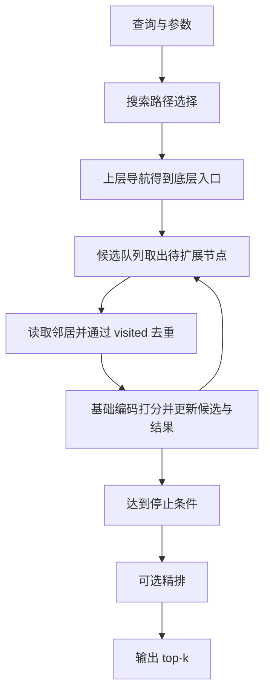

# HGraph：用多层近邻图减少候选访问

[直观图解](visual_guide.md) · [遍历路由专章](traversal_walkthrough.md)

配套：[代码逐段导读](code_walkthrough.md) · [MCI 挂件](../mci/README.md)

跨模块实现详解：[请求到结果](../../system_architecture/07_query_request_pipeline.md) · [图的构建、插入与维护](../../system_architecture/11_hgraph_build_mutation.md) · [本地断点实验](../../system_architecture/12_debugging_lab.md)。

## 1. 核心问题与直觉

全量扫描对每个查询都访问 N 个点。近邻图把向量看作节点，通过相邻节点逐步靠近查询；上层的稀疏图提供更长跨度的导航，底层图负责局部候选扩展。

不能把它理解为一棵有严格空间边界的搜索树，也不能保证每个查询都是 O(log N)。实际访问量与数据分布、图质量、候选预算及过滤条件有关。

## 2. 核心结构

| 成员 / 组件 | 作用 |
| --- | --- |
| `route_graphs_` | 上层导航图 |
| `bottom_graph_` | 底层候选扩展的邻接关系 |
| `entry_point_id_` | 搜索入口 |
| `basic_flatten_codes_` | 基础编码与距离计算 |
| 精排 / 原始向量相关存储 | 按配置改善候选排序或保留输入 |
| `Searcher`、visited 与结果堆 | 控制扩展、避免重复访问、保留候选 |
| label 与锁 | 业务 ID 映射、删除与并发维护 |

图边与向量编码职责不同。邻接关系说明“去哪里”，编码说明“这个点有多近”。当前还存在把底层图与 RaBitQ split 编码融合的专用 DataCell，目的在于减少相关数据访问的分散程度，但有明确参数与平台路径约束。

## 3. 构图过程

`Build` 训练必要编码，然后按构建配置选择 NSW 插入、ODescent 或构建缓存相关路径。插入式构图的基本逻辑是：为新点找到候选邻居，剪枝到允许的度数，更新边及必要的反向连接，再维护层级和入口。

邻居选择并非简单保留距离最近的一批。纯粹保留一团方向相近的点，可能让局部很密却缺少跨区域连接。剪枝需要在近邻质量、方向覆盖与度数预算间取舍，可继续读 `pruning_strategy.cpp`。

ODescent 则更偏向批量迭代改进邻居集合，适合用整体构建工作换图质量与构建效率。两种方式最终服务于相近的图搜索接口，但构建成本、临时内存和参数意义不同。

## 4. 查询过程

这是普通图路径的结构示意，实际还包括扫描回退、MCI、特殊量化和迭代器分支。visited 防止环路和重复计算；候选预算让系统不会无限扩大探索。

## 5. 为什么要同时有 max_degree、ef_construction、ef_search

| 参数 | 改变什么 | 增大后的典型代价 |
| --- | --- | --- |
| `max_degree` | 持久化图中每点允许的边预算 | 更多图内存和邻居读取 |
| `ef_construction` | 构建时找邻居的候选预算 | 更长构建时间和临时计算 |
| `ef_search` | 查询时保留和扩展候选的预算 | 更多距离计算与查询延迟 |
| `use_reorder` | 候选是否再经过更准确的评分 | 额外读取和计算，部分配置另需存储 |

前两个塑造图；第三个使用已有图。若图本身缺乏连接，单纯提高 `ef_search` 可能只能用更多工作弥补部分问题。精排改善的是候选内排序，无法修复图路径完全未覆盖到的真近邻。

## 6. 过滤、删除和重复使工程实现复杂化

无效节点能否用于导航、已删除入口如何处理、强制删除怎样修边、重复向量是否共享编码，都会影响正确性与召回。HGraph 为这些场景维护可选元数据与同步逻辑，所以图内存不能只用 `N × max_degree` 估算。

反向边有助于找到谁指向某节点，但付出额外边存储和维护代价。MCI 为高过滤场景增加另一条搜索路线，仍复用 HGraph 的向量数据。

## 7. 调优与验证思路

先用 FP32 基线确认距离和数据无误；固定图比较不同 `ef_search`；再检查图构建参数；最后引入量化与精排。分别记录 Recall@k、距离计算量、延迟分位数、图和编码内存。不要把某一数据集上的最优参数写成通用结论。

## 8. 源码地图

入口：[hgraph.h](../../../src/algorithm/hgraph/hgraph.h)。生命周期与装配：[hgraph.cpp](../../../src/algorithm/hgraph/hgraph.cpp)。构建：[hgraph_build.cpp](../../../src/algorithm/hgraph/hgraph_build.cpp)。查询：[hgraph_search.cpp](../../../src/algorithm/hgraph/hgraph_search.cpp)。参数映射：[hgraph_param_mapping.cpp](../../../src/algorithm/hgraph/hgraph_param_mapping.cpp)。底层搜索：[basic_searcher.cpp](../../../src/impl/searcher/basic_searcher.cpp)。剪枝：[pruning_strategy.cpp](../../../src/impl/pruning_strategy.cpp)。

阅读代码时先走普通 FP32 路径，再逐个加入量化、精排、过滤和删除；不要从最复杂的融合路径开始。
