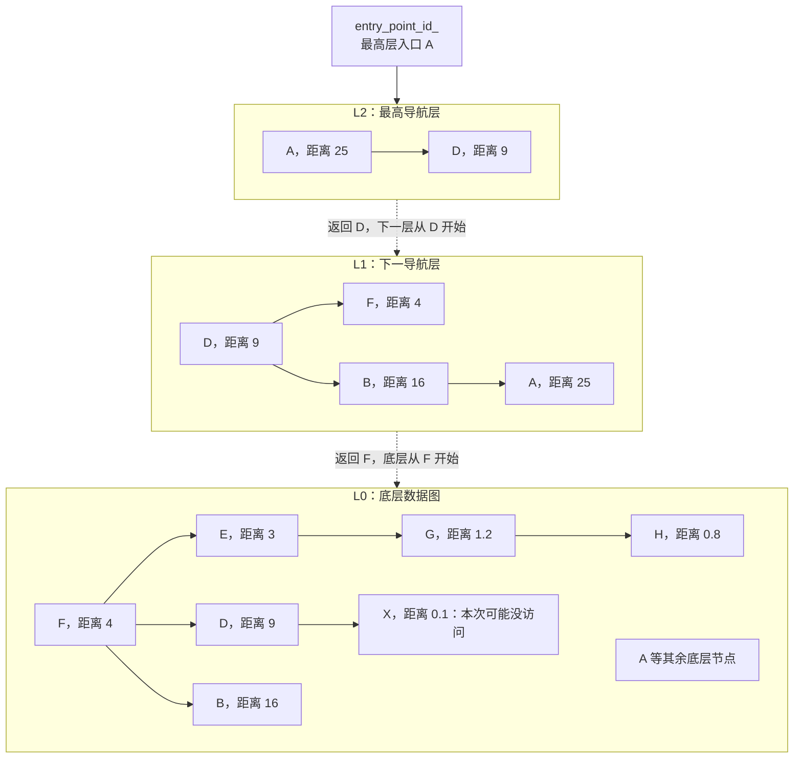

# HGraph 专题：图到底长什么样，查询如何一步步走

[直观构成图](visual_guide.md) · [设计说明](README.md) · [代码导读](code_walkthrough.md)

源码基线：`fd363937`。本篇先固定为普通单线程 KNN、FP32、无过滤、无重复、无精排、无超时及特殊快路径，让主干逻辑足够清楚；后面再说明复杂配置改变哪里。图和距离是教学示意，不是本次运行测得的数据。

## 1. 先用“城市道路”理解

每条数据向量是一座地点；图边是允许继续探索的道路。上层像稀疏的快速路网，先把你带到一个有希望的区域；下层像更细的街道网，继续找附近地点。

这个类比有三条边界：

- 图的“距离”是 query 到节点向量的距离，不是沿道路走过的路程之和。因此这不是 Dijkstra 最短路。
- 上层节点是抽样进入上层的实际数据节点，不是按省、市、区聚类得到的中心。
- 道路只是构图时形成的近邻连接；沿路越来越接近通常有效，但没有一个严格空间边界保证路外不存在更近的数据。

## 2. 图的真实组成


[查看 PNG 图片](figures/traversal_walkthrough-01.png)

<details>
<summary>查看可编辑 Mermaid 源码</summary>



</details>

实线是层内的示意邻接边，只画出本例相关边；图框之间的虚线表示查询程序把本层返回的内部 ID 传给下一层作为入口，不表示跨层另存了一条普通邻接边。节点在图中的左右位置只是排版，不代表其向量坐标。

### 2.1 为什么 D 可以出现在多层

D 在不同层是同一条向量的同一个内部 ID，但每层有各自的邻接表。上层 D 的邻居集合和底层 D 的邻居集合可以不同；向量编码不需要为每个层级复制一份。

当前 HGraph 中，`route_graphs_` 是一组导航图对象，`bottom_graph_` 是底层图对象；`basic_flatten_codes_` 提供向量编码和距离查询；`entry_point_id_` 给出最高层起点。实际设计还包含可选精排、融合编码与其他附加结构，本图先不展开。

### 2.2 为什么不是每条向量都进入最高层

如果每层都保存全部节点和很多边，上层不会形成更便宜的导航网络，还会放大内存与构建成本。实现按随机层级组织较稀疏的上层节点；例如 ODescent 构建路径对抽到某个高度的 ID，将其加入对应的各个较低导航层。

稀疏上层提供导航起点，底层负责更细搜索。这是一种工程取舍，不保证每层都能精确找到全局最近点。具体层级代码可查 [hgraph_build.cpp](../../../src/algorithm/hgraph/hgraph_build.cpp) 的 `route_graph_ids` 和 `get_random_level()` 调用。

## 3. 查询第一阶段：从最高层路由到底层

普通 `HGraph::SearchWithRequest` 先设：

```cpp
search_param.ep = this->entry_point_id_;
search_param.topk = 1;
search_param.ef = 1;
search_param.is_inner_id_allowed = nullptr;
```

这段摘自 [hgraph_search.cpp](../../../src/algorithm/hgraph/hgraph_search.cpp) 的请求初始化逻辑。含义是：上层暂时只需要一个好的下一层入口，并不在这里返回用户请求的 k 个结果。

普通导航分支从 `route_graphs_.size() - 1` 往 0 遍历；每层调用 `search_one_graph`，结果非空就把 `result->Top().second` 写回 `search_param.ep`。

以上图为例：

1. 从最高层入口 A 开始，比较 query 到 A 和沿边发现的 D 的距离，得到更好的 D。
2. 进入下一导航层时从 D 开始，不重新从 A 开始；沿 D 的邻边发现 F，得到更好的 F。
3. 最后把 F 作为底层搜索入口。此时只是路由完成，还没有得到最终 top-k。

这里 `ef=1` 不代表一层只计算一个距离。它限制保留的搜索结果候选预算，算法仍可能展开多个点并读取它们的邻居。

### 上层访问过 D，底层还能访问 D 吗？

能。`search_one_graph` 对复用的 visited list 调用 `Reset()`，因此访问标记不会直接从上层继承为底层“禁止再看”的集合。因为各层的邻接关系不同，不重置会错误地跳过底层需要的扩展。

## 4. 查询第二阶段：底层不再只保留一个入口

普通底层 KNN 将预算调整为：

```cpp
search_param.ef = std::max(params.ef_search, k);
search_param.topk = static_cast<int64_t>(search_param.ef);
search_param.rerank_topk = k;
```

源码位置仍为 [hgraph_search.cpp](../../../src/algorithm/hgraph/hgraph_search.cpp)。这是基础设置，后续 `topk_factor`、图增强和精排等配置还可能调整预算。

例如用户要 k=2，本例设置 ef_search=3，底层先保留一个最多 3 项的较宽搜索结果集合，最后再输出 2 项。额外候选让算法在多个局部方向中继续探索，减少过早卡在一个局部区域的风险。

## 5. 必须分清四份状态

| 状态 | 当前源码变量 | 用来干什么 | 顺序或规则 |
| --- | --- | --- | --- |
| 待探索队列 C | `candidate_set` | 决定下一个展开谁的邻接表 | 距离较小者先取出；有限距离以负值放入最大堆 |
| 当前结果集合 W | `top_candidates` | 保留目前找到的较好结果候选 | 正距离最大堆，堆顶是保留结果中最差的一项 |
| 已发现集合 V | `vl` | 避免同层反复处理一个节点 | 邻居首次被发现时标记，不是展开完才标记 |
| 当前结果边界 | `lower_bound` | 保存 W 中最差保留距离 | 结果变化后由 W 堆顶更新 |

`candidate_set` 和 `top_candidates` 不是同一堆的两个名字。某节点可能已经从 W 淘汰，却还留在 C 等待是否值得展开。

`lower_bound` 这个源码命名也容易误解：这里它用于表示当前保留结果的最差距离，不是数学证明出的“所有未见节点距离下界”。停止时不能靠它证明全局精确。

## 6. 用数值走完底层搜索

本例 k=2、ef=3。底层入口为 F，距离 4；相关有向邻边为 `F→D,E,B`、`E→G`、`G→H`、`D→X`。回边和已访问邻居不会产生新的候选。假定 F 的邻居按 D、E、B 的顺序处理，距离都有限，没有过滤和重复数据。

表中 C 按“下一步先弹出的顺序”列出；W 为便于阅读按距离从小到大列出，实际结果堆的堆顶是最右侧最差项。

| 步骤 | 做什么 | C：待探索 | W：当前保留结果 | V：已经发现 | 最差保留距离 |
| --- | --- | --- | --- | --- | --- |
| 初始化 | 计算入口 F | F:4 | F:4 | F | 4 |
| 展开 F | 发现 D:9、E:3、B:16 | E:3，D:9 | E:3，F:4，D:9 | F,D,E,B | 9 |
| 展开 E | 发现 G:1.2，淘汰 W 中的 D | G:1.2，D:9 | G:1.2，E:3，F:4 | F,D,E,B,G | 4 |
| 展开 G | 发现 H:0.8，淘汰 W 中的 F | H:0.8，D:9 | H:0.8，G:1.2，E:3 | F,D,E,B,G,H | 3 |
| 展开 H | 没有发现更值得加入的新节点 | D:9 | H:0.8，G:1.2，E:3 | 同上 | 3 |
| 检查 D | 9 大于 3，且 W 已满 ef=3，停止 | D 未展开 | H:0.8，G:1.2，E:3 | 同上 | 3 |
| 输出 | 无精排时最终保留 k=2 | — | H:0.8，G:1.2 | — | — |

### 6.1 为什么 D:9 一开始也被接受

刚发现 D 时，W 还没有达到 ef=3。源码条件允许在 W 未满时加入候选，不要求每个新节点都比入口 F 更近。这样底层才能暂存一些潜在的探索方向。

### 6.2 为什么 B 被标记 visited，却没进 C

visited 在 `visit()` 收集未访问邻居时就置位，评分和是否加入 C/W 在后面进行。发现 B 时 W 已经有 3 项，B:16 比最差 D:9 还差，所以不进入后续探索集合，但仍是已发现节点。

### 6.3 为什么 D 从 W 淘汰后还留在 C

两个堆承担不同职责。结果堆淘汰 D，只表示 D 目前不属于最好的 ef 个已发现点；不会自动在待探索堆里同步删除它。之后检查其距离与当前边界时，才决定不展开它。

### 6.4 这为什么是近似搜索

本图特意让 D 还有一条边通向 X:0.1。D 未展开，所以 X 从未被发现，最终返回的 H/G 不是全图真实 top-2。停止条件只能说明“目前队列里最有希望的待展开节点，比已有结果更差”，不能排除沿一个较远节点继续走会发现很近的节点。

提高 ef 会保留更多路径，可能让 D 得到展开机会，但不构成任意图上的全局精确保证。构图质量就是要降低这种需要绕过远点才能发现近邻的情况。

## 7. 底层核心循环的实现逻辑

下面是对普通有限距离分支的解释性伪代码，不是源码原文，省略过滤、重复、超时、RaBitQ 与错误处理：

```text
计算入口 ep 的距离
C 加入 ep；W 加入 ep；V 标记 ep

当 C 非空：
    u = C 中距离 query 最近的待探索节点
    如果 W 已有 ef 项，且 dist(u) > W 中最差距离：停止
    从 C 取出 u
    从当前层邻接表取得 neighbors(u)
    对未在 V 中的邻居置位并收集
    批量计算这些邻居到 query 的距离
    对每个邻居 v：
        如果 W 未满，或者 v 比 W 中最差项更近：
            C 加入 v
            W 加入 v
            若 W 超出 ef，移除 W 中距离最大者
            更新最差保留距离

对 W 做最终截取或进入配置指定的精排
内部 ID 转回外部 label，返回结果
```

为什么是“批量计算邻居”？因为读取一个节点的邻接表后，可以把所有未访问邻居的 ID 组成一批交给 DataCell，复用同一个 query Computer。图决定这一批 ID，量化器和 SIMD 决定这些 ID 怎样算距离，IO 决定编码从哪里取得。

### 7.1 层间路由：更新的是入口 ID

源码：[hgraph_search.cpp](../../../src/algorithm/hgraph/hgraph_search.cpp)，基线行号 664–675。以下是连续原文摘录。

```cpp
        for (auto i = static_cast<int64_t>(this->route_graphs_.size() - 1); i >= 0; --i) {
            auto result = this->search_one_graph(raw_query,
                                                 this->route_graphs_[i],
                                                 this->basic_flatten_codes_,
                                                 search_param,
                                                 vt,
                                                 &ctx);
            // An unrankable route seed can still bridge to finite bottom-layer results.
            if (not result->Empty()) {
                search_param.ep = result->Top().second;
            }
        }
```

- `route_graphs_[i]` 决定本次搜索读哪一层邻接表；`basic_flatten_codes_` 仍然是共享评分表示。
- `search_param` 中 `ef=1/topk=1` 保持上层的小预算；`vt` 由 `search_one_graph` 重置后用于本层。
- 返回结果非空时，`Top().second` 取的是内部 ID；更新 `ep` 后，下一轮才切换到下一层图。
- 这里没有把完整候选队列传到下一层：每层搜索重新维护自己的队列，传递的核心是入口 ID。

### 7.2 visited：先发现并置位，后决定要不要评分与入队

源码：[basic_searcher.cpp](../../../src/impl/searcher/basic_searcher.cpp)，基线行号 64–74。以下是连续原文摘录。

```cpp
        if (not vl->Get(neighbors[i])) {
            vl->Set(neighbors[i]);
            if (not filter || count_no_visited == 0 || skip_strategy == nullptr ||
                skip_strategy->ShouldVisit() || filter->CheckValid(neighbors[i])) {
                to_be_visited_id[count_no_visited] = neighbors[i];
                count_no_visited++;
            }
        }
    }
    return count_no_visited;
}
```

- `vl->Get/Set` 实现发现去重；一个节点被两条路径找到时，通常只会第一次加入本层待评分批次。
- `to_be_visited_id` 是这次展开收集的一批邻居，和贯穿整层搜索的 `candidate_set` 不是同一个容器。
- 无过滤时 `not filter` 成立，所有新邻居都会收集；有过滤时还会受 skip strategy 影响，不能照搬无过滤例子的访问数。

### 7.3 停止条件：在 Pop 和展开之前判断

源码：[basic_searcher.cpp](../../../src/impl/searcher/basic_searcher.cpp)，基线行号 757–765。以下是连续原文摘录。

```cpp
        if constexpr (mode == InnerSearchMode::KNN_SEARCH) {
            if ((-current_node_pair.first) > lower_bound && top_candidates->Size() >= ef) {
                if (reasoning != nullptr) {
                    reasoning->SetTermination(ReasoningContext::kTerminationLowerBoundReached);
                }
                break;
            }
        }
        candidate_set->Pop();
```

- `current_node_pair` 是本轮待探索队列堆顶；有限距离采用负值编码，所以这里先取负还原实际距离。
- 必须同时满足“下一项更远”和“结果数量已经达到 ef”，才按这个条件停止。
- `break` 在 `Pop()` 之前，因此数值表中的 D 可以仍留在候选队列里，却没有机会读取自己的邻居 X。
- `reasoning` 只在该分支记录停止原因；这几行不是用于证明图外不存在更近点的空间下界算法。

### 7.4 评分之后：先入待探索队列，再维护结果堆

源码：[basic_searcher.cpp](../../../src/impl/searcher/basic_searcher.cpp)，基线行号 850–880。以下是连续原文摘录。

```cpp
            if (top_candidates->Size() < ef || lower_bound > dist ||
                (mode == RANGE_SEARCH && dist <= inner_search_param.radius)) {
                candidate_set->Push(-dist, cur_id);
                //                flatten->Prefetch(candidate_set->Top().second);
                if (check_func(cur_id)) {
                    top_candidates->Push(dist, cur_id);
                } else if (reasoning != nullptr) {
                    reasoning->RecordFilterReject(cur_id);
                }
                if (inner_search_param.consider_duplicate and not use_custom_distance) {
                    const auto duplicate_ids = graph->GetDuplicateIds(cur_id);
                    for (const auto& item : duplicate_ids) {
                        if (check_func(item)) {
                            top_candidates->Push(dist, item);
                        }
                    }
                }

                if constexpr (mode == KNN_SEARCH) {
                    if (top_candidates->Size() > ef) {
                        if (reasoning != nullptr) {
                            reasoning->RecordEviction(top_candidates->Top().second, hops);
                        }
                        top_candidates->Pop();
                    }
                }

                if (not top_candidates->Empty()) {
                    lower_bound = top_candidates->Top().first;
                }
            }
```

- 第一层 `if` 控制一个有限距离候选是否值得继续探索：结果未满，或候选更好，便可进入。
- `candidate_set->Push(-dist, cur_id)` 负责后续扩展；`check_func` 决定能否进入结果堆。这是“导航资格”和“返回资格”分离的位置之一。
- 重复处理分支在本例关闭；打开时还会对关联 ID 追加结果，不能再把结果数直接等同于已扩展图节点数。
- 超过 ef 时弹出 `top_candidates` 的最差项，不会同步删除 `candidate_set` 中的旧项。
- 最后一段从结果堆顶更新 `lower_bound`，下一轮就用这个新边界判断是否还有探索价值。

## 8. 对应到当前源码，具体看哪些位置

| 逻辑 | 文件与函数 | 本提交阅读定位 |
| --- | --- | --- |
| 图与编码成员 | [hgraph.h](../../../src/algorithm/hgraph/hgraph.h) | `route_graphs_`、`bottom_graph_`、`basic_flatten_codes_` |
| 上层初始化和逐层入口更新 | [hgraph_search.cpp](../../../src/algorithm/hgraph/hgraph_search.cpp) | `SearchWithRequest`，约 621–675 行 |
| 底层 ef 与 k 设置 | 同上 | 约 687–732 行 |
| 每层 visited 重置、搜索器分派 | 同上 | `search_one_graph`，约 271–345 行 |
| 普通非迭代器搜索实现 | [basic_searcher.cpp](../../../src/impl/searcher/basic_searcher.cpp) | 从约 552 行开始的 `search_impl` 重载 |
| 初始化入口与两个堆 | 同上 | 约 695–731 行 |
| 停止判断 | 同上 | 约 733–765 行 |
| 取邻居与批量打分 | 同上 | `visit` 和约 769–807 行 |
| 有限距离入队与结果淘汰 | 同上 | 约 849–884 行 |

一个文件里有多个 `search_impl`：迭代器路径与 DistanceProvider 路径也是实现，但本篇描述普通非迭代器路径。跳转到函数后，应先核对参数签名，不要仅按函数名看第一处匹配。

## 9. 加上真实工程配置后，逻辑会怎样变化

- **过滤**：上层路由先不套最终 ID 过滤；底层区分“可参与导航”和“可进入结果”。不能删除所有不合法导航点后还假定图一样连通。
- **量化与精排**：基础编码先评估候选，再按配置精排；精排只能重算 W 及相关候选，找不到本例中未发现的 X。
- **预算**：ef 是结果候选预算，不是距离计算次数或待探索队列的严格长度上限；一个节点可能有很多邻居，多轮会计算更多点。
- **超时和 hop 上限**：可在普通距离停止条件之外提前终止；评估召回必须留意是否触发这些限制。
- **不同执行路径**：符合条件时可改走 MCI、有效集合扫描、并行搜索或融合 RaBitQ。不能把本篇队列步骤当作所有 HGraph 配置的唯一路径。

## 10. 用一句话复述完整逻辑

先在稀疏上层找到一个好的底层入口，再从该入口沿邻边不断发现候选；用 visited 控制重复，用待探索队列选择下一步，用结果堆控制当前最好的一批点，最后按预算停止并输出或精排。
