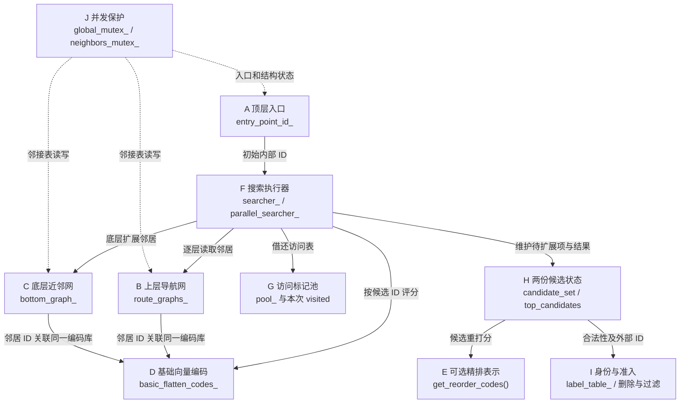
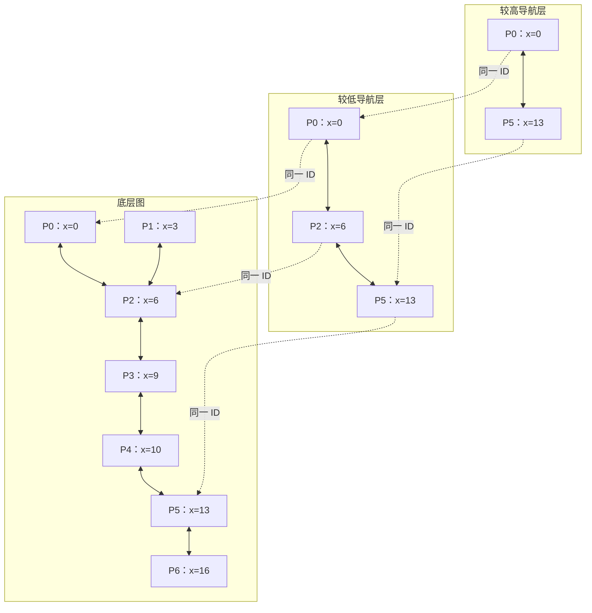

# HGraph 图解：先坐快线定位，再沿街道寻找近邻

[设计说明](README.md) · [代码逐段导读](code_walkthrough.md) · [索引总览](../README.md)

源码基线：`fd363937`。主线采用普通 FP32、单线程、无过滤、无重复向量、无 MCI、无融合 RaBitQ 的 KNN 路径；特殊分支另行说明。下面的图和距离例子用于解释源码，不是实际构建结果或性能实测。关于收益与动机的判断属于工程分析。

## 1. 形象解释：一张有多种尺度的交通网

想象你第一次到一座城市，要找到离目标位置最近的商店。
逐家商店检查就是 BruteForce；HGraph 则预先给商店建立“附近还有哪些店”的连接。
你先从少数大型站点组成的快线网络靠近目标区域，再进入更密的线路，最后沿普通街道扩展候选商店。
每到一个点，都根据它与目标的距离决定接下来更值得查看哪些邻居。

在这个类比中，上层导航图是稀疏快线，底层图是街道网，入口 ID 是最开始的站点。
向量编码像记录各店特征的资料卡；距离核是判断“接近目标程度”的计算器。
候选队列像待走访清单，结果堆像当前最好的商店清单，visited 像已经打过访问标记的点位表。

**类比的三个边界：**

- 图边不是实际道路长度，也通常不存储本次查询距离；边主要保存邻居 ID，距离来自向量表示。
- 上层不等同于行政区域树，没有“此分支包含所有正确答案”的严格空间边界。
- 一个点在多层出现仍是同一个内部 ID，不是层层复制出不同业务记录；上层更多承担导航任务。

工程分析：分层让搜索有机会用较少的节点访问接近目标，但它不是对任意数据都保证 `O(log N)` 或精确最近邻的算法。

## 2. 主要构成图：交通网、资料库和临时工作台

[查看 PNG 图片](figures/visual_guide-01.png)

查看可编辑 Mermaid 源码

**图例：** 实线表示引用、调用和数据关联，标签说明具体含义；虚线表示同步保护。
A～E 和 I 中的索引元数据是持久状态；G 的池长期存在，但借出的 visited 服务于本次搜索；H 是请求中的临时状态。
F 是可复用的搜索组件，它没有把“待访问队列”作为跨查询共享的全局清单。
可选精排 E 只有相应配置和路线需要时才参与，并非每次都额外读取一份 FP32。

## 3. 逐节点拆开看：每个零件有什么用

| 节点 | 真实成员或实现 | 存什么、做什么 | 工程分析：为何存在 |
| --- | --- | --- | --- |
| A | `entry_point_id_`，[hgraph.h](../../../src/algorithm/hgraph/hgraph.h) | 首个导航节点的内部 ID | 每次查询需要一个可进入已有图的起点 |
| B | `Vector<GraphInterfacePtr> route_graphs_` | 多个稀疏层的邻接表 | 在底层扩展前先进行较粗尺度的定位 |
| C | `GraphInterfacePtr bottom_graph_` | 底层节点的邻居 ID 列表 | 候选从这些实际连接中被发现 |
| D | `basic_flatten_codes_` | FP32 或量化编码与 `Query` 能力 | 让邻接结构与评分表示能分别演进 |
| E | `high_precise_codes_` 或 `reorder_by_base_` 指定的基础编码 | 对已得到的候选再评分 | 以少量更贵的计算改善候选内部排序 |
| F | `searcher_`、`parallel_searcher_`，[search_one_graph](../../../src/algorithm/hgraph/hgraph_search.cpp) | 对某一层执行图搜索 | 复用同一搜索规则处理不同层和配置 |
| G | `std::shared_ptr<VisitedListPool> pool_` 与 `VisitedList` | 哪些内部 ID 已经发现或处理过 | 防止有环图反复评分同一邻居 |
| H | [BasicSearcher](../../../src/impl/searcher/basic_searcher.cpp) 局部双堆 | 待扩展节点与当前最佳结果 | 区分“以后去哪”和“现在返回谁” |
| I | 父类 `label_table_`、`create_search_filter` 等 | 业务 ID、删除状态、过滤资格 | 导航 ID 和外部业务语义分开处理 |
| J | 全局锁、邻接锁数组等，[hgraph.h](../../../src/algorithm/hgraph/hgraph.h) | 图写入与查询读之间的同步 | 避免读取部分发布的结构和邻接关系 |

### B、C 与 D：边只回答“下一步能去哪”

若底层某节点保存邻居 `[7,12,30]`，这表示搜索扩展它时有机会查看这三个内部 ID。
它没有直接告诉搜索器哪个最靠近当前查询，也不表示 7、12、30 之间有大小或远近顺序。
搜索器需要向 D 请求这批候选的距离，才能更新 H。
同一个邻居对于不同查询可能非常近，也可能很远，所以不能把查询距离固定写成所有图边的权重。

当前还有 `HGraphRaBitQFusedDataCell` 等专用配置将关联数据融合存放。
这不改变“邻接关系”和“向量评分”在逻辑上的分工，但说明主图不是所有配置的强制物理内存布局。

### G：visited 记录的是当前层搜索状态

`SearchWithRequest` 借出访问表，将它传入逐层搜索。
`search_one_graph` 收到已有访问表时会 `Reset()`；因此上层见过节点 X，不会使底层永远跳过 X。
在一次层内扩展中，`visit` 读取邻居并将新发现的 ID 置位，防止多个路径重复提交它。
“已经 visited”不意味着它一定进了最终结果堆，也不意味着它的邻居已被展开。

### H：两份堆的方向相反，职责也相反

`candidate_set` 要尽快展开距离较小的候选；当前有限值实现压入 `-dist`，通过既有堆方向实现优先取近点。
`top_candidates` 要方便淘汰当前保留项里最远的点；它保存正距离，堆顶是当前最差的保留结果。
某节点进入过待扩展队列，后来即使从结果堆淘汰，也未必立即从候选队列删除。
因此停止时看到队列里还剩节点很正常：队列中可能是已经不值得展开的旧候选。

### E：精排可以改名次，不能补上从未发现的点

`get_reorder_codes()` 根据配置选择 `basic_flatten_codes_` 或 `high_precise_codes_`。
普通图路径的后处理可能对候选重新打分，融合路径、MCI 和扫描回退则有各自的评分完成语义。
假设真近邻从未进入候选集，仅仅把现有候选算得更精确不会让这个点出现。
召回问题要先区分“没有走到那里”和“走到了但量化排序不准”。

## 4. 多层图到底长什么样：同一个点可以出现在多层

下图是手工指定的教学拓扑，P0～P6 是同一组内部 ID；仅用 1 维数值方便算平方 L2。
图中实线是该层的邻接关系，双箭头表示本例显式设置了两个方向的边。
跨层虚线表示同一内部 ID 在不同层的身份对应，它不是底层邻接表中的一条边。
实际构图剪枝后不能假设所有连接永远双向对称。

[查看 PNG 图片](figures/visual_guide-02.png)

查看可编辑 Mermaid 源码

在普通路由中，不是沿虚线执行一次邻居跳转；代码结束当前层搜索后把找到的 ID 写回 `search_param.ep`，再把它交给下一层。
上层节点只是底层 ID 集合中的部分节点；B 中维护的是额外邻接关系，并不要求给这些 ID 再保存一份独立业务向量。

## 5. 构图为何要同时考虑“近”和“连接有用”

以 NSW 插入式路径为例，按照 [hgraph_build.cpp](../../../src/algorithm/hgraph/hgraph_build.cpp) 的职责可以跟踪：

1. 检查输入并准备编码，把新向量与内部 ID 对应起来。
2. 为新点采样层级；它会出现在底层以及其层级允许的上层，而不是每个点都出现在全部层。
3. 从已有入口搜索，利用更高层先定位，并为需要连接的层收集候选邻居。
4. 构建搜索使用 `ef_construct_` 等参数，通常要花比单次小预算查询更多工作来寻找可用邻居。
5. 根据度数预算和剪枝规则选边，将新点邻接表发布到对应层。
6. 尝试更新相关邻居的连接，必要时对过多候选再次剪枝，并维护新层和入口。

`Build` 并非总是这样逐点插入：它还会根据构建缓存、优化构建、NSW 或 ODescent 选择不同路径。
[代码导读](code_walkthrough.md) 已展示实际 Build 分支，读完插入式直觉后要返回入口确认所用配置。

剪枝的一个小算例能说明它为何不是简单取最近 M 个点。
设新点 `q=(0,0)`，候选 `a=(1,0)`、`b=(2,0)`、`c=(0,2)`，平方 L2 距离分别为 1、4、4；设置 `alpha=1`，候选预算至少 3。
先接受最近的 a 后，b 到 a 的距离是 1；因为 `alpha × d(a,b)=1 < d(q,b)=4`，b 会被视作被已选邻居覆盖。
c 到 a 的距离是 5，不满足 `5 < 4`，因此 c 可以保留。
最终留下 a 和 c，分别提供横向与纵向连接，而不只是把同一方向上相近的点塞满边预算。
这个例子直接对应 [pruning_strategy.cpp](../../../src/impl/pruning_strategy.cpp) 的比较条件；它是启发式覆盖判断，不是严格空间覆盖证明。

## 6. 一次查询的路由过程：先上层，再底层

继续使用第 4 节拓扑，查询 `q=9.2`，最终要求 `k=2`，底层 `ef_search=3`。
为清楚起见关闭过滤、精排、距离阈值、超时、跳数限制、重复处理以及专用搜索路线。
所有距离为平方 L2，按数学值保留两位小数；真实 FP32 的末位可能有误差。

| 节点 | x | `d(q,x)` |
| --- | --- | --- |
| P0 | 0 | 84.64 |
| P1 | 3 | 38.44 |
| P2 | 6 | 10.24 |
| P3 | 9 | 0.04 |
| P4 | 10 | 0.64 |
| P5 | 13 | 14.44 |
| P6 | 16 | 46.24 |

### 6.1 上层的 `ef=1` 不是“每层只看一个点”

[SearchWithRequest](../../../src/algorithm/hgraph/hgraph_search.cpp) 初始化 `ep=entry_point_id_`、`topk=1`、`ef=1`、`is_inner_id_allowed=nullptr`。
然后从 `route_graphs_` 的最高层向下循环，每层调用 `search_one_graph`；返回非空时，用结果堆顶 ID 更新 ep。

本例最高层入口为 P0：先算 P0 的 84.64；扩展 P0 发现 P5 为 14.44，用 P5 替换保留的结果。
随后仍可扩展 P5，它的 P0 邻居已经访问过；这一层返回 P5。
下一层从 P5 开始，发现 P2 的 10.24 更近，于是把最佳点换成 P2。
展开 P2 会看到 P0 的 84.64，但它不优于已保留的 P2；这一层返回 P2。
`ef=1` 限制当前保留的候选规模，不是给该层设定“只计算一次距离”或“只走一步”的指令。

### 6.2 底层重新开始一份访问状态

KNN 分支把 `search_param.ef` 设为 `max(params.ef_search, k)`，本例为 3，初始 ep 是上层给出的 P2。
为免混淆，下表将 candidate_set 写成按距离升序展示的清单 Q，将 top_candidates 也排序展示为 R；这不是堆内部数组布局。
Q 表示“还等着展开”，R 表示“当前保留的最多 ef 个结果”，`lower_bound` 是 R 中最差距离。
扩展 P2 时按 `[P0,P1,P3]` 的顺序处理邻居，这个明确顺序用于复现表中变化。

| 时刻 | 当前动作 | 待扩展 Q | 结果 R | lower_bound | visited |
| --- | --- | --- | --- | --- | --- |
| 初始化 | 评分 P2，放入 Q/R | `P2:10.24` | `P2:10.24` | 10.24 | `{P2}` |
| 展开 P2 后 | 发现 P0/P1/P3；P3 挤出 R 中的 P0 | `P3:0.04, P1:38.44, P0:84.64` | `P3:0.04, P2:10.24, P1:38.44` | 38.44 | `{P2,P0,P1,P3}` |
| 展开 P3 后 | P2 已见；P4 入队并挤出 P1 | `P4:0.64, P1:38.44, P0:84.64` | `P3:0.04, P4:0.64, P2:10.24` | 10.24 | 再加 `P4` |
| 展开 P4 后 | P3 已见；P5 距离 14.44，不入队 | `P1:38.44, P0:84.64` | 同上 | 10.24 | 再加 `P5` |
| 下一轮 | Q 最好项 P1 已比 R 最差项远 | 不再展开 | 同上 | 10.24 | 同上 |

停止条件在 [BasicSearcher::search_impl](../../../src/impl/searcher/basic_searcher.cpp) 的普通 KNN 循环中是：下一候选距离大于 `lower_bound`，且结果数已经达到 ef。
本例判断为 `38.44 > 10.24 && 3 >= 3`，成立，停止。
这不是“刚找到两个结果立即停止”；中间 R 保留 3 个，是为了搜索阶段保留探索余地。
最后按请求得到最近的两个结果 P3 和 P4，距离为 0.04 和 0.64。

P0 与 P1 虽然从结果 R 淘汰，仍暂留 Q；P5 虽然被评分并标记 visited，却没进入 Q。
P6 必须从 P5 才能发现，本例 P5 没有展开，所以底层不会访问 P6。
这里恰好正确返回手算 top-2；换一种图连接或分布，就可能错过更近点，不能从这个例子推出精确保证。

## 7. 把手算步骤对回真实函数

1. [hgraph_search.cpp](../../../src/algorithm/hgraph/hgraph_search.cpp) 的 `SearchWithRequest` 负责校验、参数、入口、上层循环和底层路线选择。
2. 同文件的 `search_one_graph` 负责准备或重置 visited，并根据模式和配置调用适当搜索器。
3. [basic_searcher.cpp](../../../src/impl/searcher/basic_searcher.cpp) 的普通 `search_impl` 为本层创建 Q/R，评分入口、设置 visited，然后进入循环。
4. `visit` 读邻居列表、检查 visited、收集未访问 ID；普通路径再调用 `flatten->Query` 对收集的这批邻居评分。
5. 循环根据距离、合法性和 ef 更新 Q/R，必要时弹出 R 中最差项并更新 lower_bound。
6. 回到 HGraph 做当前路线需要的精排、结果处理和外部 ID 转换。

这里说的普通路径不是 `DistanceProvider` 的另一个重载，也不是 iterator 搜索；读文件时不能仅找到相似循环就把所有细节混用。
更完整的源码级跟踪见 [遍历与路由详解](traversal_walkthrough.md)。

## 8. 设计取舍：每个旋钮改变哪一部分

| 参数或能力 | 主要影响的图中节点 | 调整的含义与成本 |
| --- | --- | --- |
| `max_degree` | B/C | 增加每点边预算可能提供更多路线，也增加存储和邻居读取 |
| `ef_construction` | 构建时 F/H | 扩大找邻居的候选预算，主要支付在构建阶段 |
| `ef_search` | 查询时 H | 允许更宽探索，增加距离计算与查询延迟 |
| 基础量化 | D | 减少编码体积或评分成本，但可能改变导航与排序决策 |
| `use_reorder` | E | 改善已发现候选的评分，可能增加另一份编码及读取 |
| 过滤和删除 | I 及 F | 可返回和可导航不总是一回事，需要仔细处理连通性 |

过滤分支不能直接照搬本例：有些不满足最终返回条件的节点仍可承担桥梁，实际访问还受到 skip strategy 等逻辑影响。
HGraph 也可能因有效比例很低触发暴力扫描回退，或者选择 MCI；在当前 `SearchWithRequest` 中，上层导航位于这些底层路线选择之前。
因此“这次选择了扫描回退”并不意味着该函数此前完全没有执行路由工作。
专用融合或并行路径的内存访问和收尾逻辑也可能不同，应该先掌握本篇普通路线再逐一加入变量。

最应记住的三件事是：图边决定有机会看到哪些点；向量编码决定怎样给这些点评分；候选队列、结果堆与 visited 决定何时扩展、保留或停止。
