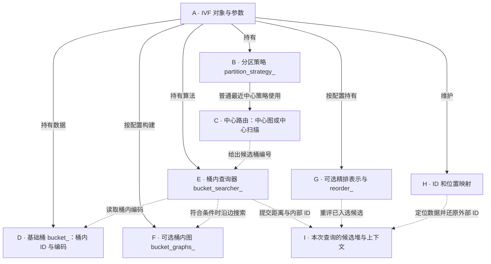
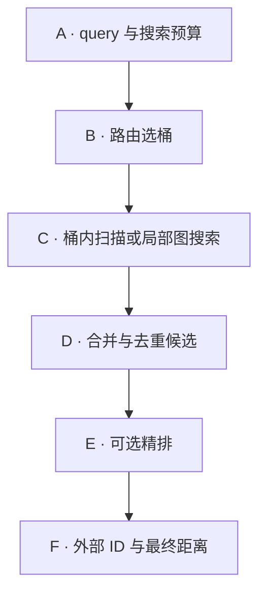

# IVF 图解：先找仓库分区，再到货架里找相似物品

[设计说明](README.md) · [代码逐段导读](code_walkthrough.md) · [索引总览](../README.md)

源码基线：`fd363937`。本篇的“为什么”是根据当前代码结构作出的工程解释，不代表作者没有写明的历史决策。

## 1. 先用仓库建立直觉

想象一个存放很多样品的仓库。先按外观相似程度把样品分到不同分区，每个区挑一个“代表样品”。
客户拿来一个新样品时，管理员先比较代表样品，决定去哪些区，然后在这些区里找最像的几个。

这对应两次选择：第一次选择桶，第二次选择桶里的记录。
“分区”对应 bucket，“代表样品”对应 centroid，“管理员”对应 partition strategy。
桶里的样品并不一定按顺序全部看完：大桶可以再装一套近邻图，用近邻之间的边导航。

类比的边界也很关键。向量相似性不是真实货架的物理距离，分区不是业务类别，中心也不必是真实数据中的一个点。
KMeans 训练的中心通常是计算出的代表值；RandomTrainer 才是选择样本作为中心。
一条向量还可以被分配到多个桶，像一个样品在多个区都有检索记录，结果阶段必须处理重复。

## 2. 主要构成图：模型、存储和查询器分开



[查看 PNG 图片](figures/visual_guide-01.png)

<details>
<summary>查看可编辑 Mermaid 源码</summary>



</details>

实线表示持有或结构关系；虚线表示一次查询中的访问或数据传递。
图中的 C 是普通最近中心策略的展开；GNO-IMI 有自己的分区组织，不能把 C 当成所有策略的固定实现。
F 与 G 是可选结构。E 是执行算法的对象，不是另一份完整向量数据。

## 3. 图中每个框到底装了什么

### A：IVF 对象是协调者

`IVF` 持有训练状态、数据计数、分区模型、桶、可选精排结构和查询器。
`Build` 把 Train、Add 和构建桶内图串起来；查询负责选桶、分发桶任务、合并结果。
它还维护 `thread_pool_`，因此不同桶可以成为独立搜索任务。
对应 [ivf.h](../../../src/algorithm/ivf/ivf.h) 和 [ivf_build.cpp](../../../src/algorithm/ivf/ivf_build.cpp)。

### B：分区策略决定“归哪个区、去哪个区”

`partition_strategy_` 的 Train 学习分区模型，构建分类把向量转换成桶编号，搜索分类返回候选桶列表。
这层接口的价值是把桶如何产生与桶怎样存储分开。
改变分区算法时，底层编码和桶内查询器仍可复用。
对应 [ivf_partition_strategy.h](../../../src/algorithm/ivf/ivf_partition_strategy.h)。

### C：中心路由本身也可能需要索引

普通策略 `IVFNearestPartition` 可以用 `route_index_ptr_` 持有路由 HGraph，也可以使用 `centroids_`、`norms_` 扫描中心。
`use_route_graph_` 决定这两条路径；路由图的点代表中心，其输出 ID 才是桶编号。
这里的图处理中心集合，和 F 中处理真实桶内记录的图是两套结构。
对应 [ivf_nearest_partition.h](../../../src/algorithm/ivf/ivf_nearest_partition.h) 和 [ivf_nearest_partition.cpp](../../../src/algorithm/ivf/ivf_nearest_partition.cpp)。

### D：桶保存搜索实际要读的数据

`bucket_` 经 `BucketInterface` 保存各桶记录、编码和内部编号。
量化类型决定一条向量怎样表示，因此“扫描一个桶”可以是扫描 FP32，也可以是扫描压缩编码。
桶编号与桶内位置不是外部 ID；桶的第 0 条记录不等于用户传入 ID 为 0 的记录。
对应 [bucket_interface.h](../../../src/datacell/bucket_interface.h) 和 [ivf_build.cpp](../../../src/algorithm/ivf/ivf_build.cpp)。

### E：桶内查询器选择计算办法

`FlatBucketSearcher` 处理桶内扫描；`GraphBucketSearcher` 可以在满足条件时转入局部图查询。
它们共享桶接口和候选堆，因此外层搜索不必知道每个桶用了哪种执行方式。
查询器按桶读取数据、应用相应过滤并维护候选，而不是重新训练桶。
对应 [ivf_bucket_searcher.h](../../../src/algorithm/ivf/ivf_bucket_searcher.h)。

### F：桶内图必须和桶的当前内容匹配

`bucket_graphs_[bucket_id]` 保存某个桶的邻接结构，主要是边和节点关系。
`GraphBucketSearcher::Search` 同时检查图存在、图节点数与桶大小一致、桶大小达到阈值。
如果这些条件不满足，会退回 `flat_searcher_`；所以追加数据后不是简单沿用一张缺点的旧图。
`RebuildBucketGraphs` 提供重建入口，修复的是图结构的覆盖，不是重新定义桶中心。
对应 [graph_bucket_searcher.cpp](../../../src/algorithm/ivf/graph_bucket_searcher.cpp)。

### G：精排表示负责修正候选分数

可选的 `precise_bucket_` 或 `reorder_codes_` 保存用于再次评分的表示，`reorder_` 负责精排计算。
这是额外的数据表示，增加存储和读取，但可以纠正基础编码造成的部分排序误差。
若真正的最近邻根本没有进入候选堆，精排不会主动去其他桶把它找回来。
对应 [ivf.h](../../../src/algorithm/ivf/ivf.h) 和 [ivf_search.cpp](../../../src/algorithm/ivf/ivf_search.cpp)。

### H：编号转换让多套结构对得上

继承的 `label_table_` 负责外部 ID 与内部 ID；`location_map_` 则编码内部 ID 对应的桶位置。
源码注释明确写出位置的打包形式：`(bucket_id << 32) | local_id`。
多桶分配时，桶里的重复命中还需要按同一内部记录合并，不能当成不同结果返回。
对应 [ivf.h](../../../src/algorithm/ivf/ivf.h) 中 `get_location`、`fill_location_map`。

### I：候选堆是查询临时状态

每个工作线程可以有自己的距离堆和临时 `dist` 数组，之后合并结果。
`QueryContext` 承接统计等查询状态，桶任务通过原子递增的桶序号动态分配。
这样，大桶不会永久绑在某个静态分组中，但并行也需要额外临时内存与合并成本。
对应 [ivf_search.cpp](../../../src/algorithm/ivf/ivf_search.cpp) 中 `IVF::search`。

## 4. 构建过程：先画分区，再把数据放进去

1. Train 取得训练样本，调用 B 训练路由，再训练 D 的基础编码器。
2. 若启用 G，训练对应的精排表示。
3. Add 为每条数据分配一个或多个桶，编码后写入 D，同时维护 H。
4. 若启用桶内图构建，为满足要求的桶准备 F。
5. 更新统计与内存信息。已有训练状态时 Train 可以直接返回，不代表新增数据会在线重训中心。

真实源码摘录，来自 [ivf_build.cpp](../../../src/algorithm/ivf/ivf_build.cpp)：

```cpp
    this->Train(base);
    // TODO(LHT): duplicate
    auto result = this->Add(base);
    if (graph_build_threshold_ > 0) {
        this->build_bucket_graphs();
    }
```

从顺序可以看出：构图发生在数据写桶之后，桶内图不是路由训练的副产品。

## 5. 查询过程：两道召回关口，一道评分修正



[查看 PNG 图片](figures/visual_guide-02.png)

<details>
<summary>查看可编辑 Mermaid 源码</summary>



</details>

这里的箭头只表示查询先后顺序，与上一张结构图的持有关系不同。
第一道关口是桶覆盖：正确记录是否位于本次选中的桶中。
第二道关口是桶内探索和候选预算：记录是否被访问并留在候选中。
精排修正的是第三件事——已有候选怎样排序。

## 6. 一个可以手算的例子

为了只看结构，设为二维、平方 L2、FP32、单桶分配、桶内扫描，并假设训练后中心已经固定如下。
这里手动给中心只是教学建模，不是说明实际 Build 会产生这些精确中心。

| 桶 | 中心 | 桶内记录 |
| --- | --- | --- |
| 0 | (0, 0) | P=(0, 1)，Q=(1, 0) |
| 1 | (10, 0) | R=(9, 0)，S=(11, 0) |
| 2 | (0, 10) | T=(0, 9)，U=(0, 11) |

query=(8, 1)，k=1。到三个中心的平方距离依次是 65、5、145。
若 `scan_buckets_count=1`，路由选桶 1；桶内算得 R 的距离为 2，S 的距离为 10，返回 R。
这次只对 2 条真实记录评分；路由中心的计算仍然是额外成本，不能从统计里凭空消失。

接着考虑边界数据：中心为 (0,0) 和 (10,0)，X=(4.9,0) 归桶 0，Y=(6,0) 归桶 1。
query=(5.1,0) 更接近中心 1，但它到 X 的平方距离是 0.04，到 Y 是 0.81。
只选桶 1 时会错过真正最近的 X；提高精排精度仍只会得到 Y。
扫描两个桶能覆盖 X；多桶分配也可能降低这种边界遗漏，但会增加写入、空间和去重工作。

## 7. 参数究竟改变图中的哪一部分

| 参数或选择 | 影响位置 | 主要代价 |
| --- | --- | --- |
| `buckets_count` | B、C、D 的分区粒度 | 更多中心、训练和桶管理成本，分布偏斜仍可能存在 |
| `scan_buckets_count` | B 到 E 的桶覆盖 | 更多桶内数据访问；一般提高候选覆盖 |
| `buckets_per_data` | D 的重复分配 | 更多编码副本或记录、更多候选去重 |
| 路由图开关与路由预算 | C | 中心图内存及近似路由误差，或完整中心扫描计算 |
| `graph_build_threshold` | F 是否值得构建和使用 | 额外图内存与维护；阈值与桶大小共同决定实际路径 |
| `ef_search` | 桶内图搜索 | 更大探索预算；不能单独扩大选桶范围 |
| `factor`、`use_reorder` | I、G | 更多候选和精排访存；不能恢复完全未入候选的记录 |

## 8. 最容易想错的地方

- “IVF 就是扫描所有中心再扫描几个桶”：中心路由可以使用图，桶内也可以使用图。
- “每个桶里是一套完整 HGraph”：当前桶图是独立图结构，通过桶内查询器与编码协作。
- “桶更多一定快”：路由、训练、小桶元数据、桶倾斜和扫描桶数都要一起看。
- “精排打开后就准确”：它主要改善候选内排序，前两道召回关口依然存在。
- “几何上越靠近中心，真实邻居越在这个桶”：边界算例已经说明两者不是充分条件。

继续读代码时，依次跟踪 `ClassifyDatasForSearch` 的桶编号、`bucket_searcher_->Search` 的桶内位置、候选去重与最终外部 ID，便能把两张图连成完整调用链。
