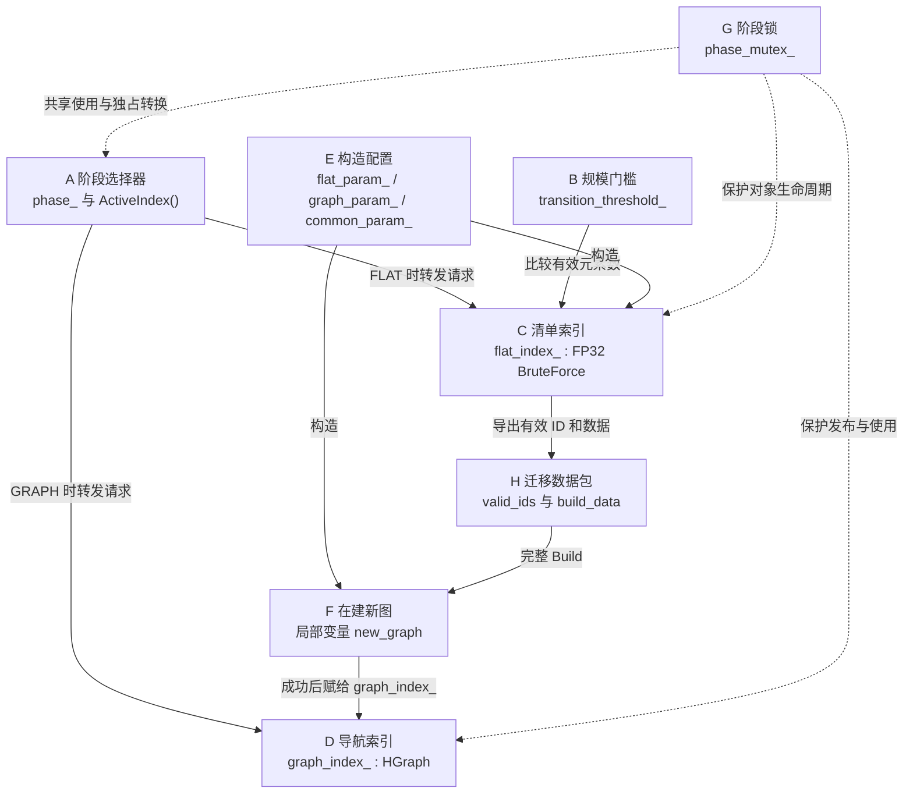
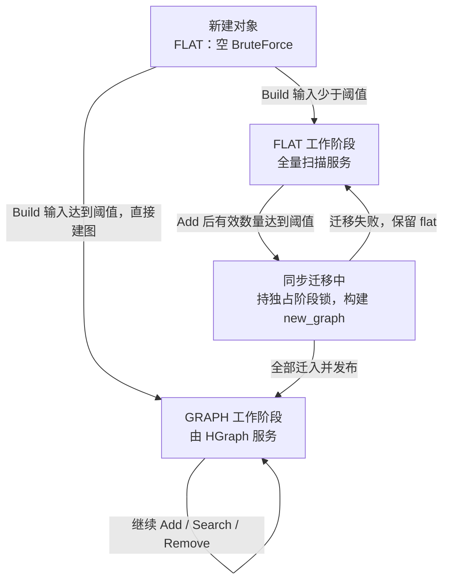

# LazyHGraph 图解：小店先用清单，规模上来再建导航网

[设计说明](README.md) · [代码逐段导读](code_walkthrough.md) · [BruteForce 图解](../brute_force/visual_guide.md) · [HGraph 图解](../hgraph/visual_guide.md)

源码基线：`fd363937`。本篇解释当前两阶段实现与同步迁移，不假定后台构建或自动调参。例子使用很小的阈值帮助跟踪状态，不代表推荐的生产参数。标注“工程分析”的内容是根据实现推导的设计动机。

## 1. 先想象一家逐渐扩大的图书室

图书室最初只有几十本书，管理员拿着完整清单逐本比对就能找到符合需求的书。
此时为每本书建立“相似图书推荐路线”本身也要花时间，还得额外维护这些联系。
后来馆藏增加到预定数量，管理员把当前有效书目导出，用它建立导航网络，之后查询和新增就交给这套网络。
读者仍然向同一个服务台提出请求；服务台根据当前阶段把请求交给清单系统或导航系统。

这个服务台就是 LazyHGraph；清单系统是 `flat_index_`，导航系统是 `graph_index_`。
预先定好的馆藏数量是 `transition_threshold_`，门口的阶段牌是 `phase_`。
转换时管理员暂时锁住服务台，确保不会有人在旧清单已经被撤掉后仍然使用它。

**类比边界：**

- 切换依据是元素数量，不是观察延迟后自动学习出来的“最佳开馆时机”。
- 当前迁移同步进行，会让需要同一阶段锁的请求等待，不是图书室照常开放、后台悄悄换系统。
- 图阶段是近似搜索，可用编码也由 HGraph 配置决定，不能承诺切换前后结果排序严格一致。
- 当前没有因馆藏减少自动改回清单阶段的逻辑；达到图阶段后通常继续使用图。

## 2. 主要构成图：外壳与两个内部索引

[查看 PNG 图片](figures/visual_guide-01.png)

查看可编辑 Mermaid 源码

**图例：** 实线表示对象引用、请求转发、数据提取或发布关系；虚线表示同步保护。
A～E、G 是外壳的长期状态；F 和 H 只在迁移调用期间存在。
C 和 D 是两种阶段下工作的完整内部索引，而不是同一向量被拆分成“前半放 C，后半放 D”。
迁移过程中旧 C、新 F 和数据包 H 可以暂时同时存在，所以图上同时画出它们并不意味着长期双写。

## 3. 每个节点对应什么代码

| 节点 | 真实对象或函数 | 保存什么、负责什么 | 工程分析：为何需要 |
| --- | --- | --- | --- |
| A | `std::atomic<Phase> phase_`、`ActiveIndex()` | 当前 FLAT/GRAPH 状态和内部对象选择 | 公共 API 只需转发，不必重复实现两套距离搜索 |
| B | `transition_threshold_` | 触发迁移的数量门槛 | 用一个可配置、可解释的条件划分小集合与增长阶段 |
| C | `std::shared_ptr<BruteForce> flat_index_` | 完整 FP32 数据、ID、清单式扫描能力 | 小集合先支付较简单的构建与维护成本 |
| D | `std::shared_ptr<HGraph> graph_index_` | 配置指定的图、编码及 HGraph 能力 | 集合变大后利用导航减少搜索候选访问 |
| E | `flat_param_`、`graph_param_`、`common_param_` | 两种内部索引的构造参数及维度/距离等公共配置 | 迁移时能够按既定配置创建新 HGraph |
| F | `TransitionToGraph` 的局部 `new_graph` | 尚未发布的完整新图对象 | 在确认迁移结果可接受前保留旧 flat |
| G | `std::shared_mutex phase_mutex_` | 内部对象使用与阶段转换之间的读写锁 | 防止查询持有旧对象裸指针时被迁移释放 |
| H | `valid_ids`、`GetDataByIds(...)` 得到的 `build_data` | 当前仍有效的外部 ID 和对应数据 | 用一致的数据集重建图，并避免迁回删除记录 |

成员定义在 [lazy_hgraph.h](../../../src/algorithm/lazy_hgraph/lazy_hgraph.h)，行为实现在 [lazy_hgraph.cpp](../../../src/algorithm/lazy_hgraph/lazy_hgraph.cpp)。

### A：atomic 状态牌与对象生命周期是两个问题

`ActiveIndex()` 使用 acquire 读取 `phase_`，FLAT 返回 `flat_index_.get()`，GRAPH 返回 `graph_index_.get()`。
返回的是内部对象的裸指针，所以调用者必须在持有 `phase_mutex_` 的期间使用它。
phase 的原子读写可以同步状态发布，但不能单独阻止另一个线程 `reset()` 旧对象。
这里真正把“我读的是哪种阶段”与“这个对象还活着”联系起来的是 G 的锁范围。

### C 与 D：共用一个外壳，不代表算法语义不变

FLAT 固定 FP32 BruteForce，公共参数映射只接受 float32 输入，并拒绝用户自定义 flat 量化配置。
GRAPH 按嵌套 `hgraph` 参数创建 HGraph，之后使用图搜索及其编码、过滤和结果处理。
工程分析：保留一个 API 让调用方不用手工搬库，但仍应把阶段变化作为检索精度和时延可能变化的事件。
“调用方不换索引对象”和“内部算法从未改变”是两回事。

### F 与 H：迁移不是给旧对象改一个类型字段

先导出有效 ID，再从 C 取回这些 ID 对应的数据，随后用新的 HGraph 执行完整 Build。
`new_graph` 是一个真正独立的在建对象；它包含图构建需要的中间过程和资源。
`CHECK_ARGUMENT(failed_ids.empty(), ...)` 要求迁移分支中的新图接收了全部待迁数据。
只有通过这个检查才赋值 D，释放 C，并发布 GRAPH。

### G：共享锁允许当前阶段操作，独占锁负责换阶段

KNN、RangeSearch 等操作在共享阶段锁下调用内部索引。
Add 也先持有共享阶段锁，把数据写进当前阶段；内部索引自己处理同阶段的读写协调。
`TransitionToGraph` 持独占阶段锁，所以不能与这些持共享阶段锁的调用同时操作内部对象。
不要把共享阶段锁误读成“Add 只读数据”：它共享的是外壳阶段，具体写入锁在内部索引里。

## 4. 生命周期图：只有一个方向的规模迁移

[查看 PNG 图片](figures/visual_guide-02.png)

查看可编辑 Mermaid 源码

实线表示控制状态变化。图中的“同步迁移中”是便于理解的执行阶段，并不是代码声明的第三个 `Phase` 枚举值。
迁移成功前 `phase_` 仍为 FLAT；失败返回到图中 B 时，有效数量可能已经达到甚至超过阈值。
所以“仍然是 FLAT”不必然表示“当前数量一定低于阈值”，还需考虑迁移失败等执行状态。
A 到 D 是直接 Build 路径，它不需要先把全部数据写入 flat 再导出迁移。

## 5. Build 和 Add 为何有不同路径

### 5.1 Build 已经看到了完整输入

1. 取得独占阶段锁，要求当前有效元素数为零。
2. 若输入数量小于阈值，直接让 flat 执行 Build，阶段保持 FLAT。
3. 若输入数量达到阈值，直接创建 `graph_index_` 并执行 HGraph Build。
4. Build 返回后发布 GRAPH、释放 flat，并向调用方返回 `failed_ids`。

直接 Build 分支返回失败 ID 列表；它没有迁移分支中“失败 ID 必须为空”的同一检查。
因此判断 Build 是否完整接收所有输入时要检查返回列表，不能只看到阶段是 GRAPH 就推断所有输入都成功。

### 5.2 Add 要先插入，再判断是否跨过门槛

1. 取得共享阶段锁，读取当前 phase。
2. FLAT 时先调用 `flat_index_->Add(data)`，记录失败 ID。
3. 读取 flat 的 `GetNumElements()`；达到阈值则令局部 `need_transition=true`。
4. GRAPH 时直接调用 `graph_index_->Add(data)`，无需再次建一个全新索引。
5. 离开局部锁作用域，释放共享阶段锁。
6. 若需要迁移，再调用需要独占锁的 `TransitionToGraph()`。

第 5 步不能省：直接在持共享锁时再申请同一把独占锁，会造成错误的锁升级方式。
多个 Add 都可能先观察到需要迁移，所以 `TransitionToGraph` 拿到独占锁后还会检查一次 phase；已经 GRAPH 就返回。
这使成功后的迁移调用幂等，但不意味着所有 Add 是一个跨迁移事务。

## 6. 迁移内部的完整操作顺序

1. `unique_lock(phase_mutex_)` 取得独占权，等待已有持共享锁的操作结束。
2. 如果另一线程已完成迁移、phase 为 GRAPH，直接结束。
3. 调用 flat 的 `ExportIDs()`，检查返回数据和 ID 指针。
4. 遍历导出的 ID，用 `CheckIdExist` 构造 `valid_ids`；空有效集合会直接结束。
5. 使用这些外部 ID 调用 `GetDataByIds` 得到 `build_data`，并检查提取结果。
6. 按 E 创建局部 `new_graph`，初始化能力，调用 `Build(build_data)`。
7. 检查新图构建返回的失败 ID 为空。
8. 将 `new_graph` 赋给 `graph_index_`，然后 `flat_index_.reset()`。
9. `phase_.store(Phase::GRAPH, memory_order_release)` 发布阶段，退出函数释放独占锁。

步骤 8 的顺序使新图已可用时才撤掉旧 flat；阶段锁又保证其他请求不会穿过发布过程中的中间状态。
但本次 Add 在进入第 1 步之前已经写过 flat，如果步骤 6 或 7 报错，这些新增数据可能仍然存在。
因此迁移失败并不等于触发它的 Add 被整体回滚，重试前应检查 ID 与当前状态。

## 7. 一个能逐步跟踪的例子

设置阈值 `T=4`，所有输入都是成功写入、互不重复的 float32 向量；不启用会限制删除的额外配置。
为清晰展示身份一致性，用业务 ID `{10,20,30,40,50}` 标识记录，不依赖内部槽位保持不变。

| 时刻 | 调用与有效 ID | 有效数量 | 活跃对象 | 是否迁移 |
| --- | --- | --- | --- | --- |
| t0 | 创建空索引 | 0 | flat | 否 |
| t1 | `Add({10,20})` | 2 | flat | `2 < 4`，否 |
| t2 | `Add({30})` | 3 | flat | `3 < 4`，否 |
| t3 | `Remove({20}, MARK_REMOVE)` | 2 | flat | FLAT 路径实际执行 FORCE_REMOVE |
| t4 | `Add({40})` | 3 | flat | `3 < 4`，否 |
| t5 | `Add({50})`，flat 中为 `{10,30,40,50}` | 4 | 尚是 flat | `4 >= 4`，准备迁移 |
| t6 | 导出、取数据、构建 new_graph | 4 | phase 仍 FLAT，阶段锁独占 | 正在同步迁移 |
| t7 | 发布 new_graph，释放 flat | 4 | graph | 已完成 |
| t8 | `Remove({30})` 后只剩 3 条有效记录 | 3 | graph | 不自动回退 |

FLAT 阶段删除会直接调用 `flat_index_->Remove(ids, RemoveMode::FORCE_REMOVE)`，即使传入的是 MARK_REMOVE。
这是 [Remove 实现](../../../src/algorithm/lazy_hgraph/lazy_hgraph.cpp) 的明确行为，不能按 BruteForce 默认删除方式猜测。
物理删除可能把末尾记录搬到被删除的槽位；迁移使用外部 ID 重新取数据，因此不要求旧内部槽位号一一保留。
迁移中仍然调用 `CheckIdExist`，作为对导出集合的有效性检查；这个检查不意味着正常 FLAT Remove 会留下 tombstone。

### 在 t6 到来的查询会发生什么

假设 Q1 在迁移前先取得共享阶段锁，它会在 flat 上完成查询，迁移等待它释放锁。
如果迁移先取得独占阶段锁，稍后到达的 Q2 等待迁移结束，再取得共享锁，看到 GRAPH 并调用 HGraph。
实际先后由锁获取时机决定，不能仅根据“请求提交时间更早”保证先进入。
这两个路径都避免查询使用已经 reset 的 flat，但第二个路径会付出迁移等待时间。

### 若 t6 构建失败会怎样

`new_graph` 尚未发布，旧 flat 没被释放，phase 仍为 FLAT。
有效 ID `{10,30,40,50}` 可能全部仍在 flat，包括触发迁移的 50。
这时再无脑重新提交 `Add({50})` 会碰到重复 ID 等语义，不能把一次错误当作没有发生任何写入。

## 8. 为何接受这些代价

- **小集合省去图结构工作。** 工程分析：将导航维护推迟到数量达到门槛时，能避免所有小集合都立即构图；具体收益仍取决于维度、硬件与负载。
- **数量阈值容易解释。** 它让触发条件可预测，但不会自行适配查询率、过滤选择性和数据分布。
- **同步迁移便于保证对象一致性。** 代价是跨阈值的 Add 会承担重建时间，其他阶段操作可能等待。
- **临时对象让发布更清楚。** 代价是旧 flat、导出的 Dataset 和在建图可能同时占用内存，峰值不能只按最终图估算。
- **单向转换减少状态复杂度。** 代价是数据缩小后仍保留图阶段，不能期待它自动重新选择最省内存的后端。
- **统一外壳减少调用方迁移工作。** 代价是同一 API 在两个阶段使用不同检索策略，评估应分别记录阶段和召回。

阅读时可用三个问题检查自己：哪个对象当前接收查询；哪把锁保证这个对象还活着；哪一步真正发布 GRAPH。
这三点清楚后，再分别进入 [BruteForce](../brute_force/visual_guide.md) 与 [HGraph](../hgraph/visual_guide.md)，就能把外壳逻辑和内部算法连接起来。
