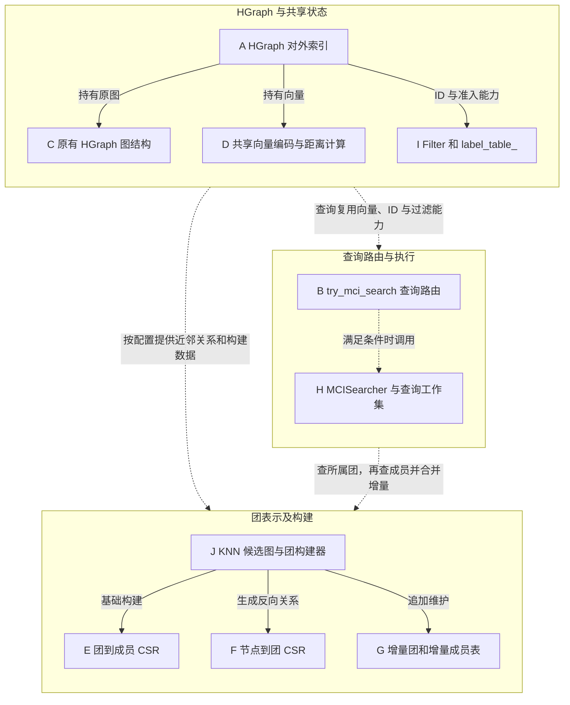
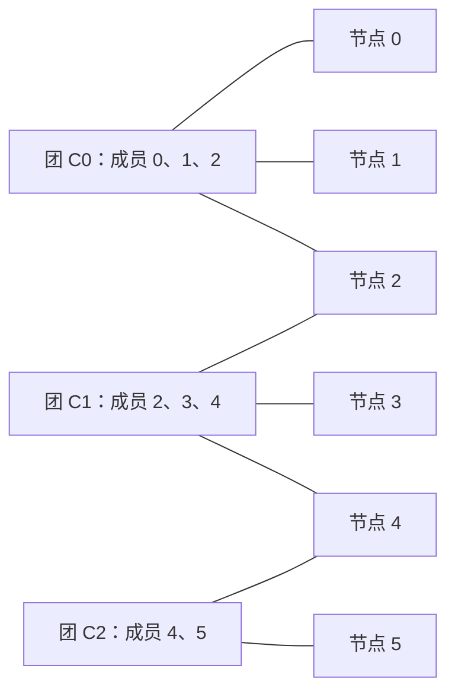

# MCI 形象图解：给 HGraph 增加一套重叠小组通讯录

[设计说明](README.md) · [代码逐段导读](code_walkthrough.md) · [HGraph 图解](../hgraph/visual_guide.md)

源码基线：`fd363937`。本文中的设计原因是依据实现作出的工程解释；团构建不应被理解为不受限制地枚举输入图的所有极大团。

## 1. 生活类比：熟人道路之外，再加共同小组

把 HGraph 看成一张熟人网络：每个人认识若干相近的人，寻找目标时沿这些熟人关系逐步接近。
现在加一个资格条件，例如只能联系“本周值班的人”。
普通熟人网络仍是原来的网络，但其中大量人不符合本次资格，搜索路径和可返回人员就发生了分离。

MCI 给这张网络增加一套重叠的小组通讯录。
每个小组保存一组在构建关系中紧密联系的成员，一个人可以同时加入多个小组。
搜索从已知符合条件的人出发，先查他参加哪些组，再检查这些组里的成员，寻找更接近目标且符合条件的人。

必须把类比边界说清楚：

- 小组由向量近邻候选关系与构建策略形成，不是业务部门、权限组或过滤属性的分桶。
- 小组之间可以通过公共成员连接，但不能保证任意过滤子集都保持连通。
- 当前搜索中的 `try_visit` 会在计算距离前拒绝非法节点，不能描述成“无论是否合法都继续从这个人扩展小组”。
- MCI 是 HGraph 的可选挂件，工厂入口仍是 `hgraph`，没有 `CreateIndex("mci", ...)` 这一独立入口。

它的目标是给部分过滤查询增加一种探索关系；这种关系是否划算，还要由选择率、seed 来源、数据覆盖和查询模式决定。

## 2. 主要构成图：共享向量，另外保存两张成员关系表



[查看 PNG 图片](figures/visual_guide-01.png)

<details>
<summary>查看可编辑 Mermaid 源码</summary>



</details>

**线条图例：**实线表示长期持有、保存或结构构建关系；虚线表示查询访问、查询分支或构建时读取依赖。
图框之间的线概括依赖，不代表原图中的邻接边。选择 HGraph 来源时，J 利用 C/D 取得近邻候选；配置 ODescent 或外部 KNNG 文件时来源会改变。B 不满足挂件条件时使用 C 的普通 HGraph 路径，满足条件时才调用 H。
E、F、G 都在 `CliqueDataCell` 的存储职责内，拆成三个框是为了讲清不同方向与生命周期，并不是三个独立索引。

### A：HGraph 承担对外生命周期

用户构建、Add、查询、序列化的对象仍然是 HGraph。
`mci_parameters_`、`mci_cliques_`、`mci_searcher_` 是 HGraph 中与挂件有关的状态。
挂件必须与当前数据量保持覆盖一致性，路由才允许使用它。

源码：[hgraph.h](../../../src/algorithm/hgraph/hgraph.h)、[hgraph_mci.cpp](../../../src/algorithm/hgraph/hgraph_mci.cpp)。

### B：路由器先判断能不能用，再判断要不要用

`try_mci_search` 首先检查本次 `use_mci`、构建启用状态、团结构存在且覆盖当前数据。
还要求没有该路径不支持的属性 executors，并具备有效 ID 或 bitset seed 来源。
通过这些条件后，RangeSearch 仍会回到普通路径；有效比例不低于阈值时也使用普通 HGraph。

因此“有 Filter”不等于“必然走 MCI”，“有效比例很低”也不等于“任意自定义 Filter 都能走 MCI”。

### C：原图继续存在

开启挂件不会把 HGraph 底图替换掉。
普通查询仍可使用原有层次图；构建 MCI 时也可以通过查询已完成的 HGraph 生成 KNN 候选关系。
MCI 搜索实际扩展的是 F、E 中的 membership，而不是每扩展一个节点都照常读取 C 的原图邻接表。

### D：距离数据复用 HGraph 的存储

路由通过 `get_precise_codes()` 取得实际可用的向量计算存储，交给 `MCISearcher`。
如果具有连续 FP32 数据且团结构提供可用基础 CSR 视图，可走直接读取原始浮点数据的专用路径。
否则使用通用的 `FlattenInterface` 与 Computer 查询距离。

向量存储共享避免再为挂件维护一套完整独立向量，但 E、F、G 的关系数据仍会带来额外内存。

### E：团到成员，回答“这个组里有哪些人”

`p_maxc_` 是团成员数组的偏移表，`maxcs_` 是连续成员 ID 数组。
团 c 的成员位于 `maxcs_[p_maxc_[c] ... p_maxc_[c + 1])`。
一个团中的成员列表是关系数据；它不保存另一份向量本身。

源码：[clique_datacell.h](../../../src/datacell/clique_datacell.h)、[clique_datacell.cpp](../../../src/datacell/clique_datacell.cpp)。

### F：节点到团，回答“这个人加入了哪些组”

`p_node_to_cid_` 是每个节点的团列表偏移，`node_to_cids_` 保存连续团 IDs。
这张反向表避免搜索时为了找一个节点所属的团而遍历全部团。
同一个节点可属于多个团，所以这里不是长度等于节点数的单一 `node → cluster` 分类数组。

### G：增量层让 Add 不必每次重写整张基础 CSR

`delta_cliques_` 保存新增团，`delta_clique_extra_` 保存对既有团追加的成员。
`delta_node_to_cids_` 保存节点到团的增量关系。
通用接口 `CollectNodeCliqueIds` 与 `GetCliqueMembers` 对搜索提供包含相应增量内容的逻辑视图。

基础连续数组有利于遍历局部性；增量结构有利于追加维护。
实际是否能使用直接基础 CSR 专用路径，还要看 `TryGetBaseView` 是否成功，不能只根据“开启了 FP32”来判断。

### H：一个查询需要两个 visited 和候选工作集

`MCISearcher` 维护候选队列/有序候选、结果堆、`visited_nodes`、`visited_cliques`。
节点去重避免同一向量通过多个团被反复算距离；团去重避免一个小组被不同成员反复展开。
候选规模按 `max(topk, ef)` 设置，扩展还受 hops、超时等条件约束。

`MCIEpochMarks` 使用 `uint16_t` tag 复用标记数组，通常增加 tag 即可开始下一次查询，tag 回绕时再清空。
实现用 `thread_local` 缓冲复用工作集；这与把所有查询共用一个未保护的可变数组不同。

源码：[mci_searcher.cpp](../../../src/impl/searcher/mci_searcher.cpp)，搜索 `MCIEpochMarks`、`try_visit`、`visited_cliques`。

### I：过滤器同时影响规划、起点和节点合法性

有效比例决定是否满足路由阈值。
有效 ID 或 bitset 能力用于收集实际 seed，并通过 label 表将外部 ID 转成内部 ID。
搜索中通过内部过滤接口再次检查节点是否合法，避免把不允许返回的节点当成普通合法候选。

选择率信息是搜索规划输入，不是“给图上每条边重新赋值”的操作。
目标 seed 数是预算，最终可收集的实际 seed 数可能更少，甚至为零。

### J：团构建器处理的是受约束的近邻候选关系

构建可以使用 HGraph 派生 KNN 图、ODescent 生成的 KNN 图或配置的外部 KNNG。
连续 FP32 等条件满足时调用 `BuildMCICliques` 等路径，其他数据也有通用构建分支。
`mcs`、`clique_max`、候选规模及构建策略约束最终结构，所以名称中的 maximal clique 不能理解为无预算的全图所有极大团枚举承诺。

源码：[mci_builder.h](../../../src/algorithm/mci/mci_builder.h)、[mci_builder.cpp](../../../src/algorithm/mci/mci_builder.cpp)。

## 3. 先手工搭一张通讯录，看清两个方向

下面是解释 membership 的教学结构，与实际向量几何及团构建结果无关：



[查看 PNG 图片](figures/visual_guide-02.png)

<details>
<summary>查看可编辑 Mermaid 源码</summary>



</details>

这张教学图中的无向线只表示成员关系，不是 HGraph 原图邻边，也不是一次查询已经走过的路线。
节点 2 是 C0 与 C1 的共同成员，节点 4 是 C1 与 C2 的共同成员。
共有 6 个节点、3 个团、8 次 membership；三个统计量不同。

把它写成基础 CSR：

```text
团到成员：
p_maxc = [0, 3, 6, 8]
maxcs  = [0, 1, 2,  2, 3, 4,  4, 5]

节点到团：
p_node_to_cid = [0, 1, 2, 4, 5, 7, 8]
node_to_cids  = [0, 0, 0, 1, 1, 1, 2, 2]
```

例如节点 2 的团数组区间是 `[p_node_to_cid[2], p_node_to_cid[3]) = [2, 4)`，读出 C0、C1。
再拿 C1 查成员区间 `[p_maxc[1], p_maxc[2]) = [3, 6)`，读出节点 2、3、4。
搜索执行的核心跳转就是“节点 2 → 所属团 C1 → 团内节点 3、4”，而不是对所有节点做一次全表扫描。

## 4. Build 与 Add：基础关系和增量关系怎样形成

1. HGraph 在启用挂件的构建流程中调用 `build_mci_clique_index`。
2. 获取当前向量存储，并按配置来源形成 KNN 候选图。
3. 按数据条件进入对应团构建路径，应用局部候选、团规模与覆盖等策略。
4. 将团成员与反向节点团关系写入 `CliqueDataCell`，更新覆盖及可用状态。
5. 已有初始结构后的 Add 会为新点寻找 KNN 候选，尝试加入合适的既有团。
6. 如果不能加入，就创建适当的新团；没有 KNN 候选的分支会创建单点团。
7. 增量成员与新团通过 G 保存；查询视图及覆盖条件必须与更新后的数据量一致。

`incremental_update_mci_clique` 的简短主干如下，是当前源码的连续摘录：

```cpp
auto knn_ids = this->find_mci_knn_for_new_node(new_inner_id, vector);
if (knn_ids.empty()) {
    Vector<InnerIdType> singleton(this->allocator_);
    singleton.push_back(new_inner_id);
    this->mci_cliques_->AppendNewClique(singleton, this->total_count_.load());
    return;
}
if (not this->try_join_mci_clique(new_inner_id, knn_ids)) {
    this->build_incremental_mci_clique(new_inner_id, knn_ids);
}
```

这解释了增量层的意义，但不能据此推断“从空索引持续 Add 与完整初始 Build 得到的团结构等价”。
初始构建与增量局部维护的可见数据、候选范围和成本模型不同，应按挂件文档的生命周期建议使用。

## 5. 查询路由与搜索：先过门槛，再沿重叠小组展开

路由阶段依次核对：

1. 本次查询启用了 `use_mci`，且索引构建启用了挂件。
2. `mci_cliques_` 存在，并且 `HasCliqueIndex(total_count)` 确认当前覆盖有效。
3. 该路径的属性 executors 为空，有有效 ID 或 bitset seed 来源。
4. 查询不是 RangeSearch，且 `valid_ratio < hgraph_valid_ratio_threshold`。
5. 按 `ceil(sqrt(N) × mci_seed_ratio)` 形成 seed 目标预算，再限制在数据规模内并以至少 1 为目标。
6. 真正收集 seed；如果一个都没有，退出 MCI 尝试，而不是凭空制造合法起点。

进入搜索后：

1. 初始化节点与团的 epoch visited，设置候选容量和结果堆。
2. 访问实际 seed：查边界与 visited，再做合法性检查，然后算距离。
3. 取最接近查询且尚未展开的候选节点，通过 F 找到它所属的各个团。
4. 对未访问过的团设置 visited，读取 E/G 中的成员，并逐个调用 `try_visit`。
5. 合法且未见过的节点才计算距离、尝试进入候选与结果堆；非法节点在该检查处退出。
6. 继续取最近未展开候选，直到候选耗尽、团扩展预算达到上限或超时等条件发生。
7. 将结果交回 HGraph 的结果处理链，完成输出 ID 等处理。

一个很容易误读的统计细节：这里扩展新团时增加 `hops`，不能机械理解成“计算了几个向量距离”。
一个团可能包含多个新合法成员，也可能几乎全被过滤；距离计算数和团扩展数因此并不一致。

## 6. 可手算的完整查询

继续使用第 3 节的教学 membership，另给节点指定一维向量，单纯为了方便手算 L2SQR；不声称该向量集合会被真实构建器分成上述团。

```text
query = 0
节点向量：0 → 10，1 → 5，2 → 2，3 → 1，4 → 3，5 → 9
合法节点：0、2、3
目标：top-1；候选容量允许保留至少 3 个节点；hops 预算至少 3
```

有效比例为 `3 / 6 = 0.5`。
为演示 MCI 路径，假设手工将路由阈值设为 0.8，其他前置条件都满足；这不是默认阈值声明。
取 `mci_seed_ratio = 0.4`，预算为 `ceil(sqrt(6) × 0.4) = ceil(0.9798...) = 1`。
假设有效 seed 来源在本次收集出的那个 seed 是节点 0。

| 步骤 | 读取的关系 | 新检查内容 | 距离与候选变化 |
| --- | --- | --- | --- |
| seed | 直接访问节点 0 | 0 合法 | `10² = 100`，加入候选 |
| 扩展 0 | 0 属于 C0 | C0 成员 0、1、2 | 0 已访问；1 非法；2 距离 `2² = 4` |
| 扩展 2 | 2 属于 C0、C1 | C0 已访问；展开 C1 | 2 已访问；3 距离 `1² = 1`；4 非法 |
| 扩展 3 | 3 属于 C1 | C1 已访问 | 不再展开这个团 |

最终 top-1 为节点 3，距离 1。
本例只有节点 0、2、3 被算距离，共 3 次；C0、C1 被展开，共 2 次团扩展。
C2 没被展开，因为把 C1 接到 C2 的节点 4 不合法，且本例没有其他 seed 直接落入 C2。

这个例子同时解释了两种 visited：

- 没有节点 visited，节点 2 会因为同时在 C0、C1 中被反复计算。
- 没有团 visited，从节点 0 与节点 2 出发时会反复展开 C0。

它也解释了为什么 MCI 仍然不能保证所有过滤子集的完全覆盖：过滤可能切断公共成员，seed 与搜索预算决定能进入哪些局部区域。
增加 seed 可以从更多合法位置启动，但也增加初始距离计算和后续探索工作。

## 7. 为什么保留这套挂件，以及最容易误会的地方

| 设计 | 工程解释 | 代价与边界 |
| --- | --- | --- |
| 原图加可选挂件 | 对不同过滤负载选择不同关系 | 多一套构建、维护与路由逻辑 |
| 两个方向的 CSR | 节点查团、团查成员都可直接定位 | membership 需要双向存储 |
| 重叠团 | 通过公共成员提供组间扩展机会 | 重叠越多，成员存储及去重需求越大 |
| 增量表 | 追加时避免反复重写全部基础数组 | 查询要处理基础与增量的组合 |
| 有效 seed 来源 | 起点来自合法候选集合 | 不具备该能力的 Filter 不能只靠选择率触发 |
| 选择率阈值 | 避免所有查询都承担挂件路径成本 | 错误估计可能导致不合适的路由 |
| 双 epoch visited | 减少重复计算和整表清零 | 内存增长及 tag 回绕时仍有额外工作 |

误解一：“MCI 团就是按 filter 字段预分组。”实际团来自向量相关构建关系，Filter 是每次查询的约束。

误解二：“只要 `use_mci = true` 就一定使用团搜索。”还必须满足完整路由条件，甚至需要能实际收集到 seed。

误解三：“小组内互通，所以任何过滤情况下都不会断路。”非法公共成员、有限 seed 和候选预算仍然会影响可达范围。

误解四：“共享向量意味着几乎没有内存成本。”需要观察团数、总 membership、增量 membership 和覆盖率，而不只是向量数。

误解五：“MCI 搜索就是 HGraph 底图搜索换了一个名字。”搜索扩展的核心是节点团反向表与团成员表，原图主要承担其他查询路径和可选构建来源等职责。

## 8. 推荐核对路线

先读 [hgraph_mci.cpp](../../../src/algorithm/hgraph/hgraph_mci.cpp) 的 `try_mci_search`，确认一次请求为何走或不走 MCI。
再读 [clique_datacell.h](../../../src/datacell/clique_datacell.h) 的四个 CSR 数组与三个增量表，手动复现第 3 节查表。
随后读 [mci_searcher.cpp](../../../src/impl/searcher/mci_searcher.cpp) 的 `try_visit` 和团扩展循环，把第 6 节逐行对应进去。
最后回到 [mci_builder.cpp](../../../src/algorithm/mci/mci_builder.cpp) 与 `incremental_update_mci_clique`，区分完整构建和新增节点维护。

配套官方本地说明：[HGraph MCI 挂件](../../../docs/docs/zh/src/advanced/hgraph_mci_companion.md)。
