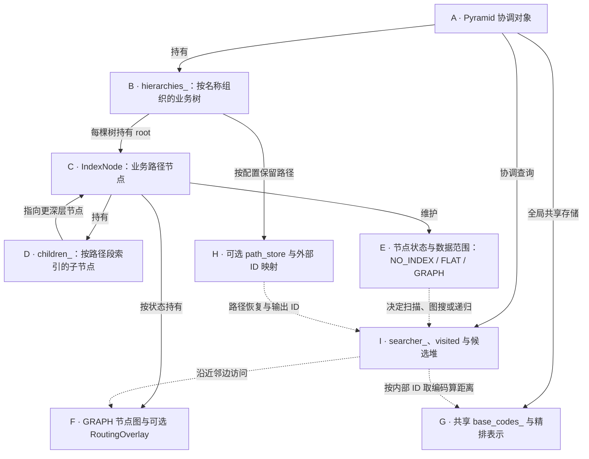
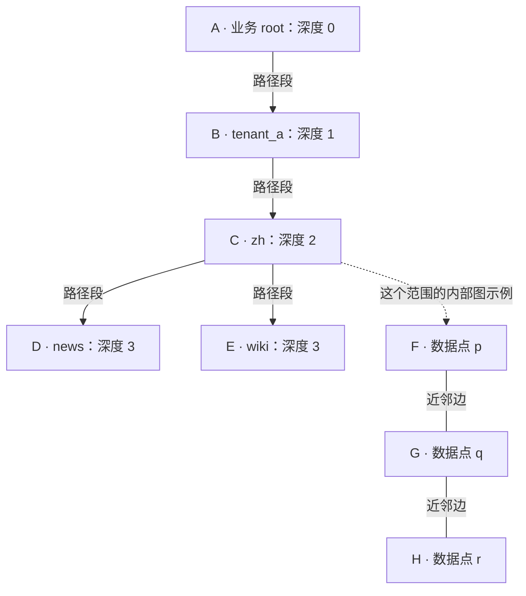

# Pyramid 图解：先找到业务房间，再在房间里找近邻

[设计说明](README.md) · [代码逐段导读](code_walkthrough.md) · [索引总览](../README.md)

源码基线：`fd363937`。设计动机按当前成员、构建分支和搜索流程作工程解释。

## 1. 用分楼层的档案馆理解

想象一个档案馆按“租户 / 语言 / 内容类型”划出房间。
想找 `tenant_a/zh/news` 的相似文档时，先按门牌走到对应房间，再在房间里的记录中做相似性搜索。
查 `tenant_a/zh` 则表示一个更大的范围，包含其下的新闻、百科等内容。

房间里的记录很少时，直接翻完索引卡就足够；记录很多时，再沿“相似文档之间的连线”找答案。
门牌负责范围，连线负责接近 query，这正是业务树与近邻图的职责分离。

类比有三个边界。第一，路径来自调用者提供的业务标签，不是根据向量自动聚类出来。
第二，文档编码可以共享，多个房间索引保存的是同一文档的编号和关系，不一定复制整篇“档案”。
第三，路径约束不是身份鉴权；调用者必须自己决定用户允许查询哪个租户路径。

## 2. 主要构成图：树节点与共享编码的关系



[查看 PNG 图片](figures/visual_guide-01.png)

<details>
<summary>查看可编辑 Mermaid 源码</summary>



</details>

实线表示持有、组织或共享关系；虚线表示查询决策和数据访问。
`D → C` 是结构递归：每个孩子仍是一个 IndexNode，不表示搜索过程中必须回到根节点。
I 中有可复用的搜索器，也有本次查询的 visited 和堆；这些查询状态不等于持久化节点图。

## 3. 逐个打开图中的框

### A：把范围选择与近邻搜索串起来

`Pyramid` 接收数据向量和路径，创建层级树，维护共享数据单元，并协调构图、过滤、精排和输出。
一个对象可以持有多套命名 hierarchy，因此同一批向量可以按不同业务维度组织。
本篇主例使用一套 hierarchy，避免把多 hierarchy 条件组合与单树路径混在一起。
对应 [pyramid.h](../../../src/algorithm/pyramid/pyramid.h) 中 `Pyramid`。

### B：Hierarchy 是一棵业务树的配置和根

`Hierarchy` 含 `name`、`root`、`no_build_levels`、`ef_construction`、`alpha` 和可选 `path_store`。
这里的“层”是路径深度，例如 root=0、tenant_a=1、zh=2。
`no_build_levels` 表达在哪些业务深度跳过构建相应索引，实际搜索如何继续由节点状态负责。
对应 [pyramid.h](../../../src/algorithm/pyramid/pyramid.h) 中 `struct Hierarchy`。

### C：IndexNode 对应一个路径前缀

它维护 `level_`、`status_`、`entry_point_`、`ids_`、`graph_` 和锁。
`entry_point_` 是内部图导航入口，不是下一段路径的名字。
节点的锁保护状态和图归属等拓扑元数据；图邻接行还有 Pyramid 层面的并发保护。
对应 [pyramid_index_node.h](../../../src/algorithm/pyramid/pyramid_index_node.h)。

### D：children_ 按完整路径段匹配

`children_` 是从字符串段到 `unique_ptr<IndexNode>` 的映射。
查询 `tenant_a/zh` 先查 `tenant_a`，再查 `zh`；不会把 `tenant_ab` 误当作 `tenant_a` 的孩子。
`GetChild(segment, false)` 里的 false 表示查询不创建缺失节点。
若一段不存在，这条请求路径不搜索，代码没有自动退回全局范围的行为。
对应 [pyramid_index_node.cpp](../../../src/algorithm/pyramid/pyramid_index_node.cpp) 和 [pyramid.cpp](../../../src/algorithm/pyramid/pyramid.cpp) 中 `search_hierarchy`。

### E：状态决定这个范围怎样执行

`FLAT` 使用 `ids_` 给出的记录集合直接计算距离。
`GRAPH` 使用节点的 `graph_`；批量构图完成后可以释放构图用 `ids_`，向量编码仍在 G。
`NO_INDEX` 不等于范围内没有数据。`IndexNode::Search` 会递归调用子节点搜索并合并结果。
`IndexNode::Init` 根据节点大小和路由配置选择 GRAPH 或 FLAT，小集合不一定值得建图。

### F：节点近邻图与可选导航层

`graph_` 保存此节点范围中的近邻连接。
可选 `RoutingOverlay` 内有 `graphs` 与 `graph_param`，为支持路由的节点保存额外导航图。
一个图点仍对应内部数据 ID；这些导航图不是 tenant、语言、类别这样的业务节点。
树上走到哪个 IndexNode，与该节点内部从哪个图入口开始搜索，是两个独立问题。
对应 [pyramid_index_node.h](../../../src/algorithm/pyramid/pyramid_index_node.h) 和 [pyramid.cpp](../../../src/algorithm/pyramid/pyramid.cpp) 中 `resolve_entry_point`。

### G：共享向量编码降低重复存储

`base_codes_` 提供在线遍历使用的基础表示；`precise_codes_` 按配置提供更精细的构建或精排表示。
某些编码支持分离的编码存储，辅助选择函数会决定实际精排使用哪一个 DataCell，不能无条件写成“总有两份数组”。
所有业务节点通过内部 ID 读取共享向量；同一文档参与祖先和子节点索引时仍可能重复保存图关系。
所以节省的是完整向量表示的重复，不代表多层组织没有额外内存。
对应 [pyramid.h](../../../src/algorithm/pyramid/pyramid.h) 中 `get_reorder_codes` 等表示选择逻辑。

### H：路径存储和标签映射各管一件事

`PyramidPathStore` 是按配置保留的路径结构，可支持按 ID 恢复路径等能力。
外部 ID 转换使用继承的 `label_table_`；路径字符串、图内部 ID、用户 ID 不应混成一种编号。
关闭某种路径保留能力，并不等于删除了 B、C、D 中支持搜索的业务树。
对应 [pyramid_path_store.h](../../../src/algorithm/pyramid/pyramid_path_store.h)。

### I：搜索器消费“这个范围”的 IDs 或图

FLAT 分支先筛出有效 IDs，再调用 `codes->Query` 批量评分。
GRAPH 分支准备入口和 ef，调用 `searcher_->SearchWithPresetComputer`。
visited 帮助控制访问，候选堆负责保留搜索结果；后续按配置精排并输出外部 ID。
对应 [pyramid.cpp](../../../src/algorithm/pyramid/pyramid.cpp) 中 `search_node`、`search_hierarchy`。

## 4. 把路径层和图层画到一张图里



[查看 PNG 图片](figures/visual_guide-02.png)

<details>
<summary>查看可编辑 Mermaid 源码</summary>



</details>

A 到 E 是业务范围树，F 到 H 是同一个范围内部的近邻图示意，不是更深的路径。
这张示意省略实际有向边、入口与可选路由层，不能拿三条画出的边当作源码构图的固定结果。
查询 `tenant_a/zh` 可以直接搜索 C 的范围；若 C 为 NO_INDEX，则递归到可搜索的子节点。

## 5. 构建时发生什么

1. 解析 Dataset 中的路径，建立树节点，确定每条数据在哪些路径范围中出现。
2. 准备共享的基础编码和必要的精排表示，让各节点都能通过内部 ID 算距离。
3. 根据层级配置和节点大小收集 IDs，选择 FLAT、GRAPH 或不在此层建索引。
4. 图构建可采用 NSW 插入或 ODescent 批量构建，对应不同构建路径。
5. 发布节点状态并保留必要的图、路径和标签映射。

下面是 [pyramid_index_node.cpp](../../../src/algorithm/pyramid/pyramid_index_node.cpp) 的真实片段：

```cpp
    if (status_ == Status::GRAPH) {
        entry_point_ = ids_[0];
        odescent.SetMaxDegree(static_cast<int32_t>(graph_param_->max_degree_));
        odescent.Build(ids_);
        odescent.SaveGraph(graph_);
        Vector<InnerIdType>(allocator_).swap(ids_);
    }
```

`ids_` 被释放的是构图阶段这份列表；`graph_` 已保存关系，向量依然由共享编码持有。

## 6. 一个能追踪范围和距离的查询

设共享向量是一维 FP32，使用平方 L2，查询 q=2，k=1；小集合都使用 FLAT，无额外过滤。

| 内部 ID | 外部 ID | 路径 | 向量 | 到 q 的平方距离 |
| --- | --- | --- | --- | --- |
| 0 | 101 | tenant_a/zh/news | 1 | 1 |
| 1 | 102 | tenant_a/zh/wiki | 3 | 1 |
| 2 | 103 | tenant_a/en/news | 2 | 0 |
| 3 | 104 | tenant_b/zh/news | 2.1 | 0.01 |

查 `tenant_a/zh/news` 时，先按三段找到目标节点，范围内只有内部 ID 0，输出外部 ID 101。
ID 103 虽然几何距离为 0，也不属于请求范围；这不是近似搜索漏召回，而是正确的范围约束。
查 `tenant_a/zh` 时，范围包含 0 和 1，两者距离相同；不能凭这张表断言并列时总返回哪个 ID。
若该中间节点未建索引，递归查询 news 和 wiki 后合并，也必须遵守相同业务范围。
查 `tenant_a/fr` 时，`fr` 子节点不存在，这条路径没有结果，不会退回 tenant_a 查英语数据。

## 7. 参数与代价要对应到结构

| 配置 | 影响对象 | 代价和适用判断 |
| --- | --- | --- |
| `no_build_levels` | B、E | 减少某些层的索引成本，查询该层可能需递归合并更多孩子 |
| 节点大小阈值 | E、F | 小节点扫描省固定图开销；大节点扫描又可能过贵 |
| `max_degree` | F | 更多近邻关系可能改善可达性，同时增加图内存和访问 |
| `graph_type`、ODescent 参数 | 构建 F 的方式 | 构建时间、临时资源和图质量不同 |
| `ef_search`、`subindex_ef_search` | I | 控制搜索候选预算，不改变业务路径的含义 |
| `use_reorder` 与编码选择 | G | 影响评分精度、额外存储和精排读取 |
| `store_paths` | H | 保留路径检索能力需要路径存储，独立于近邻编码 |

## 8. 典型误解与阅读检查点

- “Pyramid 的层就是 HNSW 的层”：业务路径层与可选图导航层必须分开。
- “每个树节点都建图”：节点可能 FLAT，也可能 NO_INDEX 并递归孩子。
- “共享编码意味着每条数据只出现一次”：向量可以共享，但多个范围可重复保存 IDs 或图边。
- “前缀搜索是字符串 starts_with”：实现按路径段在 children_ 中查找。
- “路径是权限系统”：路径只约束检索范围，授权由应用负责。

读完后应能沿一条 ID 说明：它的向量在哪里、在哪些路径节点有检索关系、目标节点属于哪种状态、最终 ID 怎样还原。
