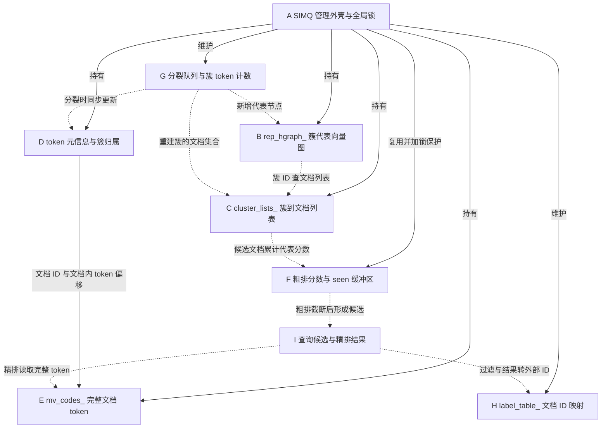
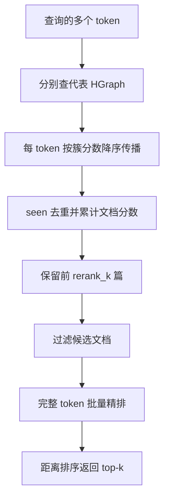

# SIMQ 形象图解：先查卡片目录，再打开整本文档核对

[设计说明](README.md) · [代码逐段导读](code_walkthrough.md) · [WARP 图解](../warp/visual_guide.md)

源码基线：`fd363937`。组件名和执行顺序依据本地源码；设计动机是从实现推导的工程解释。

## 1. 用“产品目录检索”理解它

沿用 WARP 的类比：一篇文档是一本产品目录，每条 token 是一张产品卡片，查询是由多条需求构成的清单。
WARP 每次翻开全部目录，SIMQ 增加了一个馆藏检索台。

检索台把内容相近的卡片分成若干组，每组挑一张代表卡片，并记录“哪些目录中有属于本组的卡片”。
客户提出“轻便”和“防水”两个需求时，先分别查代表卡片，快速找到可能合适的目录。
工作人员给候选目录粗打分，只把排在前面的一部分拿到桌上，再逐张阅读真实卡片完成精排。

这里的三种编号不能混淆：

- **token ID**：库中某一条 token 的全局编号，用于维护归属和定位。
- **cluster ID**：某个卡片组的编号，也是最终代表图返回的 label。
- **doc ID**：整本文档的内部编号，粗排聚合、完整评分和结果返回围绕它展开。

类比的边界：这里的“组”由向量相似性和聚类维护策略决定，不是人工主题分类。
代表卡片只能近似整组的匹配能力，既不能保证某本文档具备代表卡片的分数，也不能保证候选阶段发现所有好文档。

## 2. 主要构成图：代表图、文档映射与完整记录并存



[查看 PNG 图片](figures/visual_guide-01.png)

<details>
<summary>查看可编辑 Mermaid 源码</summary>



</details>

**线条图例：**实线表示长期持有或稳定定位关系；虚线表示构建维护、粗排传播或精排访问。
这是一张组件依赖图，F、I 不属于持久化语义相同的数据结构：F 是可复用工作缓冲，I 表示单次查询的临时集合。
B 的边连接代表向量，图中没有画出这些内部 HGraph 邻边；它们与 C 中的簇文档关系是两套不同关系。

### A：SIMQ 组织所有状态的一致性

`SIMQ` 继承公共索引基类，持有 B 到 G 等成员。
`Build`、`Add` 与 `KnnSearch` 通过 `global_mutex_` 协调；当前 KNN 入口使用 `std::unique_lock`。
因此多个调用者对同一实例发起 KNN 时会受独占锁串行化约束。

源码：[simq.h](../../../src/algorithm/simq/simq.h)、[simq.cpp](../../../src/algorithm/simq/simq.cpp)，搜索 `global_mutex_`。

### B：图节点是一簇的代表，不是一整篇文档

`rep_hgraph_` 是普通 FP32/IP HGraph，节点 label 使用 cluster ID。
一个 query token 作为一个单向量查询，去这个代表图中找最相似的若干簇。
最终建图选择簇内与均值方向内积最大的实际 token 作为代表；串行分支直接使用和向量，乘以同一正常数不改变组内最大值选择。
所以“计算过均值”和“把均值作为最终代表向量”是两回事。

源码：[simq.cpp](../../../src/algorithm/simq/simq.cpp)，搜索 `build_rep_hgraph`；初始聚类阶段的辅助 `hgraph_` 与最终 `rep_hgraph_` 也应区分。

### C：一簇连接的是文档集合

`cluster_lists_[c]` 保存至少有一个 token 归属该簇的文档 ID。
同一篇文档可分布在多个簇；同一簇也可覆盖大量文档。
构建时先用文档集合去重，再填入列表，所以多条同簇 token 不应导致同一文档在该簇内被重复计作不同文档。

C 的作用是把“代表图命中一个簇”翻译成“这一组文档值得考虑”，并不直接提供完整 token 距离。

### D：增量维护依赖细粒度 token 账本

`vec_to_cluster_` 给出 token 的当前簇。
`token_to_doc_` 与 `token_to_offset_` 给出它属于哪篇文档、在文档内第几条。
`token_to_dist_` 保存与簇代表关系相关的距离信息，供维护和分裂等逻辑使用。

只有 C 的文档集合不足以做精确 token 级拆分：同一文档可能有部分 token 留在旧簇，另一部分迁到新簇。
D 让实现能够回到 E 中准确读出需要成为新代表的那条 token。

### E：真实评分仍依赖完整文档

`mv_codes_` 是多向量 DataCell，负责完整记录存储、解码与 `MultiVectorComputer` 评分。
粗排没必要对所有文档都读取 E；精排只把候选文档 IDs 批量交给 `mv_codes_->Query`。
即使候选来自代表图，最后打分仍按文档的完整 token 集合完成。

源码：[multi_vector_datacell.inl](../../../src/datacell/multi_vector_datacell.inl)、[multi_vector_computer.cpp](../../../src/quantization/multi_vector_computer.cpp)。

### F：seen 实现“一个查询 token 对一篇文档只贡献一次”

`coarse_score_buf_` 按文档累加分数，`coarse_seen_buf_` 记录当前 query token 是否已给该文档计分。
`coarse_dirty_` 与 `coarse_seen_dirty_` 记录需要恢复的位置，减少对所有文档反复初始化的成本。

每个 query token 的簇结果先按相似度降序排列，所以首次遇到某篇文档时，计入的是本次命中簇中的最高代表分数。
处理完一个 query token 后重置该 token 的 seen，下一个 query token 可以继续给同一文档贡献。
这些是 mutable 成员缓冲，也解释了为什么 A 的 KNN 入口需要保护共享查询状态。

### G：簇过大时需要重新分组

`cluster_token_counts_` 让 Add 可以检查簇规模。
`pending_splits_` 与 `pending_split_first_overflow_` 记录待处理分裂及时间，相关策略还受分裂延迟参数影响。
实际分裂会修改 D 的归属、重建 C 的文档列表，并向 B 加入新的代表。

`execute_split_parallel` 中的新代表来自分裂后新半组的一条实际 token，而不是无条件重新求一个算术均值。
这三个结构必须一起更新，否则“图找到的簇”与“簇实际包含哪些文档”会不一致。

### H：外部文档 ID 在过滤与输出时使用

`label_table_` 把内部文档 ID 转换为业务 label。
当前 KNN 路径在精排前用外部 label 调用传入的 Filter；最终结果也输出外部文档 ID。
图 B 返回的 cluster ID 不能直接拿来过滤业务文档，也不能直接作为用户结果。

### I：临时候选与最终分数的单位不同

`coarse_results` 中是文档及累计代表相似度，越大越好。
`reranked` 中是完整文档距离及内部 ID，越小越好。
它们经过候选截断、过滤、批量查询与排序连接起来，不能把粗排相似度当成最终返回距离。

## 3. Build 与 Add：如何搭建并维护这个检索台

1. Build 校验文档 token 与维度，统计所有文档 token 总数。
2. 把 token 复制到连续 `flat` 数组，同时建立 token 到文档与文档内偏移的映射。
3. 训练 `mv_codes_`，写入完整文档记录，并插入文档 label。
4. `run_clustering` 调用动态聚类流程，生成 token 到簇的归属以及簇文档集合。
5. `build_rep_hgraph` 从每簇选取代表 token，建立最终代表 HGraph。
6. 后续 Add 先处理新增文档记录与 ID，再为新增 token 搜索代表图并维护归属。
7. 簇达到维护阈值时进入待分裂逻辑；分裂后同步更新 B、C、D、G。

工程上，保留 E 是为了最终精排；保留 B、C 是为了尽量减少访问 E 的次数；保留 D、G 是为了数据变化后还能维护 B、C。
SIMQ 的额外内存因此不只是“少量代表向量”，还包括 token 元信息、簇文档关联和工作缓冲。

## 4. 一次 KNN 查询的精确顺序



[查看 PNG 图片](figures/visual_guide-02.png)

<details>
<summary>查看可编辑 Mermaid 源码</summary>



</details>

1. KNN 入口取得 `global_mutex_` 独占锁，解析 `coarse_k` 与 `rerank_k`。
2. 每个 query token 独立搜索代表图；这些图查询可以在一次请求内部并行执行。
3. 把图距离转换成簇相似度 `1 - distance`，对簇结果从高到低排序。
4. 通过 C 扩展文档，使用 F 的 seen 保证当前 token 对同一文档只累加一次。
5. 对所有 query token 累计后的文档分数降序排序，先截断到 `rerank_k`。
6. 对截断后的文档逐个应用 Filter，产生 `batch_ids`。
7. 将 `batch_ids` 交给 E 批量精排；IP 文档距离是 `m - MaxSim`。
8. 按精排距离排序、施加该路径后续约束，返回至多 k 篇文档。

步骤 5 必须画在步骤 6 前面：当前实现不会因为过滤掉前排候选，就自动从截掉的尾部无限补齐。
一次请求中的 token 并行，也不意味着多个文档查询能在该实例上绕过入口独占锁并行执行。

## 5. 可手算例子：seen、粗排和精排分别做什么

这是教学用的簇归属与向量数据，假设已经形成如下索引，并假设代表图返回列出的簇；不声称真实聚类一定生成这一划分。
所有向量为二维 FP32，使用 IP：

```text
查询：q1 = [1, 0]，q2 = [0, 1]，m = 2
文档 A：[1, 0]、[0, 0.8]，属于 C0、C2
文档 B：[0.7, 0.7]，属于 C1
文档 C：[0.95, 0.05]、[0.65, 0.65]，属于 C0、C1
代表：C0 = [1, 0]，C1 = [0.7, 0.7]，C2 = [0, 0.8]
簇列表：C0 → A、C；C1 → B、C；C2 → A
```

取 `coarse_k = 2`，两个 query token 的簇搜索结果为：

| query token | 第一个簇及代表分数 | 第二个簇及代表分数 |
| --- | --- | --- |
| q1 | C0，1.0 | C1，0.7 |
| q2 | C2，0.8 | C1，0.7 |

处理 q1 时，先访问 C0，给 A、C 各加 1.0，并设置 seen。
再访问 C1，给 B 加 0.7；C 已经 seen，因此不能再加 0.7。
如果省略去重，C 会仅凭“出现在两个簇”得到 1.7，这不符合一个 query token 只取一次最佳匹配的规则。

清理本轮 seen 后处理 q2：C2 给 A 加 0.8，C1 给 B、C 各加 0.7。
粗排得到：A 为 1.8，C 为 1.7，B 为 1.4。
取 `rerank_k = 2` 时，只留下 A、C 进入后续流程。

| 文档 | 完整 token 的 q1 最大内积 | 完整 token 的 q2 最大内积 | MaxSim | 实际 IP 文档距离 |
| --- | --- | --- | --- | --- |
| A | 1.0 | 0.8 | 1.8 | `2 - 1.8 = 0.2` |
| C | 0.95 | 0.65 | 1.6 | `2 - 1.6 = 0.4` |
| B，仅用于对照 | 0.7 | 0.7 | 1.4 | `2 - 1.4 = 0.6` |

C 的粗排分数为 1.7，精确 MaxSim 为 1.6，差异来自代表 token 代替了真实 token。
候选内精排纠正了分数，但已经截掉的 B 不会在精排期间突然加入。

再加一个仅允许 B 的过滤器：步骤 5 已留下 A、C，步骤 6 把两者全过滤掉，最后可能返回空结果。
这并不表示整个索引没有合法文档，而是合法的 B 不在截断后的候选集合里。
提高 `rerank_k` 到 3 能覆盖本例 B；但对于从未被任何命中簇触及的文档，仅提高它仍然无效。

## 6. 为什么这样设计，以及参数究竟改变哪里

| 设计或参数 | 直接作用的组件 | 收益与代价 |
| --- | --- | --- |
| 代表 HGraph | B | 减少对完整文档的全量匹配；代表图搜索本身有成本和近似性 |
| `coarse_k` | B、C、F | 更多命中簇扩大候选覆盖，也增加代表搜索与分数传播 |
| `rerank_k` | I、E | 更多文档做完整评分，增加 token IO 与 MaxSim 计算 |
| `max_cluster_size` | G、B、C | 控制簇维护粒度；更频繁分裂需要额外更新与代表存储 |
| token 元信息 | D | 支持准确定位和增量拆分；内存随总 token 数增长 |
| 粗排缓冲复用 | F、A | 减少分配及哈希开销；当前查询入口持有独占锁 |
| 批量 DataCell 查询 | E | 给多文档 IO 组织与统计提供机会；不能消除文档评分自身成本 |

误解一：“粗排算的已经是真实 MaxSim，只是少算几篇文档。”粗排用簇代表分数，精排才访问候选文档完整 token。

误解二：“seen 在整次查询结束前都不清理。”它按 query token 清理，否则第一项命中后，后续查询项就无法为同一文档贡献。

误解三：“增大 rerank_k 等于扩大代表图搜索。”两个预算分别控制候选发现与完整评分，应分开理解。

误解四：“内部用了线程池，所以同一实例一定能同时处理多个 KNN。”当前 KNN 的全局独占锁是必须核对的吞吐边界。

## 7. 读完构成图应能回答

- B 返回一个 cluster ID 后，为什么必须经过 C 才能得到文档候选？
- 没有 D，只保存 C，为什么很难正确地把一个大簇按 token 拆成两组？
- 为什么 F 的 seen 以文档为下标，却需要对每一个 query token 重新使用？
- 为什么对同一查询，粗排相似度越大越好，精排距离却越小越好？
- 过滤结果不足 k 时，应分别检查代表覆盖、rerank 截断和过滤这三段什么信息？
