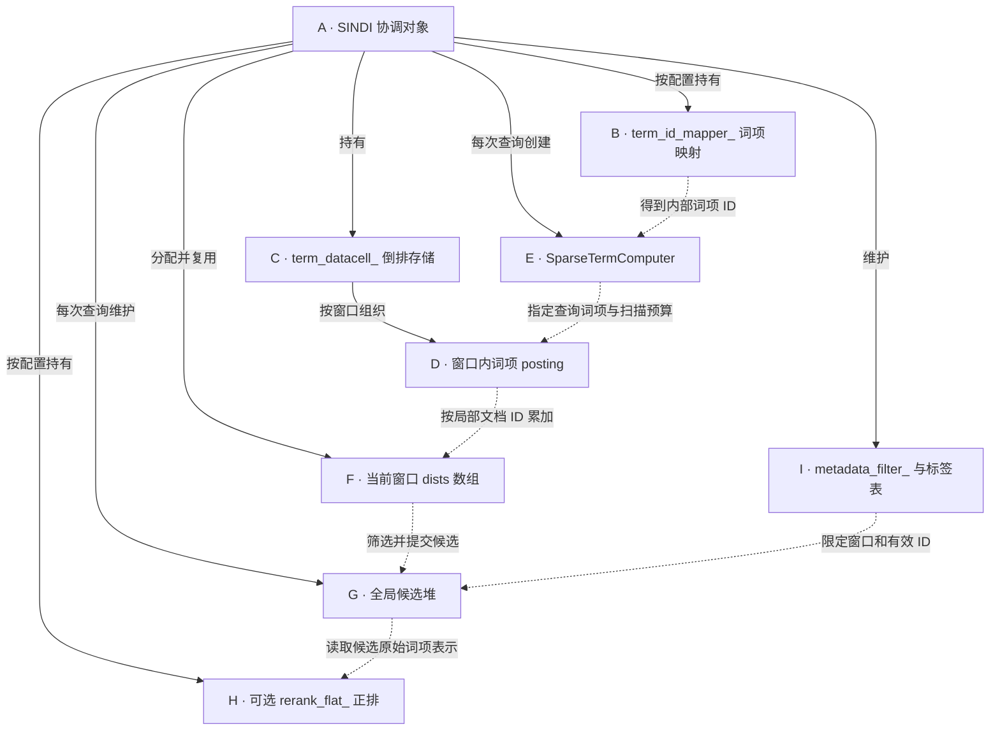

# SINDI 图解：按关键词翻名册，在一页记分板上累加

[设计说明](README.md) · [代码逐段导读](code_walkthrough.md) · [SINDI_V2 图解](../sindi_v2/visual_guide.md)

源码基线：`fd363937`。本篇的设计原因是对当前代码的工程解释；算例采用 FP32、非负权重和无剪枝，便于手算。

## 1. 用“关键词名册”理解稀疏检索

每篇文档像一张只写了少量关键词和权重的卡片。
例如卡片 d0 写着“猫:2、宠物:1”，没有出现的词不用写成 0，更不用分配一个巨大数组。
管理员另外准备名册：“猫”出现在哪些卡片、“宠物”出现在哪些卡片。
查询只需要翻自己包含的那几份名册，把共同关键词带来的贡献加到对应卡片上。

为了不铺满整个桌面的记分板，管理员每次只处理一批连续编号的卡片，记完这一页就把好结果交给总榜单。
这个“一页”对应 window；“名册条目”对应 posting；“总榜单”对应候选堆。
不同窗口重复使用同一块大小固定的记分板，因此查询临时分数数组不必和全部数据量一样大。

类比的边界是：term 可以是模型生成的稀疏特征 ID，不一定是真正自然语言关键词。
文档在窗口中的分组由内部编号及构建过程决定，不是语义聚类。
外部 ID 还可能很大且不连续，不能直接当记分板下标。

## 2. 主要构成图



[查看 PNG 图片](figures/visual_guide-01.png)

<details>
<summary>查看可编辑 Mermaid 源码</summary>



</details>

实线表示持有或数据组织关系；虚线表示查询时的编号转换、访问和计算。
F、G、E 是查询临时状态；C、D、H 是索引保存的数据，不要把它们都算成每次查询新建一份。
C 的具体后端可以为可变或不可变结构，D 画的是共同的窗口内倒排含义。

## 3. 逐框解释数据和代码

### A：SINDI 管调度，不直接展开每个累加内核

`SINDI::KnnSearch` 校验单条稀疏 query、解析候选预算、准备过滤和词项映射。
`search_impl` 负责逐窗口调度、候选提取和可选精排。
这样，索引层处理查询语义，DataCell 处理 posting 布局，Computer 处理权重计算。
对应 [sindi.cpp](../../../src/algorithm/sindi/sindi.cpp)。

### B：词项映射压紧编号空间

启用 `remap_term_ids_` 时，`term_id_mapper_` 把外部词项编号映射成内部紧凑编号。
这类似把很大的业务编码换成连续货架编号，减少词项目录按最大编号展开带来的浪费。
词项重编号本身不改变权重意义；删去低贡献项的 doc/query 剪枝则属于有损操作。
精排若仍使用原始词项空间，代码会保留原始 query，避免用映射后的编号查正排。

### C：倒排 DataCell 统一存取入口

`term_datacell_` 通过 `SindiSearchTermDataCell` 接口提供 `QueryWindow`、候选入堆等方法。
可变路径使用 `MutableSindiTermDataCell`，不可变路径使用 `ImmutableSindiTermDataCell`。
可变表示便于写入和追加；不可变表示可以将组织压紧，但不能仅因它们共享查询接口就假定写入能力一样。
对应 [sindi_search_term_datacell.h](../../../src/datacell/sindi_search_term_datacell.h)。

### D：一个窗口里有多份 term 名册

`MutableSINDIWindow` 的 `term_ids_` 保存各词项命中的局部文档 ID，`term_datas_` 保存编码后的权重，`term_sizes_` 保存数量。
局部文档 ID 使用 `uint16_t`；它表示当前窗内的位置，不是全局 internal ID。
ID 数组与权重字节数组分开，允许在相同 IDs 上切换 FP32、FP16、SQ8 等计算分支。
`postings_sorted_` 记录 posting 的排序状态，相关排序与截断逻辑服务于 term 访问剪枝。
对应 [mutable_sindi_term_datacell.h](../../../src/datacell/mutable_sindi_term_datacell.h)。

### E：Computer 是本次 query 的计算规则

`SparseTermComputer` 保存原始 query、排序后的 query、保留比例和当前 term 迭代状态。
`GetTermScanCount(posting_count)` 将完整 posting 长度转换成本次实际扫描量。
`ScanForAccumulateFloatBytes` 等方法负责调用对应值格式的累加内核。
`ResetTerm` 只重置查询词项迭代器，让下一窗重新遍历相同 query，并不清空 F 的分数。
对应 [sparse_term_computer.h](../../../src/quantization/sparse_quantization/sparse_term_computer.h)。

### F：dists 是临时局部账本

`search_impl` 分配 `Vector<float> dists(window_size_, 0.0F, search_allocator)`。
FP32 路径累加的是负内积：`dists[local_id] += -q[t] * d[t]`，更小的数表示更相似。
这只是内部比较形式，最终对外的 IP 距离是 `1 - score`。
窗口处理后的清理由相应候选入堆实现配合完成；不要把清理误归给 `ResetTerm`。

### G：候选堆把各窗口的好结果合在一起

每个窗产生的局部 ID 先加 `window_start_id` 转成内部全局 ID，再参与同一个候选堆。
候选提取可以走 term lists 或完整 dists 路径，取决于代码推导的模式。
入堆还处理过滤、预算和距离门槛等条件，因此“某个槽位存在”不等于它一定返回。
对应 [mutable_sindi_term_datacell.cpp](../../../src/datacell/mutable_sindi_term_datacell.cpp) 的 `InsertHeapByWindow`、`InsertHeapByDists`。

### H：正排让候选能够完整重算

`rerank_flat_` 按内部文档 ID 保存稀疏向量表示；倒排问“这个词在哪”，正排问“这篇文档有哪些词”。
重排阶段以候选 ID 读取正排，重新计算与 query 的距离，再裁剪到最终 k。
正排可以纠正候选上的部分剪枝或编码误差，但完全没有进入 G 的文档不会被逐一补查。
正排具体精度由 `rerank_type_` 等配置决定，不能把所有 rerank 后端一概说成原始 FP32。

### I：范围过滤与编号转换

`metadata_filter_` 可以把查询条件变成窗口范围和匹配窗口调度，并补充有效 ID 过滤。
过滤路由还会影响是否需要完整 term 扫描，不能假设它只是最后删结果。
`label_table_` 负责输出阶段把内部 ID 转回外部 ID，与词项映射 B 管理不同坐标空间。
对应 [sindi_metadata_filter.cpp](../../../src/algorithm/sindi_metadata_filter.cpp)。

## 4. 三种编号的关系必须算清楚

```text
全局内部文档 ID = window_id × window_size + local_doc_id
外部文档 ID     = label_table 对全局内部文档 ID 的转换结果
内部 term ID    = term mapper 对外部 term ID 的转换结果（若启用）
```

window ID、文档 ID 和 term ID 是三种不同角色；term 42 并不是文档 42。
以下统一用 W=3 作教学缩尺，方便两行表画完。它不是合法配置：当前参数检查要求 `window_size` 在 `[10000,60000]`。
真正运行测试应使用合法窗口大小，并按同样公式选择跨窗的内部 ID。

## 5. 构建：把正向卡片转成倒排名册

1. 检查每条稀疏向量，取得 term IDs 与权重，按配置做文档项剪枝。
2. 如启用词项映射，将保留项变成内部 term IDs；需要量化时准备值范围和编码参数。
3. 用内部文档 ID 算出窗口编号和局部编号，将 posting 插入相应窗口的 term 名册。
4. 维护标签与元数据；按路径排序、整理 posting，或完成不可变窗口布局。
5. 若启用重排，另外保存正排向量供候选重算。

写入后的“文档被剪掉的 term”已经不在基础倒排中，提高查询 `n_candidate` 不会自动恢复这些信息。

## 6. 一个跨窗口、可逐项追踪的算例

假设外部 ID 分别为 101～106，内部 ID 为 0～5，W=3 仅作缩尺教学，无剪枝、无量化、无过滤。

| 内部 ID | 窗口 / 局部 ID | 稀疏向量 |
| --- | --- | --- |
| 0 | 0 / 0 | {a:2, b:1} |
| 1 | 0 / 1 | {b:3, c:1} |
| 2 | 0 / 2 | {c:2} |
| 3 | 1 / 0 | {a:1} |
| 4 | 1 / 1 | {b:2} |
| 5 | 1 / 2 | {a:1, b:3} |

查询 q={a:1,b:2}，k=2，候选预算至少为 2。窗口里的名册为：

```text
window 0: a → [(local 0, value 2)]
          b → [(local 0, value 1), (local 1, value 3)]
          c → [(local 1, value 1), (local 2, value 2)]
window 1: a → [(local 0, value 1), (local 2, value 1)]
          b → [(local 1, value 2), (local 2, value 3)]
```

上面为可读性按 local ID 展示；实际 posting 可能按权重排序，累加结果在无剪枝时不因此改变。
window 0 只访问 a、b，不需要访问 c。a 让 dists 变成 [-2,0,0]，b 再把它改为 [-4,-6,0]。
对应得分是 [4,6,0]，正贡献最好的两条是内部 ID 1 与 0。
处理 window 1 时重新使用干净的局部账本：a 贡献 [-1,0,-1]，b 贡献 [0,-4,-6]，合计 [-1,-4,-7]。
它们分别对应全局内部 ID 3、4、5，绝不是再一次出现内部 ID 0、1、2。
把两窗结果合并，最高得分是 ID 5 的 7 和 ID 1 的 6。
最终输出外部 ID 106、102，对外距离为 -6、-5，即 `1-score`；IP 距离为负数完全可以合法。

此例只需要两个有正贡献的最终结果，因此不依赖无共同词项文档在不同入堆路径中的边界语义。
若要研究全零贡献、负权重、距离并列或 k 大于有效候选数，必须继续核对具体入堆分支。

## 7. 代码中的窗口循环对应哪个动作

来自 [sindi.cpp](../../../src/algorithm/sindi/sindi.cpp) 的真实片段：

```cpp
        const auto window_id = static_cast<uint32_t>(cur);
        const auto window_start_id = window_id * window_size_;
        computer->SetTermPruneEnabled(
            not metadata_filter_.RequiresFullTermScan(metadata_route, window_id, window_size_));
        // compute
        term_datacell_->QueryWindow(
            dists.data(), window_id, computer, use_term_lists_heap_insert, query_context);
```

这里先确定当前页的全局起点，再决定本窗是否允许 term 剪枝，最后交给倒排 DataCell 累加。
随后才是 G 的候选提取；只看 `QueryWindow` 无法解释最终返回数量。

## 8. 调参对应的省钱方式与损失

| 参数 | 省掉什么 | 可能损失什么 |
| --- | --- | --- |
| `doc_prune_ratio` | 建库后永久减少基础 posting 项 | 被删除项对候选生成的贡献 |
| `query_prune_ratio` | 本次 query 的部分 term 访问 | 这些 query term 独有的文档和分数贡献 |
| `term_prune_ratio` | 每窗某 term 的部分 posting 访问 | 本词项列表后面记录的贡献 |
| `term_retain_threshold` | 配合 term 扫描预算限制工作 | 需结合每窗阈值换算和剪枝开关理解 |
| `n_candidate` | 约束 G 和 H 的候选工作量 | 候选之外的文档无法进入精排 |
| `window_size` | 改变局部账本与窗口数量 | 大窗口增加临时工作集，小窗口增加调度与元数据 |
| 权重量化 | 缩小 D 的值数组 | 基础评分有量化误差，具体误差随格式变化 |

最常见误解是把 window 当成聚类桶，把 doc/query/term 三种剪枝混成一种，以及认为精排能恢复所有漏掉的结果。
判断性能时应统计本次实际访问了多少 posting、经过多少窗口、精排多少文档，而不能只看词表维度有多大。
