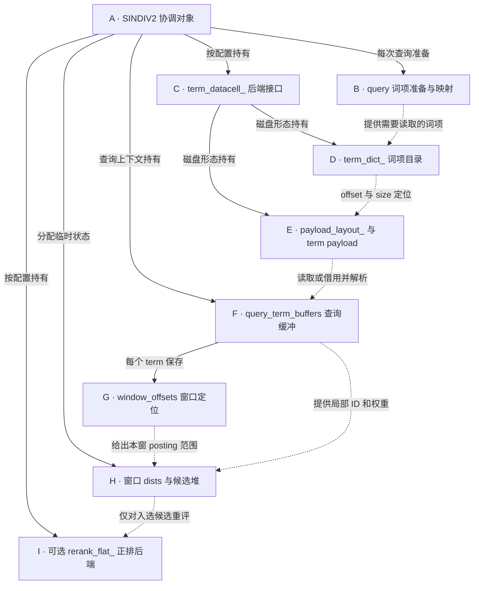
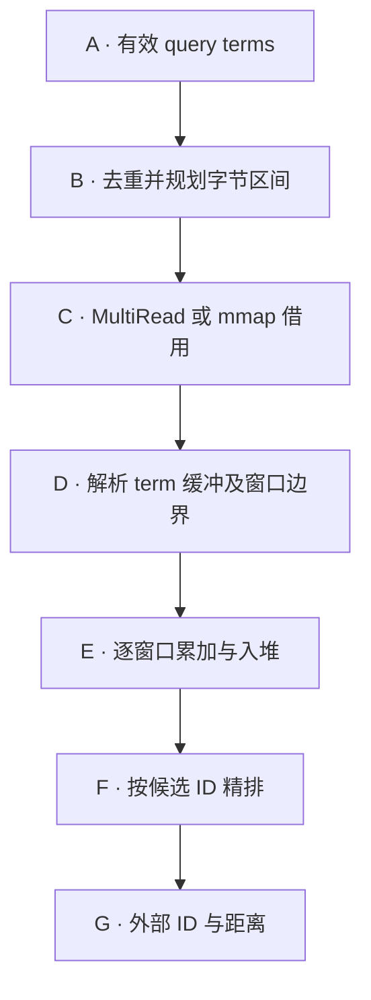

# SINDI_V2 图解：按关键词取整册，再按窗口逐页记分

[设计说明](README.md) · [代码逐段导读](code_walkthrough.md) · [SINDI 图解](../sindi/visual_guide.md)

源码基线：`fd363937`。本篇重点展示 term-first 文件布局与 window 计算如何连接；设计动机按代码作工程解释。

## 1. 用异地档案馆理解 V2

沿用 SINDI 的关键词名册。假如名册全部在桌上，按窗口依次翻找相应 term 很直接。
但名册放在远处的磁盘档案馆时，每次查询最好只领出本次用到的几个关键词册子。
V2 把同一个 term 跨窗口的 posting 放到一个可定位的 payload 中，查询先取所需 term，再拆出每个窗口的片段。

它像“先一次领出猫、宠物两本名册，再在桌上按第 0 页、第 1 页计算”。
领书方式按 term，记账方式仍按 window。这两种顺序可以同时存在，并不互相冲突。
因此 V2 的主要变化不能简化为“把窗口去掉”或“搜索只剩下 term 循环”。

类比边界：一次 `MultiRead` 表达多个字节区间读取，并不保证所有 IO 后端真正异步或并发。
mmap 可以借用映射数据，普通读取后端需要缓冲；“取一本书”也不意味着所有配置都复制完整同一份内存。
当前 V2 还支持内存相关后端，不是名字中带 V2 就一定从 SSD 读取。

## 2. 主要构成图：持久化、读取计划、计算工作集



[查看 PNG 图片](figures/visual_guide-01.png)

<details>
<summary>查看可编辑 Mermaid 源码</summary>



</details>

实线表示持有和组织；虚线表示查询阶段的数据访问和传递。
D、E 展开的是磁盘 term DataCell；可变内存实现可以直接访问自身窗口，不必照搬同一套读取缓冲成本。
图省略继承的标签映射与元数据过滤，它们仍负责范围约束和最终外部 ID 转换。

## 3. 每个组成部分的职责、存储和源码映射

### A：协调者保留两阶段检索

`SINDIV2::KnnSearch` 校验 sparse query，构造候选预算，准备过滤和 `SparseTermComputer`。
与 SINDI 的明显差异之一是进入窗口搜索前增加了 `LoadQueryTermBuffers`。
`search_impl` 仍然按窗口累加，之后可以使用正排精排。
对应 [sindi_v2.cpp](../../../src/algorithm/sindi_v2/sindi_v2.cpp)。

### B：本次真正使用的 query terms

query 可能先经过 term 重映射，再由 Computer 排序与剪枝。
`collect_query_term_ids` 从实际 Computer 收集要访问的 term，避免无条件按完整词表加载。
映射后 query 用于基础倒排；若正排保留原始词项空间，`rerank_query` 保存原始 query 供后续重评。
对应 [sindi_v2.cpp](../../../src/algorithm/sindi_v2/sindi_v2.cpp) 中 `KnnSearch`。

### C：后端接口把计算与介质隔开

`term_datacell_` 统一提供窗口计算和 term 缓冲加载等接口。
构建、加载和参数组合决定采用可变内存、不可变内存或磁盘 DataCell。
统一接口并不意味着统一的写入能力；文件、不可变和内存追加需要分开检查。
对应 [sindi_search_term_datacell.h](../../../src/datacell/sindi_search_term_datacell.h) 与 [disk_sindi_term_datacell.h](../../../src/datacell/disk_sindi_term_datacell.h)。

### D：term_dict_ 只存定位信息

每个 `DiskTermEntry` 包含 `posting_payload_offset`、`posting_payload_size`、`posting_count`。
前三个含义分别是到哪里读、读多少字节、该 term 总共有多少 posting。
词项目录不是全部 posting 内容，更不是原始稀疏向量的正排。
空 term 可以没有有效 payload；读取规划会跳过越界 term、重复 term 和 posting 数为 0 的 term。
对应 [sindi_search_term_datacell.h](../../../src/datacell/sindi_search_term_datacell.h)。

### E：payload_layout_ 持有按字节访问的布局

`DiskSindiTermDataCell` 的 `payload_layout_` 将 term payload 绑定到实际 IO。
一个 term payload 内含非空窗口列表、各窗口的局部文档 IDs，以及对应的编码值。
实际读取需要校验字节范围、计数和布局一致性，目录给出的偏移不是可以无条件信任的裸指针。
对应 [disk_sindi_term_datacell.cpp](../../../src/datacell/disk_sindi_term_datacell.cpp) 与 [sindi_datacell_utils.cpp](../../../src/datacell/sindi_datacell_utils.cpp)。

### F：query_term_buffers 是查询级缓存，不是全索引复制

`SindiQueryContext::query_term_buffers` 按 term ID 保存 `SindiTermBuffer`。
非 mmap 路径先规划多个 offset/size，调用 `MultiRead`，再把读取结果解析成各 term 的缓冲。
mmap 路径可以让 `external_ids`、`external_values` 引用已经映射的数据。
因此内存开销取决于实际 query terms 的 posting、解析结构及后端，不只取决于 query 的非零项个数。

### G：window_offsets 把 term-first 重新投影到窗口

`SindiTermBuffer::window_offsets` 为每个窗口提供该 term 在连续 posting 数组里的边界。
`GetPostingRange(w)` 返回 `begin=offsets[w]` 和 `count=offsets[w+1]-begin`。
空窗对应前后 offset 相同，所以窗口计算可直接知道这个 term 在当前窗没有贡献。
这些 offset 可以由紧凑的非空窗口元数据展开，磁盘上不必为所有空窗保存同样的细节。

### H：局部累加与全局候选仍沿用窗口模型

`QueryWindow` 对每个 query term 取当前窗口范围，再调用相应编码格式的累加内核。
局部 ID 索引 `dists`；候选入堆时转换成全局内部文档 ID。
候选堆跨窗口存在，分数数组则按窗口复用；它们的生命周期不同。
对应 [disk_sindi_term_datacell.cpp](../../../src/datacell/disk_sindi_term_datacell.cpp) 中 `QueryWindow`。

### I：rerank_io 独立决定正排怎样保存

`rerank_flat_` 通过文档内部 ID 获取候选的稀疏向量表示。
`term_io` 决定倒排 term 数据怎样访问，`rerank_io` 决定候选正排怎样访问，它们是两条成本不同的路径。
query 只有两个词，不代表精排只读这两个词的 payload；精排按候选文档读取正排表示。
正排格式还受 `rerank_type_` 控制，FP32 与压缩重排后端的精度和可写性不同。

## 4. term payload 的实际逻辑布局

```text
term_dict_[t]
  offset ── 指向下面整段 payload
  size   ── 整段字节数
  count  ── 总 posting 数

payload(t)
  non_empty_window_count
  TermWindowMeta[0] = {window_id, posting_count}
  TermWindowMeta[1] = {window_id, posting_count}
  ... 按 window_id 递增，仅列非空窗口
  local_doc_ids[]   = 各非空窗口的 IDs 依次拼接
  alignment padding
  encoded_values[]  = 与 IDs 一一对应的权重编码
```

IDs 使用紧凑局部编号，values 按量化格式占用不同字节数。
ID 数组和 value 数组分开意味着定位第 i 条值还要乘 `value_code_size`，不能把 posting 数当成字节数。
窗口元数据负责切分同一个 term 的两组数组，保证第 i 个 ID 与第 i 个权重始终对应。

## 5. 构建时怎样得到这种布局

1. 校验稀疏输入，执行文档剪枝、词项映射和必要的量化参数准备。
2. 按内部文档 ID 确定所属窗口，产生各 term 的窗口 posting。
3. term-layout 构建把 posting 记录按 term ID、window ID 排序，只保留非空记录。
4. 为同一 term 汇总非空窗口数、总 posting 数和 payload 大小，生成 D 中的目录条目。
5. 序列化窗口元数据、拼接 IDs、对齐填充和编码值，同时保存标签、参数和必要正排。

步骤 3～5 对应 [sindi_datacell_utils.cpp](../../../src/datacell/sindi_datacell_utils.cpp) 的 `BuildTermLayout` 和 `SerializeTermLayout`。
具体 Build 后采用哪种可变或不可变形态由配置决定，不能把这条持久化布局主线推断为所有后端的唯一中间内存结构。

## 6. 从文件读到结果的两段查询图



[查看 PNG 图片](figures/visual_guide-02.png)

<details>
<summary>查看可编辑 Mermaid 源码</summary>



</details>

A 到 D 决定把哪些词项数据搬到可计算的位置；E 决定怎样把 term 的贡献累加到文档；F 是独立的候选正排访问。
这说明“只读取所需 term”与“只计算部分窗口”是不同优化，不应混成一句话。
例如元数据路由缩小了实际计算窗口，也不能直接断言 term payload 一定只读取那些窗口的字节。
当前磁盘 `LoadQueryTermBuffers` 是按选中的 term entry 规划其 payload 读取。

## 7. 一个能手算 offset 的例子

设 W=3，仅作教学缩尺，不是可直接传入的配置；当前 V2 参数要求 `window_size` 在 `[10000,60000]`。
有三个窗口，内部文档 ID 0～8。只展示非空文档中的两个 query terms，其余文档可包含其他词项。

```text
term a:
  window 0 → [(local 0, value 2)]
  window 2 → [(local 1, value 4)]
term b:
  window 0 → [(local 1, value 3)]
  window 1 → [(local 2, value 1)]
```

term a 的非空窗口元数据为 `[(0,1),(2,1)]`，拼接 IDs 为 `[0,1]`，values 为 `[2,4]`。
解析后 `window_offsets=[0,1,1,2]`；因此 window 1 的范围是 `[1,1)`，确实为空。
term b 的元数据为 `[(0,1),(1,1)]`，IDs 为 `[1,2]`，values 为 `[3,1]`，offsets 为 `[0,1,2,2]`。
这些数组为教学的逻辑内容，省略真实序列化字节序、头部与填充，不是完整二进制文件样本。

查询 q={a:1,b:2}，FP32、无剪枝、无过滤、k=2，候选预算至少为 2。
首先只对 a、b 规划 term payload 读取，不用为无关的 c、d 等词项取数据。
window 0：a 命中 local 0，得分 2；b 命中 local 1，得分 6，分别是全局 ID 0、1。
window 1：a 范围为空，b 命中 local 2，得分 2，转换成全局 ID `1×3+2=5`。
window 2：a 命中 local 1，得分 4，转换成全局 ID `2×3+1=7`；b 范围为空。
总榜前两名是内部 ID 1 与 7，得分为 6 与 4，对外 IP 距离为 -5 与 -3。

在代码的 FP32 累加形式中，这三个窗口的 dists 分别出现 -6、-2、-4 等负内积值。
最后再转成 `1-score`，所以不能直接把内存中的负分数原样称为最终返回距离。
本例只比较有正贡献的候选，不对零贡献和并列边界作额外假定。

## 8. 一段源码把读取阶段和窗口阶段接起来

真实片段来自 [sindi_v2.cpp](../../../src/algorithm/sindi_v2/sindi_v2.cpp)：

```cpp
    SindiQueryContext query_context(search_allocator);
    auto query_term_ids = collect_query_term_ids(computer, search_allocator);
    query_context.query_term_buffers =
        term_datacell_->LoadQueryTermBuffers(query_term_ids, search_allocator);
    const bool use_term_lists_heap_insert =
        effective_query.len_ != 0 && UseTermListsHeapInsert(search_param);
```

这里先准备 query 所需 term buffers，随后把同一个 `query_context` 传入窗口搜索。
磁盘 `QueryWindow` 再用 `tb->GetPostingRange(window_id)` 找本窗切片，而不是每窗重新做完整 term payload 读取规划。

## 9. 参数、成本与能力边界

| 参数 | 影响图中位置 | 主要代价或边界 |
| --- | --- | --- |
| `term_io` | C、D、E、F | 冷读、缓存、缓冲复制或 mmap 访问，不同后端有不同写入能力 |
| `rerank_io` | I | 候选文档的额外读取，可与 term 访问成本独立变化 |
| `immutable` | C 的构建与持有形态 | 更紧凑组织与增量能力之间的取舍 |
| doc/query/term 剪枝 | 构建、B、H | 分别减少永久 posting、查询词项、实际累加，损失来源不同 |
| `n_candidate` | H、I | 增大候选覆盖和精排工作量；V2 的 0 表示导出内部放大预算 |
| `window_size` | G、H | 改变窗口元数据和临时账本，不改变 term-first 文件的主方向 |
| `rerank_type` | I | 存储大小、重评精度，以及某些后端的增量限制 |

当前 `InitFeatures` 只有在非 immutable、非 DMQ8 rerank、term 后端为 `memory_io` 时声明 Add-after-Build。
`UpdateVector` 当前不支持；支持磁盘 Build 或 Deserialize 不能推出支持磁盘上持续原位追加。

## 10. 最容易误解的逻辑

- “term-first 就没有窗口”：布局先按 term，计算仍按 window，G 正是两者之间的桥。
- “query 词少，IO 一定少”：一个高频 term 的 payload 本身可能很大。
- “MultiRead 就保证并发磁盘 IO”：它首先是批量区间读取接口，执行方式取决于后端。
- “V2 是 SINDI 改了工厂名字”：window-first 与 term-first 的字节协议不同，不能直接换名字读取旧格式。
- “精排候选越多必然召回所有遗漏”：未进入候选的文档仍不会被读取重算。

阅读源码时同时记录 term ID、payload 字节偏移、窗口 posting 下标、局部文档 ID 和全局 ID，就能避免把磁盘布局与计算坐标混为一谈。
