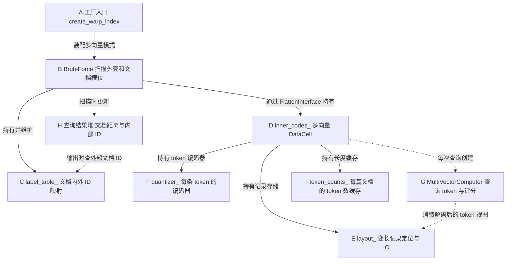

# WARP 形象图解：逐本翻阅、逐项对照的多向量扫描器

[设计说明](README.md) · [代码逐段导读](code_walkthrough.md) · [SIMQ 图解](../simq/visual_guide.md)

源码基线：`fd363937`。本文描述本仓库当前实现；文中的“为什么”是结合代码职责作出的工程解释，不代表作者原始设计声明。

## 1. 先用一个生活场景记住它

把每篇文档想成一本产品目录，目录中的每张产品卡片是一条 token 向量。
查询不是一个词，而是一张需求清单，例如“轻便”“防水”两个需求，各自也有一条 token 向量。

WARP 的工作人员逐本翻目录。
对“轻便”，他在当前目录中找匹配程度最高的卡片；对“防水”，再找匹配程度最高的卡片。
把两个最佳匹配分数相加，得到整本目录的得分，然后保留最好的几本目录。

这里有三个关键细节：

- 两个需求可以匹配同一张卡片，没有“一张卡片被用过就不能再用”的约束。
- 同一个需求只取一张最匹配卡片的分数，不能把所有卡片的分数都加上。
- 返回的是目录编号，也就是文档 ID；不会把最佳卡片当成最终文档返回。

类比的边界：模型提前把文字编码成向量，VSAG 不在查询期间阅读文字、理解语义或重新做分词。
卡片之间的匹配由指定距离计算决定，不是规则引擎逐条判断“满足/不满足”。
当前 WARP 入口实际创建多向量模式的 `BruteForce`，没有一个独立的 WARP 图结构或隐含的聚类路由器。

## 2. 主要构成图：一个扫描外壳，里面装可变长文档



[查看 PNG 图片](figures/visual_guide-01.png)

<details>
<summary>查看可编辑 Mermaid 源码</summary>



</details>

**线条图例：**实线表示长期组件的装配、持有或存储依赖；虚线表示查询期间的创建、读取或结果转换。
`G → E` 是“评分需要这批记录内容”的逻辑依赖，实际读取由 DataCell 负责，并非 Computer 自己调用磁盘 IO。
图中的框不是进程或线程，也不意味着每个框都对应独立堆对象。

### A：工厂负责选择模式

`create_warp_index` 注入内部 `WARP_MODE_MARKER`，最终构造 `IndexImpl<BruteForce>`。
标记随后被参数映射消费，多向量数据单元由映射后的配置装配。
这解释了为什么源码中应该去看 `bruteforce`，而不是寻找不存在的独立 WARP 算法目录。

源码：[index_creators.cpp](../../../src/factory/index_creators.cpp)、[bruteforce.cpp](../../../src/algorithm/bruteforce/bruteforce.cpp)，搜索 `create_warp_index`、`CheckAndMappingExternalParam`。

### B：外壳只管理文档级检索

`is_multi_vector_` 标识记录类型，`inner_codes_` 保存记录计算接口。
`claim_slot` 分配内部文档槽位，扫描范围中的一个内部 ID 对应一篇完整文档。
扫描器不需要把每个 token 放进全局结果堆，职责仍是“遍历记录、过滤、评分、保留文档结果”。

源码：[bruteforce.h](../../../src/algorithm/bruteforce/bruteforce.h)、[bruteforce.cpp](../../../src/algorithm/bruteforce/bruteforce.cpp)，搜索 `is_multi_vector_`、`claim_slot`、`SearchWithRequest`。

### C：业务文档 ID 与内部存储槽位分开

`label_table_` 来自索引公共基类，维护外部 label 与内部 ID 的关系。
假设用户传入 ID 为 10001 的文档，它可以存在内部槽位 0；记录定位使用 0，返回给用户时恢复为 10001。
这种分离让业务 ID 不必连续，也避免把很大的业务 ID 当成数组下标。

源码：[inner_index_interface.h](../../../src/algorithm/inner_index_interface.h)、[bruteforce.cpp](../../../src/algorithm/bruteforce/bruteforce.cpp)。

### D：多向量 DataCell 让一条记录包含多个 token

`MultiVectorDataCell` 实现 `FlattenInterface`，所以外壳仍然通过 `InsertVector`、`Query`、`FactoryComputer` 调用它。
这里 `InsertVector` 接收的实际对象是 `MultiVector`，其中 `len_` 是 token 数，`vectors_` 指向 `len_ × dim` 个浮点数。
`dim` 是每个 token 的维度，不能误读为文档中 token 的数量。

源码：[multi_vector_datacell.h](../../../src/datacell/multi_vector_datacell.h)、[multi_vector_datacell.inl](../../../src/datacell/multi_vector_datacell.inl)。

### E：变长布局保存偏移与记录内容

记录的逻辑字节形式是：`4 字节 token_count + n 条 token 编码`。
`layout_` 的类型包含 `VariableRecordLayout`，偏移相关存储使用 `MemoryBlockIO`，记录内容 IO 后端由模板参数决定。
因此长度不同的两篇文档不能统一按 `doc_id × 固定记录大小` 来定位。

源码：[multi_vector_datacell.inl](../../../src/datacell/multi_vector_datacell.inl)，搜索 `GetMultiVectorRecordSize`、`layout_.Write`。

### F：编码器负责每张卡片如何保存

`quantizer_` 的训练样本是一条条 token 向量，`EncodeOne` 也逐条处理 token。
文档边界由 E 保存，编码器不负责决定“哪几条 token 属于同一篇文档”。
存储精度变化可能影响最终距离，因此“遍历所有文档”与“完全等于原始 FP32 的距离”要分别判断。

### G：Computer 保存本次查询并完成两层循环

`MultiVectorComputer` 持有查询 token 视图相关状态。
外层循环枚举 query token，内层循环枚举当前文档 token；内层保留最小距离，外层把这些最小值加起来。
IP 距离采用 `1 - dot`，因此最终是 `m - MaxSim`，其中 `m` 是 query token 数。

源码：[multi_vector_computer.cpp](../../../src/quantization/multi_vector_computer.cpp)，搜索 `ComputeDist`。

### H：堆保存整篇文档的名次

`SearchWithRequest` 为扫描任务维护结果堆，堆元素的 ID 是内部文档 ID。
多线程分段扫描时，各段先维护自己的候选，再合并并转换外部 label。
堆的大小主要受返回需求约束，不会随文档 token 数直接扩成一个 token 排行榜。

### I：长度缓存减少额外读取

`token_counts_` 在插入时填充，反序列化时重建。
DataCell 知道候选文档有几个 token 后，能准备完整记录读取，减少为了读出头部长度而先做一次独立 IO 的需要。
缓存节省的是记录读取准备成本，不会省掉真正的 token 匹配计算。

## 3. Build 与 Add：目录如何进入书架

1. `Build(data)` 调用 `Train(data)`，再调用 `Add(data)`。
2. 多向量训练遍历所有文档，把 token 复制到连续缓冲区，训练样本数为所有 `len_` 的总和。
3. `Add` 根据 `is_multi_vector_` 进入 `add_multi_vector`；空索引的该路径也会执行训练判断。
4. 对每篇文档检查 label，并通过 `claim_slot` 取得内部 ID；重复 label 可以进入失败 ID 列表。
5. `InsertVector` 写入 token 数头部，再逐 token 编码，写入该文档的变长记录。
6. 同时更新 `token_counts_` 和公共 ID 管理状态，使后续查询能按内部 ID 找到记录。

这条链中没有近邻边构建，没有为文档分配聚类中心，也没有倒排簇文档表。
主要构建成本来自数据整理、训练与编码/写入；“没有建图”并不表示 Build 完全没有工作量。

## 4. 一次查询：清单逐项检查每本目录

1. 查询传入一个带若干 token 的 `MultiVector`，`make_search_computer` 选择多向量 Computer。
2. 扫描器枚举内部文档 ID，按实际过滤路径跳过不合法记录。
3. DataCell 根据内部 ID 定位文档记录，并向 Computer 提供可计算的 token 数据。
4. 对第一个 query token，算它与该文档所有 token 的距离，保留最小者。
5. 对剩余 query token 重复步骤 4，并把每次最小值加起来。
6. 将 `(文档距离, 内部文档 ID)` 放入该扫描段的结果堆。
7. 所有扫描段结束后合并结果，转成外部文档 IDs 和距离返回。

以下是与真实双循环同义的教学伪代码，省略了 IO、过滤、并行、阈值与错误处理：

```cpp
// 教学伪代码：IP 模式；Q、D 都是非空 token 集合。
float document_distance = 0.0F;
for (const auto& query_token : Q) {
    float best_distance = positive_infinity;
    for (const auto& document_token : D) {
        best_distance = min(best_distance, 1.0F - dot(query_token, document_token));
    }
    document_distance += best_distance;
}
```

## 5. 可手算例子：为什么是 m 减 MaxSim

下面是手算用的教学数据，不是实测索引结果；设每条 token 都是二维 FP32 向量，度量为 IP，不额外做归一化：

```text
查询 Q：q1 = [1, 0]，q2 = [0, 1]，所以 m = 2
文档 A：a1 = [1, 0]，a2 = [0, 0.8]
文档 B：b1 = [0.7, 0.7]
```

| 对象 | q1 与各 token 的内积 | q1 最大内积 | q2 与各 token 的内积 | q2 最大内积 |
| --- | --- | --- | --- | --- |
| 文档 A | 1、0 | 1 | 0、0.8 | 0.8 |
| 文档 B | 0.7 | 0.7 | 0.7 | 0.7 |

文档 A 的 MaxSim 为 `1 + 0.8 = 1.8`，距离为 `(1 - 1) + (1 - 0.8) = 0.2`。
文档 B 的 MaxSim 为 `0.7 + 0.7 = 1.4`，距离为 `(1 - 0.7) + (1 - 0.7) = 0.6`。
返回 top-1 时文档 A 获胜，因为距离更小。

文档 B 只有一条 token，但同一条 `b1` 可以分别服务 `q1` 和 `q2`。
它不需要两条 token 才能匹配两个查询项，也不进行一对一配对。

如果误写成 `1 - MaxSim`，A 会得到 `-0.8`，B 得到 `-0.4`。
同一个查询下名次虽然相同，实际返回距离却整体错了 1，距离阈值也会被误解。
当查询 token 数不同，错误常数还会变化，所以跨查询直接比较该原始分数也需要谨慎。
L2SQR 模式计算的是每个 query token 的最小平方 L2 距离之和，不能照搬 IP 的 MaxSim 公式。

## 6. 这样设计的收益、代价与常见误解

| 设计点 | 工程收益 | 对应代价或边界 |
| --- | --- | --- |
| 复用 BruteForce 外壳 | 复用槽位、过滤、结果堆与输出流程 | 阅读时必须持续区分单向量与多向量分支 |
| 按文档保存完整 token | 文档级计算与持久化边界清晰 | 长文档读取更多字节，匹配更贵 |
| 全量扫描候选文档 | 没有代表图候选漏召回这一层误差 | 朴素匹配工作量约为 `N × m × n × dim` |
| token 编码独立于扫描 | 可替换记录表示而复用外壳 | 相对原始输入的精确性取决于实际表示 |
| 独立长度缓存 | 减少查询准备阶段的额外读取 | 需要缓存内存及加载时重建 |

误解一：“WARP 名字听起来像某种剪枝算法，因此这里一定有那套剪枝结构。”当前代码明确复用多向量 BruteForce，应以工厂和实现为准。

误解二：“所有 token 内积加起来就是文档得分。”实际先对每个 query token 取文档内最大值，再求和。

误解三：“普通 BruteForce 的能力表可以完整套给 WARP。”多向量路径的原始向量读取、强制删除等能力存在区别，应继续查对应分支。

误解四：“扫描了所有文档，所以任何配置都精确等于原始 FP32。”扫描范围与编码误差是两个独立问题。

## 7. 看懂构成图后的自检

- 给一个外部文档 ID，能否指出 C 如何把它接到 D、E 中的一条记录？
- 文档从 3 条 token 增加到 30 条，E、F、G 哪些工作会增加，H 中的结果条数为何不变？
- 如果要减少完整文档评分数量，为什么需要 SIMQ 那样额外的候选结构？
- 为什么只改变 DataCell 与 Computer，就可以让原有的文档扫描框架处理多向量？
