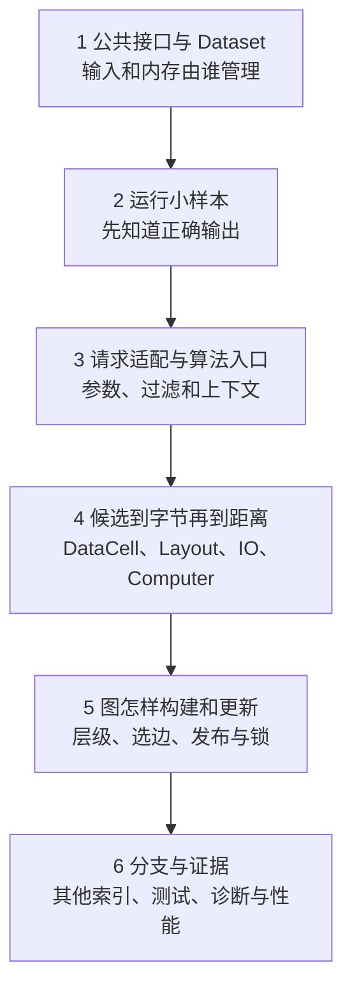

# 深入 VSAG 的阅读路线：沿着数据、状态和证据走

[系统架构目录](README.md) · [学习总入口](../README.md) · [可运行调试实验](12_debugging_lab.md)

源码基线：`fd363937`。这条路线面向“能跟踪一次请求、解释关键设计、定位异常行为”的学习目标。现有索引图解先提供直觉，本组新增章节进一步下钻到公共适配层、内存与字节布局、距离计算、图构建及状态维护。

## 1. 我会怎样带你读

我会先和你走通一个答案能手算的小请求，再沿调用链逐层展开；每次停在一个函数时，都回答四个问题：输入从哪里来、此时持有什么状态、接下来改变什么、怎样验证这一步真的发生。

第一遍保持单个 query、FP32、L2、内存 IO、无精排；第二遍只加入一种复杂条件，例如过滤或量化。先有一条能复述的主线，再理解分支为什么出现，阅读量会更可控。

具体顺序是：


[查看 PNG 图片](figures/00_deep_reading_roadmap-01.png)

<details>
<summary>查看可编辑 Mermaid 源码</summary>



</details>

箭头表示学习依赖，不是一次查询的物理调用顺序。例如构图在真实使用中发生于查询之前，但初读代码时，可以先借助已经建好的图理解查询需要什么结构。

## 2. 每一站读什么，读完应能做什么

| 学习站点 | 主文档 | 读完的可检查成果 |
| --- | --- | --- |
| 对象入口 | [06 接口、工厂与 Dataset](06_api_factory_dataset.md) | 画出 Factory/Registry/IndexImpl/实际索引的对应关系，说明指针所有权 |
| 手算基线 | [12 本地调试实验](12_debugging_lab.md) | 运行 BF 与 HGraph，解释同一组 label、距离和结果形状 |
| 请求全链路 | [07 请求到结果](07_query_request_pipeline.md) | 标出过滤创建、路由、底层分流、精排及结果转换的位置 |
| 图内搜索 | [HGraph 路由专章](../indexes/hgraph/traversal_walkthrough.md) | 手推 candidate_set、top_candidates、visited 的变化和停止条件 |
| 数据实际访问 | [08 存储字节路径](08_storage_byte_path.md) | 解释一个内部 ID 怎样找到编码，以及批量打分时哪些缓冲被复用 |
| 数值计算 | [09 量化与 SIMD](09_quantization_simd.md) | 算出 L2/IP/cosine 距离，区分表示误差与搜索漏召回 |
| 图的形成 | [11 HGraph 构图与修改](11_hgraph_build_mutation.md) | 用一次插入说明层级、候选选择、剪枝、反边和入口更新 |
| 状态有效性 | [10 标签、过滤与生命周期](10_labels_filters_lifecycle.md) | 解释删除、有效集合、序列化和并发读写怎样影响查询 |
| 横向扩展 | [全部索引图解](../indexes/visual_map.md) | 比较各索引在“候选从哪里来”这一环节上的差异 |

建议每次只完成一站的“可检查成果”。能把一个函数的名字背下来，还不能说明已经知道它的状态边界。

## 3. 从同一组小数据出发

实验固定 query 为 `(1,1,0,0)`，数据使用不连续的外部 ID：101、305、9001、42、77、880。
普通 top-3 是 `9001:0、305:1、101:2`，距离为平方 L2。

这组数据故意让外部 ID 与输入数组位置不同：

```text
输入位置 0 → 外部 label 101 → 向量 (0,0,0,0)
输入位置 1 → 外部 label 305 → 向量 (1,0,0,0)
输入位置 2 → 外部 label 9001 → 向量 (1,1,0,0)
```

位置、内部 ID、外部 label 在第一次简单 Build 时可能存在直接对应，但不能把这种巧合当成所有索引更新后的不变量。删除、重映射、分桶、多向量和重复数据都会让这种假设失效。

运行实验后，先解释三种变化：排除 label 305 后为什么 42 补位；threshold=0.5 后为什么只剩 9001；重载索引后为什么仍能返回原来的业务 label。具体步骤与已观测结果见 [12](12_debugging_lab.md)。

## 4. 看函数时固定记录八项

| 项目 | 写在笔记里的具体内容 |
| --- | --- |
| 输入 | query 数、dim、dtype、距离定义、ID 属于哪个空间、参数是否已经映射 |
| 输出 | 返回值形状、排序方向、是否可能少于 k、是否包含失败 ID |
| 所有权 | 参数是借用还是持有；返回指针依附哪个对象；临时缓冲何时释放 |
| 状态 | 长期索引状态与当前请求状态分别有哪些 |
| 变化 | 本函数真正写入什么，而不只是调用了什么 |
| 不变量 | 例如邻接 ID 能否定位编码、结果是否满足过滤、容量是否足够 |
| 分支 | 当前配置进入哪条路线；相似函数名是不是另一个重载 |
| 证据 | 连续源码、实际断点、真实测试，或者尚待运行的实验 |

以 `BasicSearcher::visit` 为例，不应该只写“遍历邻居”。应写清：先取得当前节点邻接表，检查 visited，首次发现就置位，根据过滤跳过策略收集待评分 ID，返回这一批的数量。它没有在这里完成整个 top-k 结果维护。

以 `Dataset::Owner(false)` 为例，不应该只写“设置参数”。应写清：Dataset 包装调用方指针而不负责释放，调用方的 vector 必须在使用期间有效，不能在调用前发生释放或使 data() 失效的重新分配。

## 5. 三条跨模块主线

### 5.1 创建和构建

```text
外部 JSON 与资源
  → Factory / Engine / Registry
  → IndexImpl<T> 参数检查与内部参数映射
  → 实际索引对象及 DataCell、图、量化器等组件
  → Build / Train / Add 的具体分支
  → 编码、label、邻接或桶结构变成可查询状态
```

这是一条职责示意，不代表 Factory 与 Engine 总以同一种方式串行经过。尤其要在 [06](06_api_factory_dataset.md) 核对实际入口使用的是默认资源还是 Engine 持有的资源。

Build 与 Add 也不能视作同义函数：某些 Build 负责训练、批量重排或图优化；Add 负责已有状态上的增量维护。查看 `Build` 的分派后，再决定应该读插入式图构建还是 ODescent。

### 5.2 查询和结果

```text
Dataset / SearchRequest
  → 公共适配层处理请求能力和过滤包装
  → 实际索引校验、选择策略与候选
  → DataCell 按候选 ID 提供编码访问与评分
  → 堆、visited、分桶或窗口状态更新
  → 配置指定的精排、阈值与合法性处理
  → 内部 ID 转回外部 label，组装结果 Dataset
```

顺序必须以具体索引为准。例如普通 HGraph 的上层路由发生在底层最终过滤器构建之前；SIMQ 的候选截断与过滤顺序不同。上面的共同职责不能用来覆盖这些差异。

### 5.3 保存和恢复

```text
索引的结构与编码
  → 格式元数据、各组件 Serialize、校验信息
  → BinarySet / 流 / 读写回调
  → 空索引或支持的加载入口
  → 校验、参数兼容、各组件恢复
  → 可继续查询的对象
```

本地实验执行了内存 BinarySet 往返；它只能证明该小样本和当前配置的往返行为，不能直接推导所有版本、文件 IO 和量化配置都兼容。

## 6. 用源码搜索缩小范围

先进入仓库，再用符号名与限定目录搜索。下面的命令只读取本地文件：

```bash
cd /Users/lzh/Desktop/code/vsag
rg -n 'CreateIndex|Register|IndexImpl' src/factory src/index/index_impl.h
rg -n 'SearchWithRequest|search_one_graph' src/algorithm/hgraph
rg -n 'search_impl|candidate_set|top_candidates' src/impl/searcher/basic_searcher.cpp
rg -n 'FactoryComputer|Query|InsertVector' src/datacell/flatten_datacell.h
rg -n 'TEST_CASE' src/impl/searcher/basic_searcher_test.cpp tests/test_hgraph.cpp
```

发现同名函数后先看签名，再看调用者。`search_impl` 有普通、DistanceProvider、iterator 等相关实现；看第一处文本命中并不一定是在看当前请求路径。

模板类的最终类型通常由工厂与参数组合决定。读 `FlattenDataCell` 之前，应先弄清 Quantizer、IO 与 metric 的具体组合，否则会把一个未实例化分支误当成本次执行路径。

## 7. 用测试理解边界，而不是只读正常案例

先选与你正在读的代码对应的一项测试，再看它如何构造数据、期待什么结果，以及它没有覆盖什么。

| 关注点 | 实际源码入口 | 可先搜索的真实测试名 |
| --- | --- | --- |
| 图搜索基本行为 | [basic_searcher_test.cpp](../../src/impl/searcher/basic_searcher_test.cpp) | `BasicSearcher supports KNN, range, filters, and empty data cells` |
| 非有限距离桥接 | 同上 | `BasicSearcher traverses through a non-finite-distance bridge` |
| 过滤引起扫描回退 | [test_hgraph.cpp](../../tests/test_hgraph.cpp) | `(PR) HGraph brute_force_threshold` |
| 自定义距离接口 | 同上 | `(PR) HGraph Custom Batch Distance` |
| 诊断结果 | [test_brute_force.cpp](../../tests/test_brute_force.cpp) | `(PR) BruteForce SearchWithRequest Reasoning` |
| threshold 与结果数量 | 同上 | `(PR) BruteForce KnnSearch threshold filtering` |

这些是阅读定位，本章没有声称执行完整测试集。当前 Debug 构建的 `ENABLE_TESTS`、`ENABLE_EXAMPLES`、`ENABLE_TOOLS` 均为 OFF；如果要执行仓库套件，再按 [构建与测试说明](../../docs/agents/build-and-test.md) 配置所需目标。

## 8. 从现象倒推应该在哪一层停下

| 现象 | 首先核对 | 下一步追踪 |
| --- | --- | --- |
| 返回 ID 看起来不对 | 是否把内部 ID 当外部 label、是否有删除或重映射 | label_table 与结果转换 |
| 距离与手算差一个平方或常数 | L2/IP/cosine 定义、是否归一化、多向量距离是否有聚合常数 | Quantizer 与具体 metric 分支 |
| 结果不足 k | 有效数量、threshold、过滤、候选覆盖、超时与 budget | 请求参数及最终输出逻辑 |
| 提高精排精度仍找不到目标 | 目标有没有进入候选集合 | 图路线、选桶、posting 剪枝、粗排截断 |
| 开诊断后统计变化 | 诊断是否额外评分目标，是否改变线程执行方式 | QueryContext 与 ReasoningContext |
| 编译包含 SIMD 但没有加速 | 平台能力和运行派发，以及具体核是否有实现 | simd_status、dispatch、标量尾部 |
| 加载成功但某操作不可用 | 参数兼容、不可变后端与能力声明 | InitFeatures 与具体方法检查 |

这里的“首先核对”是排查顺序，不是对异常根因的预先结论。

## 9. 再读其他索引时复用已经掌握的骨架

从 HGraph 切到 [IVF](../indexes/ivf/visual_guide.md)，先把候选生成换成“选中心与选桶”，再找桶内扫描和图查询的位置。
从 HGraph 切到 [LazyHGraph](../indexes/lazy_hgraph/visual_guide.md)，先读规模驱动的对象切换与锁，再复用已知 BF/HGraph 主线。
读 [Pyramid](../indexes/pyramid/visual_guide.md) 时，把业务路径树与近邻导航层分别画出来。

读 [SINDI](../indexes/sindi/visual_guide.md) 和 [SINDI_V2](../indexes/sindi_v2/visual_guide.md) 时，把“候选点逐个打分”换成“词项 posting 对窗口文档累加”，然后重新检查局部 ID、全局 ID 和负分表示。
读 [WARP](../indexes/warp/visual_guide.md) 和 [SIMQ](../indexes/simq/visual_guide.md) 时，先确认 top-k 的对象是文档，内部 token 只是评分或粗排的一部分。
读 [MCI](../indexes/mci/visual_guide.md) 时，先确认查询确实进入挂件路径，再跟节点到团、团到成员的双向关系。

## 10. 读到什么程度再开始调整实现

可以先用纸笔或文档完成下面六个小任务：

1. 画出一条 query 的生命周期，并标出它借用的内存何时仍必须有效。
2. 画出一个 label 怎样变为候选内部 ID，再变回输出 label。
3. 用两个堆的状态解释 HGraph 为什么停止，给出可能遗漏近邻的反例。
4. 用一个量化数值例子解释“遍历正确但排序变了”和“根本没访问目标”的区别。
5. 找到删除与并发修改时保护同一份状态的锁，并说明锁作用域。
6. 为准备修改的行为找到一项已有边界测试，说明还缺少哪种输入证据。

如果这些内容能讲清楚，接下来读性能优化、压缩图、RaBitQ 融合、自定义距离和多线程快路径时，就能判断每项优化到底改变了什么。

## 11. 这次实际验证和后续实验要分开记录

这次已经运行的范围见 [12](12_debugging_lab.md) 与 [结构化观测结果](labs/observed_results.json)：两个索引、六条数据、普通与诊断模式、过滤、threshold、BinarySet 往返、非法 k 的错误返回。
它们是功能与阅读辅助验证，不是吞吐量、召回曲线或 p95 延迟测试。

更大规模实验可接着使用 [05 的对照实验表](05_source_reading_and_experiments.md)。每次只改变一个因素，记录 commit、实际参数、数据集、度量定义、线程数和硬件；先固定真值与并列处理规则，再看召回。

## 12. 源码同步后怎样维护这条路线

先检查工厂注册与参数映射，再检查关键函数签名、能力声明、序列化格式和测试变化。
文档中的行号仅用于定位 `fd363937`，函数名和相对源码链接用于后续重新核对。
新的实现分支应补充“进入条件、共享状态、与普通路径的区别”，而不是只在目录中增加一个名词。
