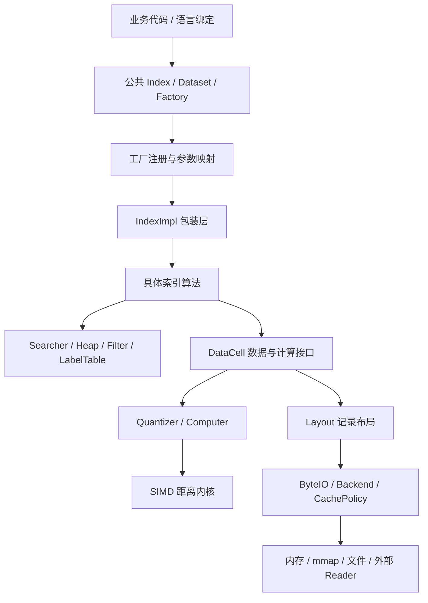

# 分层、模块职责与设计取舍

## 1. 先看整体关系



这是一张依赖关系图。并非所有索引经过完全相同的链路，例如 SINDI 的倒排计算有专用 DataCell，HGraph 也有融合 RaBitQ 数据与图邻接信息的实现。

## 2. 模块与源码对应

| 层次 | 入口 | 主要职责 |
| --- | --- | --- |
| 对外协议 | [include/vsag](../../include/vsag/) | 描述 Dataset、Index、Filter、Reader、资源与错误类型 |
| 创建与资源 | [src/factory](../../src/factory/) | 解析配置、按名字创建实现、接入分配器等公共资源 |
| 接口包装 | [index_impl.h](../../src/index/index_impl.h) | 包装内部算法，处理公共入口逻辑、异常到返回值的转换及部分状态检查 |
| 算法 | [src/algorithm](../../src/algorithm/) | 构图、分桶、路径路由、倒排累加、多向量候选生成 |
| 通用执行组件 | [src/impl](../../src/impl/) | 搜索器、结果堆、标签映射、聚类、重排、线程池 |
| 数据组织 | [src/datacell](../../src/datacell/) | 向量编码、邻接表、桶、倒排项、多向量记录等 |
| 编码与计算 | [src/quantization](../../src/quantization/) / [src/simd](../../src/simd/) | 训练、编码、针对查询准备计算器、执行距离内核 |
| 字节访问 | [src/layout](../../src/layout/) / [src/io](../../src/io/) | 记录到字节区间的映射、内存和文件访问、缓存及读缓冲生命周期 |
| 持久化 | [src/storage](../../src/storage/) | 流读写、元数据、序列化结构与版本检查 |
| 观测 | [src/analyzer](../../src/analyzer/) / [query_context.h](../../src/query_context.h) | 查询过程统计及索引相关分析 |

## 3. 为什么有 Index 和 InnerIndexInterface 两层

公共 `Index` 面向调用者；内部算法继承 `InnerIndexInterface`；`IndexImpl<T>` 把两者接起来。构造时它调用 `T::CheckAndMappingExternalParam`，再构建算法并初始化能力标志。

这样的拆分把重复的外部接口行为集中起来，使算法更关注搜索和存储。例如 `Build` 和 `Add` 的公共入口会检查不可变状态，并通过 `SAFE_CALL` 包装内部调用。

代价是阅读调用栈时要穿过一层模板包装；也不能假定包装层完成所有参数校验，具体算法仍有自身的约束检查。新增功能时，要同时考虑公共入口、内部实现、能力声明与测试。

## 4. 为什么工厂注册与算法实现分开

[index_registry.cpp](../../src/factory/index_registry.cpp) 规范化索引名字并查找创建函数；[index_creators.cpp](../../src/factory/index_creators.cpp) 集中注册当前内置入口。注册通过 `call_once` 执行，表访问使用互斥锁；找到创建器后再调用具体创建逻辑。

好处是调用者不必包含每种算法的实现头文件。对外入口还能与内部实现不同名：`warp` 创建的是带多向量配置的 `IndexImpl<BruteForce>`。因此，统计索引种类不能只数 `src/algorithm` 的子目录。

## 5. 为什么算法、编码、IO 要分别配置

以 HGraph 为例，图决定“下一步访问哪个 ID”，编码决定“这个 ID 的距离怎样算”，IO 决定“编码数据从哪里取”。三者变化的原因不同：召回不足可能需要更多候选，内存紧张可能需要压缩，容量超过内存可能需要文件后端。

分开后可复用同一算法和公共组件。代价是配置组合多、能力存在交叉限制，也会增加模板实例化与构建成本。不能从“某量化器存在”直接推出“所有算法和所有 IO 都支持这个量化器”。

## 6. 公共接口相同，不代表操作语义相同

BruteForce 的 Add 主要是追加记录；HGraph 的 Add 还要维护邻接关系；SIMQ 的 Add 会涉及 token 到簇和文档的映射；LazyHGraph 的 Add 甚至可能触发索引类型切换。理解系统时，应先找公共接口，再回到具体算法确认执行成本和状态变化。

## 7. 代码：公共接口怎样装配内部算法

源码：[src/index/index_impl.h](../../src/index/index_impl.h)，基线行号 31–50。以下为连续原文摘录，可能是函数的一部分。

```cpp
                                   std::declval<const IndexCommonParam&>());

template <class T>
class IndexImpl : public Index {
    static_assert(std::is_base_of<InnerIndexInterface, T>::value);
    static_assert(HasStaticCheckAndMappingExternalParam<T>::value);

public:
    IndexImpl(const JsonType& external_param, const IndexCommonParam& common_param)
        : Index(), common_param_(common_param) {
        auto param_ptr = T::CheckAndMappingExternalParam(external_param, common_param);
        this->inner_index_ = std::make_shared<T>(param_ptr, common_param);
        this->inner_index_->InitFeatures();
    }

    IndexImpl(InnerIndexPtr inner_index, const IndexCommonParam& common_param)
        : inner_index_(std::move(inner_index)), common_param_(common_param) {
        this->inner_index_->InitFeatures();
    }

```

模板约束要求 T 继承 InnerIndexInterface，并提供静态参数映射函数。构造函数先映射外部参数，再创建算法，最后初始化能力；所以能力不是工厂名字附带的一张静态表，而可能受具体配置影响。第二个构造函数允许包装已有内部对象，仍会初始化能力。

## 8. 代码：注册表查找与调用解耦

源码：[src/factory/index_registry.cpp](../../src/factory/index_registry.cpp)，基线行号 50–81。以下为连续原文摘录，可能是函数的一部分。

```cpp
void
register_index_creator(const std::string& index_name, IndexCreator creator) {
    auto normalized_name = normalize_index_name(index_name);
    std::lock_guard<std::mutex> lock(index_registry_mutex());
    index_registry().insert_or_assign(normalized_name, creator);
}

tl::expected<std::shared_ptr<Index>, Error>
create_registered_index(const std::string& index_name,
                        JsonType& parsed_params,
                        const IndexCommonParam& index_common_params) {
    auto normalized_name = normalize_index_name(index_name);
    IndexCreator creator = nullptr;
    {
        std::lock_guard<std::mutex> lock(index_registry_mutex());
        auto& registry = index_registry();
        auto iterator = registry.find(normalized_name);
        if (iterator == registry.end()) {
            LOG_ERROR_AND_RETURNS(ErrorType::UNSUPPORTED_INDEX,
                                  "failed to create index(unsupported): ",
                                  normalized_name);
        }
        creator = iterator->second;
    }
    if (creator == nullptr) {
        LOG_ERROR_AND_RETURNS(ErrorType::INTERNAL_ERROR,
                              "failed to create index(internal): null creator for ",
                              normalized_name);
    }
    return creator(parsed_params, index_common_params);
}

```

在锁内读取创建器指针，锁外调用。这样注册表锁只保护表本身，不覆盖可能很重的参数映射和对象创建。不存在名称和空创建器有不同错误路径。注意规范化名字是公共命名处理，实际算法仍由对应创建器决定。
