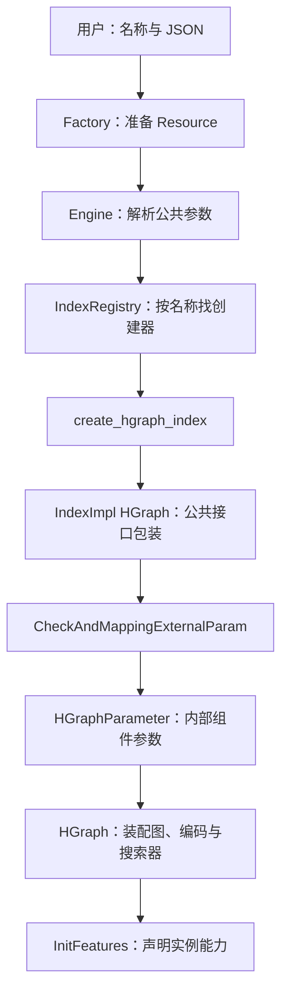

# 06：从公共 API 走进实现——工厂、请求与 Dataset

[架构导航](README.md) · [总览](01_layers_and_modules.md) · [构建与搜索主线](02_build_and_search_flow.md) · [标签与生命周期](10_labels_filters_lifecycle.md)

本文回答“调用一次 `CreateIndex`、`Build`、`KnnSearch`，究竟穿过了哪些对象，各对象拥有哪一份数据”。
基线为 `fd363937`，重点是普通稠密 HGraph 与 BruteForce。
“源码事实”表示直接由下列实现确定；“工程分析”表示对设计动机和代价的解释。
示例用于源码阅读，没有将未执行的示例描述为测试结果。

## 1. 先建立三个不能混淆的对象

| 对象 | 回答的问题 | 不承担的职责 |
| --- | --- | --- |
| `Index` / `IndexImpl<T>` | 用户有哪些操作，操作如何转交给算法 | 不替每一种算法实现构图和评分 |
| `IndexCommonParam` / 算法参数 | 这个索引将使用什么维度、度量、编码与组件 | 不装每一次查询的临时堆 |
| `Dataset` / `SearchRequest` | 这一次传入什么数据、要怎样搜 | 不等同于索引拥有的存储 |

同样都是 `shared_ptr`，其含义也不同。
`DatasetPtr` 共享 Dataset 包装对象；它并不自动把 `std::vector<float>::data()` 变成有共享所有权的缓冲区。
`IndexCommonParam::allocator_` 是资源引用；它不是这次查询结果数组本身。
`IndexImpl::inner_index_` 才持有具体算法实例。

## 2. 一次创建的真实调用链



[查看 PNG 图片](figures/06_api_factory_dataset-01.png)

<details>
<summary>查看可编辑 Mermaid 源码</summary>



</details>

箭头表示调用或构造依赖，不表示这些对象永久一一拥有下一个对象。
特别是 `Factory` 里的 `Engine` 是局部对象，但返回的 `IndexImpl` 持有算法与公共资源引用。

在调试器中跟随这一条栈：

```text
Factory::CreateIndex
  Engine::CreateIndex
    IndexCommonParam::CheckAndCreate
    create_registered_index
      create_hgraph_index
        create_index_impl_with_param_log<HGraph>
          IndexImpl<HGraph>::IndexImpl
            HGraph::CheckAndMappingExternalParam
            HGraph::HGraph
            HGraph::InitFeatures
```

第一轮先看每个函数的输入、输出，不展开 HGraph 构造中的所有 DataCell 模板。
否则还没有理解“谁选择了量化器”，就容易陷入量化器内部实现。

## 3. Factory 与 Engine：便利入口和资源上下文

源码：[src/factory/factory.cpp](../../src/factory/factory.cpp)，基线 `fd363937` 第 325–337 行。以下为连续原文，可能是函数的一部分。

```cpp
Factory::CreateIndex(const std::string& origin_name,
                     const std::string& parameters,
                     Allocator* allocator) {
    std::shared_ptr<Resource> resource{nullptr};
    if (allocator == nullptr) {
        resource = std::make_shared<Resource>(Engine::CreateDefaultAllocator(), nullptr);
    } else {
        resource = std::make_shared<Resource>(allocator, nullptr);
    }
    Engine e(resource.get());
    return e.CreateIndex(origin_name, parameters);
}

```

源码事实：默认分配器和用户传入的裸指针分配器走不同的 `Resource` 构造重载。
随后统一进入 `Engine::CreateIndex`，因此定位 JSON 解析问题应进入 Engine。

资源生命周期继续查 [Resource 构造](../../src/factory/resource.cpp) 第 23–44 行和 [ResourceOwnerWrapper](../../src/factory/resource_owner_wrapper.h) 第 21–45 行：

- 传入 `Resource*` 时，Engine 使用 `owned=false` 包装；由它自己 new 的默认 Resource 使用 `owned=true`。
- `IndexCommonParam::CheckAndCreate` 提取 `shared_ptr<Allocator>` 与 `shared_ptr<SafeThreadPool>`。
- 用户提供的裸 `Allocator*` 被 `SafeAllocator(allocator,false)` 包装。共享包装对象不等于接管用户原始分配器的生命。
- 因此用户自定义分配器本体应活得比使用它的索引、查询结果等对象更久。

工程分析：Factory 适合一次性创建；Engine 让调用方显式组织资源。它们最终复用同一创建协议，避免两套参数解释逻辑。

## 4. 公共参数和算法参数是两次不同的解释

源码：[src/factory/engine.cpp](../../src/factory/engine.cpp)，基线 `fd363937` 第 49–68 行。以下为连续原文，可能是函数的一部分。

```cpp
tl::expected<std::shared_ptr<Index>, Error>
Engine::CreateIndex(const std::string& origin_name, const std::string& parameters) {
    try {
        register_all_index_creators();
        auto parsed_params = JsonType::Parse(parameters);
        auto index_common_params = IndexCommonParam::CheckAndCreate(parsed_params, this->resource_);
        return create_registered_index(origin_name, parsed_params, index_common_params);
    } catch (const std::invalid_argument& e) {
        LOG_ERROR_AND_RETURNS(
            ErrorType::INVALID_ARGUMENT, "failed to create index(invalid argument): ", e.what());
    } catch (const std::bad_alloc& e) {
        LOG_ERROR_AND_RETURNS(
            ErrorType::NO_ENOUGH_MEMORY, "failed to create index(not enough memory): ", e.what());
    } catch (const vsag::VsagException& e) {
        LOG_ERROR_AND_RETURNS(e.error_.type, "failed to create index: " + e.error_.message);
    } catch (const std::exception& e) {
        LOG_ERROR_AND_RETURNS(
            ErrorType::UNSUPPORTED_INDEX, "failed to create index(unknown error): ", e.what());
    }
}
```

依次观察 `parsed_params`、`index_common_params`、最终 `expected`。
这里先做内置注册，再解析 JSON，再校验公共参数，最后查找具体名称。
所以“未知索引名字”和“JSON 不合法”谁先被观察到，受这段执行顺序影响。

公共参数主要是 [IndexCommonParam](../../src/index_common_param.h) 第 30–44 行中的这些成员：

| 外部字段/来源 | 内部成员 | 需要理解的变化 |
| --- | --- | --- |
| `dtype` | `data_type_` | 字符串变成枚举；不是量化类型 |
| `repr` | `repr_` | dense、sparse、multi_vector 描述记录形态 |
| `metric_type` | `metric_` | `l2` 映射为 `METRIC_TYPE_L2SQR` |
| `dim` | `dim_` | 稠密输入必须提供正整数维度 |
| Resource | `allocator_`, `thread_pool_` | 保存供索引组件复用的资源引用 |

源码事实：`repr` 未给出时，sparse dtype 推导为 sparse，其余默认 dense；显式 sparse dtype 与非 sparse repr 的冲突会报错。
可在 [index_common_param.cpp](../../src/index_common_param.cpp) 第 117–160 行逐项核对。

例如阅读一个包含 `dtype=float32, metric_type=l2, dim=128` 的 HGraph 配置时，不应看到“float32”就断言底层永远存原始浮点数。
`dtype` 说明输入数据类型，`index_param.base_quantization_type` 才继续影响基础编码。

## 5. 名称注册：为什么 WARP 不需要独立 WARP 类

注册入口 [index_creators.cpp](../../src/factory/index_creators.cpp) 第 125–138 行使用 `std::call_once` 注册九个名字。
HGraph 创建器取的是 `index_param` 子对象，而不是把顶层公共字段再次解释一遍。
名称通过小写化匹配；注册表并不要求“名字 == C++ 类名”。

源码：[src/factory/index_registry.cpp](../../src/factory/index_registry.cpp)，基线 `fd363937` 第 57–80 行。以下为连续原文，可能是函数的一部分。

```cpp
tl::expected<std::shared_ptr<Index>, Error>
create_registered_index(const std::string& index_name,
                        JsonType& parsed_params,
                        const IndexCommonParam& index_common_params) {
    auto normalized_name = normalize_index_name(index_name);
    IndexCreator creator = nullptr;
    {
        std::lock_guard<std::mutex> lock(index_registry_mutex());
        auto& registry = index_registry();
        auto iterator = registry.find(normalized_name);
        if (iterator == registry.end()) {
            LOG_ERROR_AND_RETURNS(ErrorType::UNSUPPORTED_INDEX,
                                  "failed to create index(unsupported): ",
                                  normalized_name);
        }
        creator = iterator->second;
    }
    if (creator == nullptr) {
        LOG_ERROR_AND_RETURNS(ErrorType::INTERNAL_ERROR,
                              "failed to create index(internal): null creator for ",
                              normalized_name);
    }
    return creator(parsed_params, index_common_params);
}
```

源码事实：创建器指针在锁内读取，真正的 `creator(...)` 在锁作用域之外执行。
工程分析：注册表锁保护的是查找/更新，不应把可能较重的参数装配整个串行化。
这里也展示了一个读代码习惯：看花括号的作用域，不能仅凭函数里出现 `mutex` 就说整个函数都在锁内。

WARP 的创建器在 [index_creators.cpp](../../src/factory/index_creators.cpp) 第 108–114 行注入 `_warp_mode`，然后创建 `IndexImpl<BruteForce>`。
这解释了为什么仅枚举算法目录不能准确得到对外支持的索引名字。

## 6. IndexImpl：模板在创建时选算法，虚接口在调用时屏蔽差异

源码：[src/index/index_impl.h](../../src/index/index_impl.h)，基线 `fd363937` 第 33–53 行。以下为连续原文，可能是函数的一部分。

```cpp
template <class T>
class IndexImpl : public Index {
    static_assert(std::is_base_of<InnerIndexInterface, T>::value);
    static_assert(HasStaticCheckAndMappingExternalParam<T>::value);

public:
    IndexImpl(const JsonType& external_param, const IndexCommonParam& common_param)
        : Index(), common_param_(common_param) {
        auto param_ptr = T::CheckAndMappingExternalParam(external_param, common_param);
        this->inner_index_ = std::make_shared<T>(param_ptr, common_param);
        this->inner_index_->InitFeatures();
    }

    IndexImpl(InnerIndexPtr inner_index, const IndexCommonParam& common_param)
        : inner_index_(std::move(inner_index)), common_param_(common_param) {
        this->inner_index_->InitFeatures();
    }

    ~IndexImpl() override {
        this->inner_index_.reset();
    }
```

源码事实：静态约束检查继承关系与参数映射函数，然后先映射参数、构造 T、初始化功能标志。
公共 `Index` 指针通过虚函数调用进入 `IndexImpl<HGraph>`；包装内部的 T 已在编译期明确。
这并不是每一次查询都按字符串重新去注册表找算法。

工程分析：这一层让异常包装、不可变状态检查、空输入处理等公共行为有复用点。
代价是栈里会出现模板和转发，阅读时最好分别画“接口边界”和“算法内部”两条线。

HGraph 外部参数继续经过 `map_hgraph_param → HGraphParameter::FromJson`。
例如 `max_degree` 映射到图参数，`ef_construction` 映射到构图搜索宽度，两者不可以互换。

源码：[src/algorithm/hgraph/hgraph_param_mapping.cpp](../../src/algorithm/hgraph/hgraph_param_mapping.cpp)，基线 `fd363937` 第 199–220 行。以下为连续原文，可能是函数的一部分。

```cpp
                value);
        } else if (key == HGRAPH_PRECISE_QUANTIZATION_TYPE) {
            inner_json[PRECISE_CODES_KEY][QUANTIZATION_PARAMS_KEY][TYPE_KEY].SetJson(value);
        } else if (key == HGRAPH_GRAPH_IO_TYPE) {
            inner_json[GRAPH_KEY][IO_PARAMS_KEY][TYPE_KEY].SetJson(value);
        } else if (key == HGRAPH_GRAPH_FILE_PATH) {
            inner_json[GRAPH_KEY][IO_PARAMS_KEY][IO_FILE_PATH_KEY].SetJson(value);
        } else if (key == HGRAPH_GRAPH_CACHE_TOTAL_SIZE) {
            inner_json[GRAPH_KEY][IO_PARAMS_KEY][READ_CACHE_TOTAL_CACHE_SIZE_KEY].SetJson(value);
        } else if (key == RAW_VECTOR_IO_TYPE) {
            inner_json[RAW_VECTOR_KEY][IO_PARAMS_KEY][TYPE_KEY].SetJson(value);
        } else if (key == RAW_VECTOR_FILE_PATH) {
            inner_json[RAW_VECTOR_KEY][IO_PARAMS_KEY][IO_FILE_PATH_KEY].SetJson(value);
        } else if (key == HGRAPH_GRAPH_MAX_DEGREE) {
            inner_json[GRAPH_KEY][GRAPH_PARAM_MAX_DEGREE_KEY].SetJson(value);
        } else if (key == HGRAPH_BUILD_EF_CONSTRUCTION) {
            inner_json[EF_CONSTRUCTION_KEY].SetJson(value);
        } else if (key == HGRAPH_BUILD_ALPHA) {
            inner_json[ALPHA_KEY].SetJson(value);
        } else if (key == HGRAPH_INIT_CAPACITY) {
            inner_json[GRAPH_KEY][GRAPH_PARAM_INIT_MAX_CAPACITY_KEY].SetJson(value);
        } else if (key == RESIZE_INCREASE_COUNT_BIT) {
```

读取这段时跟踪三个层次：外部 `key`，内部 `inner_json` 的层级路径，随后参数对象中的具体成员。
`graph_io_type` 改图的 IO，不等同于 `base_io_type` 改向量编码的 IO。
`raw_vector_io_type` 又属于另一个数据副本。

在 [hgraph_param_mapping.cpp](../../src/algorithm/hgraph/hgraph_param_mapping.cpp) 第 356–369 行，`max_degree` 限制为 `[4,max(dim,128)]`；`ef_construction` 下界是 `max_degree`，上界是 `max(1000,100*max_degree)`。
工程分析：这里限制的是组件组合和构图预算的合理范围，不是召回率保证。

## 7. Dataset 是描述符：setter 不拷贝向量

源码：[src/dataset_impl.h](../../src/dataset_impl.h)，基线 `fd363937` 第 149–162 行。以下为连续原文，可能是函数的一部分。

```cpp
    DatasetPtr
    Float32Vectors(const float* vectors) override {
        this->data_[FLOAT32_VECTORS] = vectors;
        return shared_from_this();
    }

    const float*
    GetFloat32Vectors() const override {
        if (auto iter = this->data_.find(FLOAT32_VECTORS); iter != this->data_.end()) {
            return std::get<const float*>(iter->second);
        }

        return nullptr;
    }
```

源码事实：setter 将指针放入 `data_` 字段，getter 再读出来；这段完全没有分配和复制向量。
`Ids` 同理；`NumElements`、`Dim` 则保存标量值。
因此 Dataset 必须与其指针指向的缓冲区一起讨论。

### 借用内存的最小示例

下面是阅读辅助代码，省略 include 和上层错误处理函数，未作为本章运行实验。

```cpp
std::vector<int64_t> labels{101, 205};
std::vector<float> vectors{1.0F, 2.0F, 3.0F, 4.0F};
auto base = vsag::Dataset::Make();
base->Owner(false)
    ->NumElements(2)
    ->Dim(2)
    ->Ids(labels.data())
    ->Float32Vectors(vectors.data());

auto built = index->Build(base);
if (!built.has_value()) {
    // 记录 built.error()，本次操作失败。
} else if (!built.value().empty()) {
    // 这是未成功插入的 IDs；不能直接认为全部数据已建好。
}
```

`labels` 和 `vectors` 在调用期间必须有效，不能在并发操作读取时 resize、释放或修改。
对于异步任务或保留请求上下文的封装，必须把有效期延长到实际使用完成。
不要把某个普通同步 Build 的拷贝行为泛化为所有 API 都不保留输入。

### Owner(true) 不会神奇地复制数据

源码：[src/dataset_impl.h](../../src/dataset_impl.h)，基线 `fd363937` 第 53–65 行。以下为连续原文，可能是函数的一部分。

```cpp
    DatasetImpl(DatasetImpl&& other) noexcept {
        this->owner_ = other.owner_;
        other.owner_ = false;
        this->data_ = other.data_;
        other.data_.clear();
    }

    DatasetPtr
    Owner(bool is_owner, Allocator* allocator) override {
        this->owner_ = is_owner;
        this->allocator_ = allocator;
        return shared_from_this();
    }
```

`Owner` 只是设置释放责任与分配器指针。
本基线 `DatasetImpl` 的 `owner_` 默认值为 **true**，见 [dataset_impl.h](../../src/dataset_impl.h) 文件末尾。
因此把 `std::vector::data()` 或栈数组传入时，应显式 `Owner(false)`。

析构函数 [dataset_impl.cpp](../../src/dataset_impl.cpp) 第 216–330 行的规则值得逐项检查：

- `owner_ == false`：立即返回，不释放这些外部缓冲。
- 数值数组在给定 allocator 时走 `Deallocate`，否则走 `delete[]`。
- SparseVector / MultiVector 含嵌套指针，拥有模式还会释放每个元素中的内部数组。
- 字符串与属性对象有专门销毁逻辑，不能把“所有字段都由 allocator 分配”当成通用规则。

工程分析：零拷贝传参降低额外内存与复制成本，同时把缓冲区生命管理责任显式留给调用者。
如果需要独立副本，应读 `DeepCopy`，而不是只改变 Owner 标志。

源码：[src/dataset_impl.cpp](../../src/dataset_impl.cpp)，基线 `fd363937` 第 332–351 行。以下为连续原文，可能是函数的一部分。

```cpp
DatasetPtr
DatasetImpl::DeepCopy(Allocator* allocator) const {
    auto* allocator_ref = allocator != nullptr ? allocator : this->allocator_;
    auto copy_dataset = std::make_shared<DatasetImpl>();
    copy_dataset->Owner(true, allocator_ref);

    auto num_elements = this->GetNumElements();
    auto dim = this->GetDim();

    copy_dataset->NumElements(num_elements);
    copy_dataset->Dim(dim);
    if (this->GetIds() != nullptr) {
        copy_dataset->Ids(allocate_and_copy(this->GetIds(), num_elements, allocator_ref));
    }
    if (this->GetDistances() != nullptr) {
        copy_dataset->Distances(
            allocate_and_copy(this->GetDistances(), num_elements * dim, allocator_ref));
    }
    if (this->GetInt8Vectors() != nullptr) {
        copy_dataset->Int8Vectors(
```

这里先创建一个拥有数据的新 Dataset，再复制 ID 与向量等字段；完整函数还处理其他数据形态。
对照旧指针和新指针即可区分“共享包装对象”“借用数组”“深拷贝数组”三种关系。

## 8. Build/Add 的 expected 边界

源码：[src/index/index_impl.h](../../src/index/index_impl.h)，基线 `fd363937` 第 81–99 行。以下为连续原文，可能是函数的一部分。

```cpp
public:
    tl::expected<std::vector<int64_t>, Error>
    Add(const DatasetPtr& base) override {
        CHECK_IMMUTABLE_INDEX("add");
        CHECK_NONEMPTY_DATASET(base);
        SAFE_CALL(return this->inner_index_->Add(base));
    }

    std::string
    AnalyzeIndexBySearch(const SearchRequest& request) override {
        return this->inner_index_->AnalyzeIndexBySearch(request);
    }

    tl::expected<std::vector<int64_t>, Error>
    Build(const DatasetPtr& base) override {
        CHECK_IMMUTABLE_INDEX("build");
        CHECK_NONEMPTY_DATASET(base);
        SAFE_CALL(return this->inner_index_->Build(base));
    }
```

源码事实：不可变检查与空数据返回发生在 `SAFE_CALL` 之前；内部算法调用位于宏中。
这说明包装层并不是“所有语句天然都被 try 包围”。
比如这一宏检查会解引用 Dataset，调用方仍需遵循非空等 API 前置条件，不能把 `expected` 误解为任意错误输入都绝不触发异常或非法访问。

Build/Add 返回的两层信息不同：

| 层次 | 要检查什么 | 实际意义 |
| --- | --- | --- |
| `expected` 没有 value | `error().type`, `error().message` | 调用失败，如不支持、参数或内存错误 |
| 有 value，向量非空 | 失败 IDs | 操作返回了部分记录未成功的结果 |
| 有 value，向量为空 | 本次未报告失败 ID | 仍需结合空输入分支理解，不能据此断言实际新增了 N 条 |

## 9. 统一请求不是所有字段都在每个算法里生效

源码：[src/algorithm/hgraph/hgraph_search.cpp](../../src/algorithm/hgraph/hgraph_search.cpp)，基线 `fd363937` 第 50–63 行。以下为连续原文，可能是函数的一部分。

```cpp
HGraph::KnnSearch(const DatasetPtr& query,
                  int64_t k,
                  const std::string& parameters,
                  const FilterPtr& filter,
                  Allocator* allocator) const {
    SearchRequest req;
    req.query_ = query;
    req.topk_ = k;
    req.filter_ = filter;
    req.params_str_ = parameters;
    req.threshold_ = ParseSearchThreshold(parameters);
    req.search_allocator_ = allocator;
    return this->SearchWithRequest(req);
}
```

HGraph 普通 KnnSearch 将 query、k、filter、搜索 JSON、阈值和 allocator 写入 SearchRequest，再进入 SearchWithRequest。
请求只是参数容器；具体消费路径仍要到算法中寻找。

| 请求字段 | 普通 HGraph/BF 阅读重点 |
| --- | --- |
| `query_`, `mode_`, `topk_` | 查询数据与 KNN/Range 分支 |
| `params_str_` | 每次搜索参数，不是创建时参数 |
| `filter_` | 进入 `create_search_filter`，适配 label 与删除状态 |
| `enable_attribute_filter_`, `expression_` | 属性执行器独立分支 |
| `distance_batch_func_` | 自定义评分；收到稳定外部 ID，分数越小越好 |
| `search_allocator_` | 是否真正用于临时/结果分配，要跟具体实现 |
| `bucket_ids_` | 包装层和具体算法对支持范围分别做检查 |

一个容易误读的地方：头文件对 `enable_filter_` 的注释不能代替执行证据。
本基线 HGraph/BF 的普通路径直接读取 `request.filter_`，上述 KnnSearch 适配也没有设置 `enable_filter_`。
同样，不能仅因 SearchRequest 有 `bitset_filter_` 成员，就假定所有 SearchWithRequest 实现都消费它。
阅读接口时，把每个字段的读引用搜出来，才能确定它在哪个入口有效。

## 10. 内部异常如何变成外部错误

源码：[src/common.h](../../src/common.h)，基线 `fd363937` 第 23–42 行。以下为连续原文，可能是函数的一部分。

```cpp
#define SAFE_CALL(stmt)                                                                      \
    try {                                                                                    \
        stmt;                                                                                \
        return {};                                                                           \
    } catch (const vsag::VsagException& e) {                                                 \
        LOG_ERROR_AND_RETURNS(e.error_.type, e.error_.message);                              \
    } catch (const std::bad_alloc& e) {                                                      \
        LOG_ERROR_AND_RETURNS(ErrorType::NO_ENOUGH_MEMORY, "not enough memory: ", e.what()); \
    } catch (const std::exception& e) {                                                      \
        LOG_ERROR_AND_RETURNS(ErrorType::UNKNOWN_ERROR, "unknownError: ", e.what());         \
    } catch (...) {                                                                          \
        LOG_ERROR_AND_RETURNS(ErrorType::UNKNOWN_ERROR, "unknown error");                    \
    }

#define CHECK_ARGUMENT(expr, message)                                        \
    do {                                                                     \
        if (not(expr)) {                                                     \
            throw vsag::VsagException(ErrorType::INVALID_ARGUMENT, message); \
        }                                                                    \
    } while (0);
```

`CHECK_ARGUMENT` 抛出包含 ErrorType 的 `VsagException`；`SAFE_CALL` 保留该错误类型并转成 expected 的错误返回。
普通 `std::exception` 在这里变成 `UNKNOWN_ERROR`。
而 Engine 创建时对普通 `std::exception` 使用 `UNSUPPORTED_INDEX`；这是本基线具体实现，不能给两条边界套同一张表。

工程分析：公共返回类型使调用方可以明确分支处理；内部算法仍能用异常跨多层组件传播错误。
不要只搜索 `return unexpected`；在深层组件里还要搜索 `CHECK_ARGUMENT`、`throw VsagException` 与分配异常。

## 11. 推荐的断点与观察顺序

| 次序 | 断点函数 | 观察变量 | 应能回答的问题 |
| --- | --- | --- | --- |
| 1 | `Engine::CreateIndex` | `origin_name`, `parsed_params` | 工厂实际收到哪个名字和 JSON |
| 2 | `IndexCommonParam::CheckAndCreate` | `result.dim_`, `metric_`, `repr_` | 输入协议被解释成什么 |
| 3 | `create_registered_index` | `normalized_name`, `creator` | 名称如何落到算法 |
| 4 | `HGraph::CheckAndMappingExternalParam` | `inner_json`, `hgraph_parameter` | 参数是否进入正确组件 |
| 5 | `IndexImpl<HGraph>::Build` | `base` 与失败 IDs | 包装层如何处理状态与返回值 |
| 6 | `DatasetImpl::Float32Vectors` | 指针地址与数据 | 是借用还是复制 |
| 7 | `HGraph::SearchWithRequest` | `request`, `params`, `ctx` | 这次请求选择了哪个分支 |

使用优化构建时模板函数可能被内联；可在对应源文件行上设断点。
看指针值时同时记录 `NumElements`、`Dim`，否则“指针非空”仍不能证明缓冲长度正确。

## 12. 用已有测试验证理解，而非从测试名字猜保证

本章列出可读的真实测试入口，未声明本轮执行了这些测试：

| 文件 | TEST_CASE 或 SECTION | 用它确认什么 |
| --- | --- | --- |
| [factory_test.cpp](../../src/factory/factory_test.cpp) | `Factory reports removed indexes as unsupported` | 删除的工厂入口如何报错 |
| [index_impl_test.cpp](../../src/index/index_impl_test.cpp) | `immutable index test` | 不可变状态如何阻止修改 |
| [index_impl_test.cpp](../../src/index/index_impl_test.cpp) | `index empty input test` | 空输入如何提前返回 |
| [dataset_impl_test.cpp](../../src/dataset_impl_test.cpp) | `Dataset Copy and Append Test` / `Deep Copy` | 真正的副本独立性 |
| [dataset_impl_test.cpp](../../src/dataset_impl_test.cpp) | `Dataset MultiVector Basic Test` / `Owner(true) with allocator releases MultiVector without crash` | 多向量嵌套释放路径 |

完成本章后，可以拿一个实际 HGraph 创建配置，标出顶层公共字段、index_param 字段、查询字段三种来源。
再用同一批小数据先看 BruteForce 的写入/评分，随后进入 HGraph 的图路由。
这样之后阅读算法时，就不会把参数解释、对象生命周期与近邻搜索本身混成一件事。
