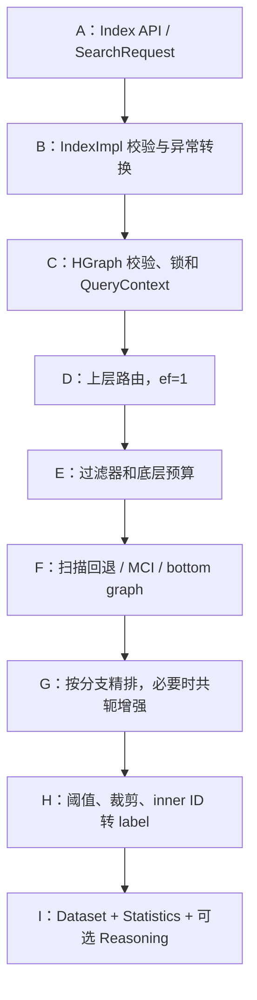

# 07｜把一次查询从 API 跟到返回结果

[返回系统架构](README.md) · [HGraph 遍历手算](../indexes/hgraph/traversal_walkthrough.md) · [HGraph 构建与维护](11_hgraph_build_mutation.md) · [调试实验](12_debugging_lab.md)

源码基线：`fd363937`。本章主线是 **HGraph、普通单次 KNN、内置距离、非融合、单线程**。
先把这条链看完整，再分别打开过滤、精排、自定义距离和 MCI 分支。
Iterator、DistanceProvider 和普通 Flatten 的 `search_impl` 是不同重载，不能把一处循环的细节直接套给另一处。
已有 HGraph 专章解释两堆与 visited；这里补齐“谁准备它们、它们活多久、结果怎么回来”。

## 1. 先画一条请求线，而不是逐个读目录



[查看 PNG 图片](figures/07_query_request_pipeline-01.png)

<details>
<summary>查看可编辑 Mermaid 源码</summary>



</details>

实线表示控制流，不表示调用者拥有下一级对象。
索引的图、编码和标签表跨请求复用；C 中创建的上下文和堆只服务这次查询。
F 的三项是分支，并不是每次依次执行三种搜索。
G 也不是无条件精排，是否已经精排以及当前 route 决定它要不要执行。

| 阅读站点 | 要回答的问题 | 重点符号 |
|---|---|---|
| `include/vsag/index.h`、`search_request.h` | 用户交给库什么？ | `Index::SearchWithRequest`、`SearchRequest` |
| `src/index/index_impl.h` | 为什么用户看到 expected 而不是内部异常？ | `IndexImpl<T>`、`SAFE_CALL` |
| `hgraph_search.cpp:509` | 本次请求的状态在哪里创建？ | `stats`、`ctx`、`params` |
| `hgraph_search.cpp:621` | 搜索参数如何从路由模式变成底层模式？ | `search_param` |
| `hgraph_search.cpp:271` | 谁选择融合、并行、普通 searcher？ | `search_one_graph` |
| `basic_searcher.cpp:552` | 普通单次查询如何消费这些状态？ | Flatten + LabelTable 版本 `search_impl` |
| `hgraph_search.cpp:913` 之后 | 为什么输出是外部 label 且按近到远排列？ | `search_result`、`create_fast_dataset` |

## 2. API 层：先分清两种入口

调用旧的 `KnnSearch(query,k,params,filter)` 时，HGraph 的普通重载在
[`hgraph_search.cpp:50`](../../src/algorithm/hgraph/hgraph_search.cpp#L50)
创建局部 `SearchRequest req`，设置 query、topk、params、filter、threshold，再调用 `SearchWithRequest`。
因此理解新入口，就能理解这个普通旧入口的大部分执行路径。

带 `IteratorContext` 的重载从同文件 66 行开始，自己维护迭代状态；不要沿它推断普通请求生命周期。
Iterator 的 visited、已返回集合及分页恢复语义要另开一条调用链学习。

`SearchRequest` 将“用户意图”保留在字段中：

| 字段 | 本章的普通路径含义 | 容易混淆之处 |
|---|---|---|
| `query_` | 查询 Dataset | HGraph 不是任意批量查询入口 |
| `mode_`、`topk_` | 单次 KNN 及返回预算 | topk 不等于探索预算 ef |
| `params_str_` | HGraph 搜索参数 JSON | 需要进入 `FromJson` 才成为类型化参数 |
| `filter_` | 调用方过滤逻辑 | 内部还会加删除过滤和 ID 包装 |
| `enable_attribute_filter_`、`expression_` | 属性表达式执行请求 | 与普通 Filter 走不同准备流程 |
| `search_allocator_` | 可选查询分配器 | 覆盖部分查询分配，并非重建索引对象 |
| `expected_labels_` | 想诊断为什么没找到的目标 | 不是强制返回名单 |
| `distance_batch_func_` | 自定义 lower-is-better 评分 | 它拿到外部 label，不是 inner ID |

这里有一个需要尊重实现的细节：公开头文件的字段说明偏 API 语义，
但 HGraph 当前直接使用 `request.filter_`，不能只凭 `enable_filter_` 的名字推断它会拦截该字段。
同样，不能把头文件中“after initial similarity search”的描述解读成所有过滤只在最后做。
普通 BasicSearcher 会在结果接纳过程中检查过滤条件。

## 3. IndexImpl 是错误边界，空索引也是一条实际路径

`IndexImpl<T>::SearchWithRequest` 先检查显式 `bucket_ids_` 的结构约束，
然后校验 threshold，再处理空索引，最后调用 `inner_index_`。
`bucket_ids_` 的通用检查不是说 HGraph 自动获得 IVF 指定桶功能。

普通空 HGraph 可能在 **包装层** 就返回，所以断点不一定能进入 `HGraph::SearchWithRequest`。
`ShouldSkipEmptyCheck` 的特殊例外与 IVF `disable_bucket_scan` 有关，不能当作 HGraph 通用开关。

异常转换在 [`src/common.h:23`](../../src/common.h#L23)：
`VsagException` 保留明确错误类型，`std::bad_alloc` 转 `NO_ENOUGH_MEMORY`，其他异常转相应错误结果。
这说明两层调试视角不同：内部检查会 throw，外部 API 用 `tl::expected` 表示失败。
调试时既可以断在 CHECK_ARGUMENT，也可以检查外层 `.error()`；不要只看返回 Dataset。

## 4. 进入 HGraph：先建立请求状态，再进入搜索

源码：[src/algorithm/hgraph/hgraph_search.cpp](../../src/algorithm/hgraph/hgraph_search.cpp#L509)，基线行号 **509–534**；以下为连续原文摘录。

```cpp
HGraph::SearchWithRequest(const SearchRequest& request) const {
    ValidateSearchThreshold(request.threshold_);
    SearchStatistics stats;
    QueryContext ctx{.alloc = this->allocator_, .stats = &stats};
    if (request.search_allocator_ != nullptr) {
        ctx.alloc = request.search_allocator_;
    }

    const auto& query = request.query_;
    bool is_range = (request.mode_ == SearchMode::RANGE_SEARCH);
    auto k = request.topk_;
    const bool use_custom_distance = request.distance_batch_func_ != nullptr;

    if (use_custom_distance) {
        CHECK_ARGUMENT(request.distance_batch_size_ > 0,
                       "distance_batch_size must be greater than 0");
        CHECK_ARGUMENT(not is_range, "HGraph custom distance only supports KNN search");
    }

    if (is_range) {
        if (not use_custom_distance) {
            this->validate_range_args(query, request.radius_, request.limited_size_);
        }
    } else {
        if (not use_custom_distance) {
            this->validate_knn_args(query, k);
```

这段逐句做了四件事：

1. `stats` 在栈上创建，`ctx.stats` 借用它；不会把统计对象写进图节点。
2. `ctx.alloc` 默认是索引 allocator，请求带自己的 allocator 时覆盖这个指针。
3. `is_range` 决定接下来的校验和搜索模式；`use_custom_distance` 决定是否需要真实向量。
4. 自定义距离先要求 batch size 正数并拒绝 Range，随后按分支验证 k/query。

继续读 540–568 行能看到 `HGraphSearchParameters::FromJson`、`ef_search >= 1`，
以及自定义距离拒绝并行搜索、拒绝正的 `brute_force_threshold`。
校验通过不代表已经开始读邻接表；这一阶段仍是在保证后续状态合法。

索引可变时取得相应的 force-remove 读锁以及 global 读锁；immutable 时跳过这组锁。
这里的锁局部变量在函数作用域保留，不是只保护一次 GetNumElements。
获取有效元素数后将 `k` 截到元素数，再取 `raw_query`。
无元素或 `entry_point_id_` 无效时还有内部的空结果出口。

## 5. QueryContext、ComputerPool 与 Reasoning 分别是什么

源码：[src/query_context.h](../../src/query_context.h#L59)，基线行号 **59–87**；以下为连续原文摘录。

```cpp
struct QueryContext {
    Allocator* alloc = nullptr;
    SearchStatistics* stats = nullptr;
    ReasoningContext* reasoning_ctx = nullptr;
    float rabitq_error_rate = std::numeric_limits<float>::quiet_NaN();
    DistanceEvaluationPhase distance_phase = DistanceEvaluationPhase::APPROXIMATE;
    bool track_distance_evaluations = true;
    bool enable_rabitq_reorder = true;
    QueryComputerPool* computer_pool = nullptr;
};

class ScopedDistancePhase {
public:
    ScopedDistancePhase(QueryContext& context, DistanceEvaluationPhase phase)
        : context_(context), previous_phase_(context.distance_phase) {
        context_.distance_phase = phase;
    }

    ~ScopedDistancePhase() {
        context_.distance_phase = previous_phase_;
    }

    ScopedDistancePhase(const ScopedDistancePhase&) = delete;
    ScopedDistancePhase&
    operator=(const ScopedDistancePhase&) = delete;

private:
    QueryContext& context_;
    DistanceEvaluationPhase previous_phase_;
```

`QueryContext` 是参数和观测的通道，不是拥有所有资源的“大对象”。
它的 `stats`、`reasoning_ctx`、`computer_pool` 都是借用指针。
这些被借用对象必须覆盖所有下游调用；普通 HGraph 用当前函数中的局部对象保证这一点。

`distance_phase` 给距离计算贴上 routing / approximate / rerank 分类，
不是告诉 searcher 改变 L2/IP 的数学含义。
`ScopedDistancePhase` 在析构时恢复旧值，所以嵌套调用和异常退出也不会遗留临时 phase。
HGraph 主函数上层前后直接切换 ROUTING→APPROXIMATE；精排实现使用对应的作用域机制。

[`QueryComputerPool`](../../src/impl/query_computer_pool.h#L49)
以 **同一 query 指针和同一 Flatten 对象身份** 复用 Computer。
对常规量化器，Computer 可保存查询预处理状态或查询相关查表，避免每层重复构造。
容量是 3，对应 HGraph 可能需要的 base、precise、raw；它不是无限增长的全局缓存。
自定义距离路径不会把这个池挂到 `ctx`，因为评分由回调完成。

| 对象 | 创建和拥有者 | 谁使用 | 结束时发生什么 |
|---|---|---|---|
| `SearchStatistics stats` | 当前 SearchWithRequest 栈帧 | datacell/searcher/reorder | 先 Dump 到结果，随后局部对象析构 |
| `QueryContext ctx` | 当前栈帧 | 向下传递的调用 | 指针不写入返回 Dataset |
| `QueryComputerPool` | 当前栈帧 | AcquireQueryComputer | 释放 ComputerLease 引用 |
| `ReasoningContext` | 可选局部 shared_ptr | 经 ctx 借用 | 生成报告文本后销毁 |
| visited list | 索引 pool 拥有/复用 | 各层搜索 | guard 归还到 pool |
| result Dataset | 当前函数创建 | 调用方持有 | 按 Dataset 所有权规则释放缓冲区 |

Reasoning 只在 KNN 且 `expected_labels_` 非空时开启。
初始化先把期望外部 label 映射成 inner ID，再计算这些目标的参考距离，
随后由搜索循环记录 visit、eviction、filter reject，精排记录 reorder。
参考距离也会调用评分路径，所以开启诊断会增加计算；不要拿它当零成本观察器。

`DiagnoseExpectedTargets` 的 `not_reachable` 表示“本次没有记录到访问”，
不能证明数学意义上不存在从入口到目标的路径。
`ef_too_small`、`quantization_error` 是按记录做的启发式诊断，不是完整因果证明。
可以看 [`DiagnoseTarget`](../../src/impl/reasoning/search_reasoning.cpp#L159) 的判断优先级验证这一点。
[调试实验](12_debugging_lab.md) 还记录了 expected_labels 增加距离计算、threshold 排除已访问目标却诊断为 unknown 的例子；
遇到这类结果，先用实际参数和事件还原原因，不能只照搬诊断字符串。

## 6. 路由在先，过滤准备和回退判断在后

源码：[src/algorithm/hgraph/hgraph_search.cpp](../../src/algorithm/hgraph/hgraph_search.cpp#L663)，基线行号 **663–691**；以下为连续原文摘录。

```cpp
    } else {
        for (auto i = static_cast<int64_t>(this->route_graphs_.size() - 1); i >= 0; --i) {
            auto result = this->search_one_graph(raw_query,
                                                 this->route_graphs_[i],
                                                 this->basic_flatten_codes_,
                                                 search_param,
                                                 vt,
                                                 &ctx);
            // An unrankable route seed can still bridge to finite bottom-layer results.
            if (not result->Empty()) {
                search_param.ep = result->Top().second;
            }
        }
    }
    ctx.distance_phase = DistanceEvaluationPhase::APPROXIMATE;

    FilterPtr ft = this->create_search_filter(request.filter_, params.use_extra_info_filter);

    if (request.enable_attribute_filter_ and this->attr_filter_index_ != nullptr) {
        ExprPtr expression = request.expression_;
        if (expression == nullptr) {
            auto& schema = this->attr_filter_index_->field_type_map_;
            expression = AstParse(request.attribute_filter_str_, &schema);
        }
        auto executor =
            Executor::MakeInstance(this->allocator_, expression, this->attr_filter_index_);
        executor->Init();
        search_param.executors.emplace_back(executor);
    }
```

普通路由循环从最高 `route_graphs_[i]` 向下调用 `search_one_graph`。
此前 `search_param` 已设 `ep=entry_point_id_、ef=1、topk=1、is_inner_id_allowed=nullptr`。
一层有结果才更新入口；没有可排序结果时保留现有入口，仍可能在底层找到有限距离的点。
上层路由与普通底层过滤是不同阶段，不能为了“过滤不合法点”直接假定上层也应剪断这些节点。

代码顺序非常重要：**先完成上层路由，再 create_search_filter，再准备属性 executor，再选底层路径**。
所以本次 route 最终标为 `brute_force`，不意味着上层路由完全没有执行或计费。

`create_search_filter` 在 [`inner_index_interface.cpp:1109`](../../src/algorithm/inner_index_interface.cpp#L1109)：
取得删除过滤，再把用户 Filter 包装成 inner-ID 语义，必要时按 extra_info 调用。
两者都存在时组合为 AND；只有一种时直接保留，避免丢失枚举有效 ID 等能力。
属性条件则单独解析 AST，构造 Executor，并存进 `search_param.executors`。
普通 BasicSearcher 会 `Clear→Run` 这个 executor，再用 `check_func` 合并 ID 和属性结果。

## 7. 底层预算与真正的分派次序

普通 KNN 先设 `ef=max(params.ef_search,k)`，底层 `topk=ef`、`rerank_topk=k`。
`topk_factor>1` 可以进一步限制 searcher 留下的候选；共轭增强又可能提高最低候选预算。
`hops_limit<=ef_search` 时该限制会被忽略并按条件告警，不能只看传入数字推断实际跳数上限。
超时 Timer 是 KNN 参数分支中准备的；不能给 Range 套用同样的超时行为。

然后按以下顺序分派：

| 分支 | 触发条件/输入 | 本次需要跟进去的实现 |
|---|---|---|
| 扫描回退 | 正阈值且 `valid_ratio<=brute_force_threshold` | `brute_force_search`，接收 `ft`、k/radius/threshold |
| MCI 尝试 | 未扫描且不是自定义距离 | `try_mci_search`，检查实际 `mci_result.route` |
| 图搜索 | MCI 未接管，或自定义距离 | `search_one_graph(bottom_graph_,...)` |
| 融合 searcher | datacell/flatten 身份和模式满足条件 | `rabitq_fused_searcher_->Search` |
| 并行 searcher | 未得到融合结果，且请求并行、`thread_pool_` 与 `parallel_searcher_` 均非空 | `parallel_searcher_->Search` |
| 普通 searcher | 以上路径未产生结果 | `searcher_->Search` |

前 3 行是 HGraph 主函数的选择；后 3 行是 `search_one_graph` 内部的选择，不能混成一层。
请求并行但缺少线程池/parallel_searcher 时会回退普通实现，并增加 `parallel_search_fallback_count`。
这里判断的是能力和对象状态，不是 JSON 写了并行就一定多线程。

属性过滤要按每个分支的参数逐个检查：普通 BasicSearcher 接收 executors，
扫描回退调用展示的是 `ft` 而非整份 `search_param`。
读源码时不能因入口统一，就假定每个分支采用完全一样的属性执行机制。

`search_one_graph` 对传入的 visited 做 `Reset`，防止上一层的 visited 阻止下一层合法访问。
主函数的 `HGraphVisitedListGuard` 在正常搜索后主动 Release，异常退出则析构归还。
因此 visited 的“内存复用”和“访问状态跨层共享”是两回事。

## 8. 自定义距离改变评分来源，但不是脱离图做全排序

源码：[src/impl/searcher/basic_searcher.cpp](../../src/impl/searcher/basic_searcher.cpp#L621)，基线行号 **621–648**；以下为连续原文摘录。

```cpp

    auto score_ids = [&](const InnerIdType* ids, uint64_t count, float* scores) {
        if (not use_custom_distance) {
            flatten->Query(scores, computer, ids, count, ctx);
            return;
        }
        CHECK_ARGUMENT(label_table != nullptr, "custom distance requires a label table");
        CHECK_ARGUMENT(inner_search_param.distance_batch_size > 0,
                       "distance_batch_size must be greater than 0");
        for (uint64_t offset = 0; offset < count;
             offset += inner_search_param.distance_batch_size) {
            const uint64_t batch_count =
                std::min(inner_search_param.distance_batch_size, count - offset);
            for (uint64_t i = 0; i < batch_count; ++i) {
                custom_labels[i] = label_table->GetLabelById(ids[offset + i]);
            }
            inner_search_param.distance_batch_func(
                custom_labels.data(), batch_count, scores + offset);
            if (ctx != nullptr and ctx->stats != nullptr) {
                ctx->stats->AddDistance(
                    ctx->distance_phase, DistanceEvaluationBackend::UNKNOWN, batch_count);
            }
            for (uint64_t i = 0; i < batch_count; ++i) {
                CHECK_ARGUMENT(is_finite_distance(scores[offset + i]),
                               "distance callback must return finite scores");
            }
        }
    };
```

普通路径把一组 inner ID 交给 Flatten::Query。
回调路径先将 inner ID 转为外部 label，再按用户的 batch size 切批，要求每个返回分数有限。
统计 backend 记 UNKNOWN，因为库无法知道用户评分内部执行的是何种数学运算或模型。
回调评分同样参与上层路由和底层候选排序；图边仍是预先构造好的图边。
如果新评分与构图时的邻近关系相差很大，图导航效果可能下降——这是工程推断，并非该 API 的召回保证。

回调可以接收到最终不会返回的被过滤 label，用来维持图导航；“回调调用过”不等于“进入结果”。
当前路径关闭内置重排、RaBitQ one-bit 查询，拒绝 parallel 和扫描阈值。
它从普通 Flatten/LabelTable 重载中的 `score_ids` 分支执行，
不能因为出现了“自定义距离”就跳到独立 `DistanceProviderForGraph` 重载去解释它。

## 9. 候选结束之后，还有结果语义要完成

搜索输出是 `(distance, inner_id)` 的距离堆，而不是用户最后收到的 Dataset。
主函数先归还 visited，再判断融合路径是否已经完成重排。
MCI、扫描回退和已完成融合重排的结果会避开不适用的通用重排分支。
普通重排的 codes 来自 `get_reorder_codes()`，不能把名字直接等同于独立 FP32 副本。

可选共轭增强随后把结果临时转换为 label 队列，再按标签取距离、过滤并增强。
这一分支实际可能引入新候选，与仅对已有候选重新计算距离的 reorder 不同。
最后 Range 按 radius/limited_size 裁剪；KNN 清理 NaN、执行 threshold，再裁到 k。
没有 threshold 的旧 KNN 语义允许 infinity 留在结果中；不要把“有限距离过滤”概括成全场景规则。

源码：[src/algorithm/hgraph/hgraph_search.cpp](../../src/algorithm/hgraph/hgraph_search.cpp#L961)，基线行号 **961–981**；以下为连续原文摘录。

```cpp
    for (int64_t j = count - 1; j >= 0; --j) {
        const auto& top = search_result->Top();
        dists[j] = top.first;
        ids[j] = this->label_table_->GetLabelById(top.second);
        result_inner_ids[j] = top.second;
        if (extra_infos != nullptr) {
            this->extra_infos_->GetExtraInfoById(top.second, extra_infos + extra_info_size_ * j);
        }
        search_result->Pop();
    }
    dataset_results->Statistics(mci_result.MakeStatistics(stats).Dump());

    // Generate reasoning report if reasoning context was created
    if (reasoning_ctx) {
        reasoning_ctx->MarkResult(result_inner_ids);
        reasoning_ctx->DiagnoseExpectedTargets();
        dataset_results->Reasoning(reasoning_ctx->GenerateReport());
    }

    return std::move(dataset_results);
}
```

堆顶是当前最差距离，所以倒着写 `j=count-1...0` 才得到由近到远的数组。
`ids[j]` 经 LabelTable 转换成用户 ID；`result_inner_ids` 留给 Reasoning 使用。
有 extra_info 时同步拷贝与该 inner ID 关联的信息，避免只转换 label 而忘记附属载荷。
统计和诊断都以报告内容附在 Dataset 上；返回的不是指向栈上 ctx 的指针。
`DatasetImpl::GetReasoning()` 实际返回 `const std::string&`，不是 JSON 对象；
HGraph 的 `ReasoningContext::GenerateReport()` 返回 `report.Dump()`，所以有报告时该字符串内容是 JSON。
持有 Dataset 再读取或复制该字符串；没有开启诊断时先检查是否为空，不要直接解析空串。

## 10. 用一张状态表追一次请求

下面是教学跟踪设定，不是性能实验：普通 FP32 KNN，`k=3、ef_search=8`，
假设索引有 100 个有效元素，上层末尾入口 inner ID 为 42，未启用过滤、精排、共轭、MCI。

| 停靠点 | 关键状态 | 这时尚未完成什么 |
|---|---|---|
| 类型化参数完成 | k=3，params.ef_search=8 | 尚未探索图 |
| 路由开始 | ep=全局入口，ef=1，topk=1，phase=routing | 尚未创建底层过滤 |
| 路由结束 | ep=42，phase=approximate | 尚未确定底层返回候选数 |
| 底层准备完成 | ef=8，topk=8，rerank_topk=3 | 尚未得到用户结果 |
| 普通 search_impl 返回 | 至多 8 个候选 inner ID | 仍需最终阈值/裁剪/label 转换 |
| 最终裁剪 | 至多 3 个记录 | 仍需按排序顺序装入数组 |
| Dataset 完成 | 外部 labels、距离、统计 | 请求局部资源可退出 |

对同一个请求只改 `expected_labels_`，观察是否多出诊断参考距离与事件记录。
只改 `parallelism` 时，除了看耗时，还看 `parallel_search_fallback_count`，确认真的走了哪条路。
只改回退阈值时，检查 route 和 routing 统计，验证“回退仍可能先路由”的顺序。
这些是建议实验，本章没有声称已经运行。

## 11. 真实测试与断点路线

| 实际测试名 | 源码入口 | 验证重点 |
|---|---|---|
| `(PR) HGraph SearchWithRequest Reasoning` | [tests/test_hgraph.cpp:1535](../../tests/test_hgraph.cpp#L1535) | 请求诊断接口与报告 |
| `(PR) HGraph Custom Batch Distance` | [tests/test_hgraph.cpp:1810](../../tests/test_hgraph.cpp#L1810) | batch 上限、外部 ID、非法参数 |
| `(PR) HGraph brute_force_threshold` | [tests/test_hgraph.cpp:3743](../../tests/test_hgraph.cpp#L3743) | 过滤比例与回退结果 |
| `QueryComputerPool reuses computers by cell identity` | [src/impl/query_computer_pool_test.cpp:73](../../src/impl/query_computer_pool_test.cpp#L73) | Computer 缓存对象身份 |
| `ScopedDistancePhase restores after exceptions` | [src/query_context_test.cpp:89](../../src/query_context_test.cpp#L89) | phase 的异常恢复 |
| `ReasoningContext diagnosis logic` | [src/impl/reasoning/search_reasoning_test.cpp:154](../../src/impl/reasoning/search_reasoning_test.cpp#L154) | 诊断分类的实际规则 |

第一轮断点只放 5 个：`IndexImpl<T>::SearchWithRequest`、`HGraph::SearchWithRequest`、
`HGraph::search_one_graph`、普通 `BasicSearcher::search_impl`、`create_fast_dataset`。
调试器碰到模板重载时以文件位置为准，普通循环在 `basic_searcher.cpp:552` 开始。
观察 `ctx.distance_phase`、`search_param.ep/ef/topk`、`ft`、`mci_result.route`、
`fused_search_finalized`、`search_result->Size()`，比逐行停在所有算距离函数更容易先看清主线。

第二轮再下钻 `score_ids`、`check_func` 和 reorder，回答一个候选在哪里被排除。
第三轮才比较并行、融合、MCI 等替代实现，检查它们对同一结果语义的实现方式。
读完应能解释：一次请求在哪里转换 ID、在哪里执行过滤、哪里可能回退，以及哪些对象只活一次查询。
