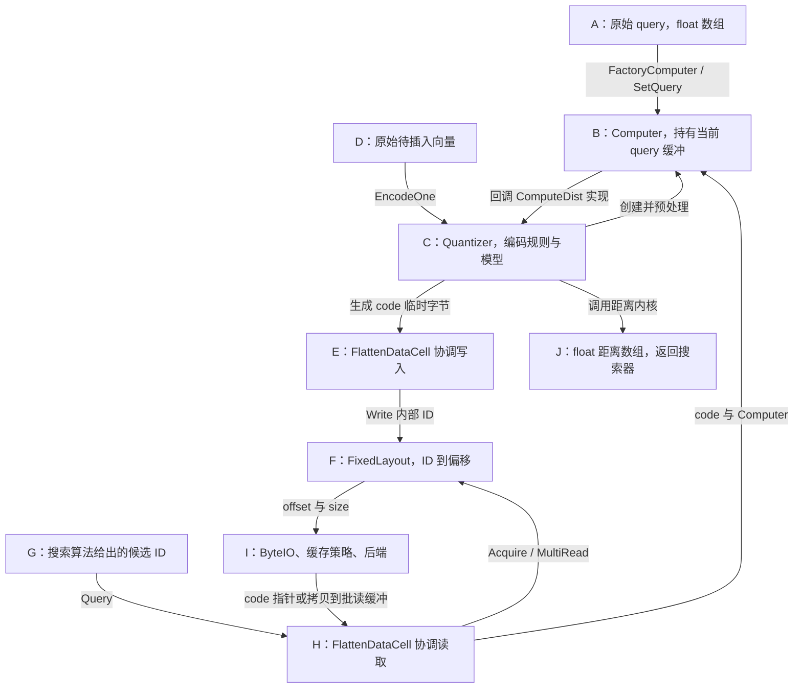

# 沿一条向量追到底：FlattenDataCell 的字节与计算路径

[架构目录](README.md) · [存储抽象概览](03_storage_quantization_io.md) · [量化与 SIMD 深读](09_quantization_simd.md)

本文以源码基线 `fd363937` 为准，主线选 `FP32Quantizer<L2SQR> + FixedLayout<MemoryIO>`。
先看懂普通路径，再追磁盘批读、融合编码等分支。
这里的 ID 是索引内部 ID；用户 label 到内部 ID 的映射发生在更上层。

读完应能回答：向量插入后到底存在哪些字节里，查询为什么需要 Computer，距离函数何时拿到真实地址，临时内存由谁释放。
本文分析源码，没有运行新的单测或性能实验。

## 1. 先画出真实依赖，避免把调用顺序读反



[查看 PNG 图片](figures/08_storage_byte_path-01.png)

<details>
<summary>查看可编辑 Mermaid 源码</summary>



</details>

图里的箭头表示调用或数据传递，字母只是说明编号。
量化器既参与写入，也参与查询；它不是在 IO 后临时创建的对象。
Computer 在候选读取前就已经准备好 query；它不是一条存储记录。
Layout 完全不需要知道浮点数、余弦或图邻居是什么，只接收 ID 并安排字节区间。
IO 负责字节，距离函数负责解释编码；两者由 DataCell 组织起来。

查询的时间顺序应读成：

1. 从已有 Quantizer 创建 Computer，把当前 query 预处理一次。
2. 搜索器选出一批候选 ID，调用 DataCell 的 `Query`。
3. Layout 算偏移，IO 返回字节及其有效期。
4. DataCell 把这些 code 指针交给已准备的 Computer。
5. Computer 回调量化器的具体计算实现，得到与 ID 顺序对应的距离数组。

它不是“ID → Layout → IO → 新建 Quantizer → 新建 Computer”这种单向流水线。
后两个对象的生命周期与每条记录读取并不一致。

## 2. 成员表：哪些状态属于索引，哪些属于一次查询

| 状态 | 定义位置 | 作用与生命周期 |
| --- | --- | --- |
| `quantizer_` | `flatten_datacell.h` 208 | DataCell 持有的共享模型；FP32 无需统计训练参数，SQ8 需要上下界 |
| `layout_` | 同文件 209 | DataCell 持有的记录布局，内部持有 IO |
| `allocator_` | 同文件 211 | 来自 `common_param.allocator_` 的原始指针，用于若干临时缓冲 |
| `common_param_` | 同文件 206 | 保留公共参数，包括 allocator 的共享所有权 |
| `code_size_` | [FlattenInterface](../../src/datacell/flatten_interface.h) | 一条编码的字节数，不能一概用 `dim*sizeof(float)` 代替 |
| `total_count_` | 同一接口 | 当前内部 ID 空间的高水位；不是“查询应扫描全部槽位”的算法指令 |
| `Computer::quantizer_` | [computer.h](../../src/quantization/computer.h) 96 | 指向具体量化器的非 owning 指针，量化器必须活得更久 |
| `Computer::buf_` | 同文件 97 | 当前 query 的预处理缓冲，FP32 为 float 编码 |
| `ByteBuffer codes` | 插入/非内存查询的局部变量 | 临时编码或批读缓冲，离开作用域自动释放 |
| `lease1…lease4` | 内存查询循环 | code 的读取有效期对象；借用地址不等于拥有底层存储 |

不要因为类里有一个 mutex 就推断整个类可以任意并发调用。
`FlattenDataCell` 文件 35–37 行直接标注 `thread unsafe`。
索引外层、布局后端和具体操作仍需提供匹配的同步协议。

## 3. 构造：编码格式先决定一条记录有多大

源码：[src/datacell/flatten_datacell.h](../../src/datacell/flatten_datacell.h)，`fd363937` 第 242–252 行；以下为连续原文。

```cpp
FlattenDataCell<QuantTmpl, LayoutTmpl>::FlattenDataCell(const QuantizerParamPtr& quantization_param,
                                                        const IOParamPtr& io_param,
                                                        const IndexCommonParam& common_param)
    : allocator_(common_param.allocator_.get()) {
    this->common_param_ = common_param;
    this->quantizer_ = std::make_shared<QuantTmpl>(quantization_param, common_param);
    this->code_size_ = quantizer_->GetCodeSize();
    this->layout_ = std::make_shared<LayoutTmpl>(this->code_size_, io_param, common_param);
    this->backend_ =
        QuantizerDistanceBackend<QuantTmpl>::Get(static_cast<const QuantTmpl&>(*quantizer_));
}
```

逐段对照：

- 245 行取得 allocator 指针；246 行同时保存公共参数对象。
- 247 行创建具体 `QuantTmpl`，模板类型已经包含所选量化与 metric。
- 248 行询问量化器 `GetCodeSize()`，这才是 Layout 的记录长度。
- 249 行把长度交给具体布局，布局再构造自己的 IO。
- 250–251 行的 `backend_` 是距离统计分类；它不等价于磁盘 IO backend。

为什么这样组织：代码格式的决定权属于量化器，布局无需为 FP32、SQ8 各写一套地址公式。
若改了编码长度却没同步 Layout，ID 到地址的映射会错位，表现可能是随机的距离错误。
`SetQuantizer` 在同文件 178–184 行也会同步 `code_size_`、Layout 与统计 backend。

普通 FP32 L2：`code_size = 4*dim`。
FP32 cosine 且 `hold_molds=true` 时，记录还带一个 float 范数，长度为 `4*dim+4`。
所以读取连续 FP32 数据时，`TryGetContiguousRawFloatData` 返回 row stride，而非让调用者猜长度。

## 4. Train 与 Encode 是两件事

`FlattenDataCell::Train` 在 256–259 行转交 `quantizer_->Train`。
[Quantizer::Train](../../src/quantization/quantizer.h) 50–54 行检查 `is_trained_`，已训练则直接成功。
`ReTrain` 是另一个入口，会先清除此标志。

FP32 的 `TrainImpl` 在 [fp32_quantizer.cpp](../../src/quantization/fp32_quantizer.cpp) 51–54 行只设置训练状态。
它不聚类，不创建码本，也不把训练输入保存成索引记录。
SQ8 才会从训练样本提取每维范围，见下一章。

`EncodeOne` 的问题是“把一条输入变成当前格式的 code”。
`InsertVector` 的问题是“给这份 code 确定内部 ID 并写入存储”。
只调用 `Train`，不会自动完成所有向量的插入。
只调用 `Decode`，也不会自动恢复用户 label；那是另一张映射表的职责。

## 5. 单条插入：先占 ID，再编码，再写字节

源码：[src/datacell/flatten_datacell.h](../../src/datacell/flatten_datacell.h)，`fd363937` 第 264–277 行；以下为连续原文。

```cpp
FlattenDataCell<QuantTmpl, LayoutTmpl>::InsertVector(const void* vector, InnerIdType idx) {
    {
        std::lock_guard lock(mutex_);
        if (idx == std::numeric_limits<InnerIdType>::max()) {
            idx = total_count_;
            ++total_count_;
        } else {
            total_count_ = std::max(total_count_, idx + 1);
        }
    }
    ByteBuffer codes(static_cast<uint64_t>(code_size_), allocator_);
    quantizer_->EncodeOne(static_cast<const float*>(vector), codes.data);
    layout_->Write(idx, codes.data);
}
```

- 265–273 行只覆盖计数与 ID 分配这一段锁区间。
- 267–269 行：传最大 ID 哨兵表示追加，取旧 `total_count_` 作为 ID，再递增。
- 270–271 行：显式 ID 则把高水位扩到至少 `idx+1`，不是另外构造一份 label 映射。
- 274 行为一条 code 分配临时缓冲。
- 275 行把原始浮点输入编码进去；FP32 L2 路径就是拷贝 float 字节。
- 276 行按内部 ID 写入 Layout，真正的地址计算留给 Layout。

这里能看出一个调试重点：计数更新早于 Encode/Write。
不要把一次 `InsertVector` 自动理解成具有数据库事务级回滚保证。
研究失败处理时还要回到调用者，看异常后是否继续使用、重试或丢弃正在构建的索引。
本文不修改这段逻辑，也不把局部锁的存在解释为完整并发承诺。

## 6. 批量插入：连续 ID 与显式 ID 走不同路径

源码：[src/datacell/flatten_datacell.h](../../src/datacell/flatten_datacell.h)，`fd363937` 第 294–314 行；以下为连续原文。

```cpp
FlattenDataCell<QuantTmpl, LayoutTmpl>::BatchInsertVector(const void* vectors,
                                                          InnerIdType count,
                                                          InnerIdType* idx_vec) {
    if (idx_vec == nullptr) {
        ByteBuffer codes(static_cast<uint64_t>(count) * static_cast<uint64_t>(code_size_),
                         allocator_);
        quantizer_->EncodeBatch(static_cast<const float*>(vectors), codes.data, count);
        uint64_t cur_count;
        {
            std::lock_guard lock(mutex_);
            cur_count = total_count_;
            total_count_ += count;
        }
        layout_->WriteRange(cur_count, codes.data, count);
    } else {
        auto dim = quantizer_->GetDim();
        for (int64_t i = 0; i < count; ++i) {
            this->InsertVector(static_cast<const float*>(vectors) + dim * i, idx_vec[i]);
        }
    }
}
```

无 `idx_vec` 时：先分配 `count*code_size` 字节并 `EncodeBatch`，再一次性取得连续 ID 段，最后 `WriteRange`。
因此同样叫批量插入，布局层能获得一次连续写入的机会。

有 `idx_vec` 时：按 `dim*i` 找原输入的第 i 条，逐条调用 `InsertVector`。
输入步长是原始 float 维数，输出步长则是 code 字节数；这是调试量化格式时必须区分的两个单位。
它支持指定内部位置，但这里不会把任意 ID 列表自动排序成顺序 IO。

FP32 的 `EncodeBatchImpl` 本身仍是逐条调用 EncodeOne，不要仅凭名字推断它使用专门的 SIMD 批量编码内核。
“批量接口”“合并 IO”“多候选计算”“单向量 SIMD”是四种不同的优化层面。

## 7. 查询准备：一个 Computer 复用 query 预处理

源码：[src/quantization/computer.h](../../src/quantization/computer.h)，`fd363937` 第 39–56 行；以下为连续原文。

```cpp
    explicit Computer(const T* quantizer, Allocator* allocator)
        : quantizer_(quantizer), allocator_(allocator), raw_query_(allocator){};

    ~Computer() override {
        if (quantizer_) {
            quantizer_->ReleaseComputer(*this);
        }
    }

    void
    SetQuery(const float* query) {
        quantizer_->ProcessQuery(query, *this);
    }

    inline void
    ComputeDist(const uint8_t* codes, float* dists) {
        quantizer_->ComputeDist(*this, codes, dists);
    }
```

39–40 行保存量化器与 allocator，不复制整个量化模型。
49–50 行的 `SetQuery` 把输入交给量化器预处理。
54–55 行计算候选距离时，将自身 query 状态和候选 code 一起传回量化器。
42–45 行析构时由量化器释放其认识的缓冲格式。

[FlattenDataCell::factory_computer](../../src/datacell/flatten_datacell.h) 222–225 行把“创建 Computer”和“设置 query”组合成一个入口。
[Quantizer::FactoryComputer](../../src/quantization/quantizer.h) 180–181 行用 `std::make_shared` 创建 Computer 对象。
Computer 对象的 shared_ptr 分配和 `buf_` 的 allocator 分配是不同的所有权层次。

源码：[src/quantization/fp32_quantizer.cpp](../../src/quantization/fp32_quantizer.cpp)，`fd363937` 第 145–161 行；以下为连续原文。

```cpp
FP32Quantizer<metric>::ProcessQueryImpl(const float* query,
                                        Computer<FP32Quantizer<metric>>& computer) const {
    try {
        if (computer.buf_ == nullptr) {
            computer.buf_ =
                reinterpret_cast<uint8_t*>(this->allocator_->Allocate(this->query_code_size_));
        }
    } catch (const std::bad_alloc& e) {
        computer.buf_ = nullptr;
        throw VsagException(ErrorType::NO_ENOUGH_MEMORY, "bad alloc when init computer buf");
    }
    if constexpr (metric == MetricType::METRIC_TYPE_COSINE) {
        Normalize(query, reinterpret_cast<float*>(computer.buf_), this->dim_);
    } else {
        memcpy(computer.buf_, query, this->code_size_);
    }
}
```

- 148–150 行仅在 buf 尚未分配时申请 `query_code_size_` 字节，因此重复 SetQuery 可以复用此缓冲。
- 152–155 行把 bad_alloc 包装成 VSAG 内存不足错误。
- 156–157 行：cosine 对 query 做归一化。
- 158–159 行：普通 L2/IP 把 query 拷入缓冲，不在每个候选上重复复制 query。

FP32 的 ReleaseComputerImpl 在同文件 262–264 行调用量化器 allocator 的 `Deallocate`。
本路径没有把 Computer 当成可以随意跨并发请求共享的不可变对象：`SetQuery` 会改写 buf。

## 8. 内存查询：四条记录一起计算，剩余记录走尾部循环

源码：[src/datacell/flatten_datacell.h](../../src/datacell/flatten_datacell.h)，`fd363937` 第 384–408 行；以下为连续原文。

```cpp
        auto lease1 = this->layout_->Acquire(idx[i]);
        auto lease2 = this->layout_->Acquire(idx[i + 1]);
        auto lease3 = this->layout_->Acquire(idx[i + 2]);
        auto lease4 = this->layout_->Acquire(idx[i + 3]);
        if (not lease1 or not lease2 or not lease3 or not lease4) {
            throw VsagException(ErrorType::READ_ERROR,
                                "failed to acquire codes for batch distance evaluation");
        }
        computer->ComputeDistsBatch4(lease1.Data(),
                                     lease2.Data(),
                                     lease3.Data(),
                                     lease4.Data(),
                                     result_dists[i],
                                     result_dists[i + 1],
                                     result_dists[i + 2],
                                     result_dists[i + 3]);
    }
    for (; i < id_count; ++i) {
        auto lease = this->layout_->Acquire(idx[i]);
        if (not lease) {
            throw VsagException(ErrorType::READ_ERROR,
                                "failed to acquire codes for id " + std::to_string(idx[i]));
        }
        computer->ComputeDist(lease.Data(), result_dists + i);
    }
```

这段位于 377 行开始的 `i += 4` 循环内。
每组分别 Acquire 四个内部 ID，并不要求这四个 ID 在存储中连续。
任何一次 Acquire 失败都会抛 READ_ERROR；不会把无效指针继续交给距离内核。

392–399 行把四个 code 地址和四个结果引用交给 `ComputeDistsBatch4`。
这通常给具体量化器与内核复用 query 加载、并行累加多条候选的机会。
它不是一次把结果排序完成：返回数组的槽位仍与 `idx` 顺序对应，TopK 由搜索器负责。

401–408 行处理候选数除以 4 后的剩余部分。
例如 id_count=5，前四条走一次 Batch4，第五条走一次 ComputeDist。
这是“候选条数的 tail”，下一章 SIMD 的 tail 则是“一条向量维度不足寄存器宽度的部分”。

预取发生在前面的 343–345 与 378–381 行，它只是访问提示，不代替 Acquire 的有效读取。
内存路径通常无需额外复制四条 code；Lease 的存在让读取地址与使用期限一起留在同一作用域。

## 9. 非内存批读：把离散记录聚到一段临时字节里

源码：[src/datacell/flatten_datacell.h](../../src/datacell/flatten_datacell.h)，`fd363937` 第 346–367 行；以下为连续原文。

```cpp
    if constexpr (not LayoutTmpl::InMemory) {
        if (id_count > 1) {
            ByteBuffer codes(
                static_cast<uint64_t>(id_count) * static_cast<uint64_t>(this->code_size_),
                search_alloc);
            double io_cost_ms = 0.0F;
            {
                Timer timer(io_cost_ms);
                this->layout_->MultiRead(idx, id_count, codes.data, search_alloc);
            }

            if (ctx != nullptr and ctx->stats != nullptr) {
                ctx->stats->io_cnt.fetch_add(id_count, std::memory_order_relaxed);
                ctx->stats->io_time_ms.fetch_add(static_cast<uint32_t>(io_cost_ms),
                                                 std::memory_order_relaxed);
            }

            computer->ScanBatchDists(id_count, codes.data, result_dists);
            if (ctx != nullptr and ctx->stats != nullptr and ctx->track_distance_evaluations)
                ctx->stats->AddDistance(ctx->distance_phase, backend_, id_count);
            return;
        }
```

`if constexpr` 按布局类型编译选择；不是每一条候选运行时检测是否在 RAM。
当 `id_count>1` 时，分配 `id_count*code_size` 的批读缓冲。
354 行 Layout 按 ID 列表读取，并把结果依请求顺序装入这段缓冲。
363 行的 `ScanBatchDists` 消费连续 code，因此第 i 条位置是 `codes+i*code_size`。

在 FP32 实现中，ScanBatchDistImpl 133–140 行仍逐条调用 ComputeDistImpl。
它的主要结构收益之一是让布局/IO 有机会聚合读请求；不能直接承诺计算一定比内存 Batch4 更快。

357–360 行统计请求数量与耗时；这里的 `io_cnt += id_count` 是这一层记账方式。
它不等价于操作系统实际执行了多少次磁盘请求，也不自动等价于缓存未命中次数。
单条非内存查询不进入该分支，后续仍通过 Acquire 获取它的 code。

`select_query_allocator(ctx, allocator_)` 在 341 行选择该临时缓冲的 allocator。
[query_context.h](../../src/query_context.h) 305–312 行规定：优先 `ctx->alloc`，否则索引 allocator。
这不意味着 FP32 Computer 的 buf 也会自动切换到这个查询 allocator；上面的 ProcessQueryImpl 使用量化器保存的 allocator。

## 10. Layout 与 IO：ID 变地址，地址变有效读取

源码：[src/layout/fixed_layout.h](../../src/layout/fixed_layout.h)，`fd363937` 第 107–125 行；以下为连续原文。

```cpp
    [[nodiscard]] Lease
    Acquire(InnerIdType id) const {
        return io_->Acquire(GetOffset(id), code_size_);
    }

    [[nodiscard]] Lease
    AcquireRange(InnerIdType begin_id, uint64_t count) const {
        return io_->Acquire(GetOffset(begin_id), GetByteSize(count));
    }

    bool
    MultiRead(const InnerIdType* ids, uint64_t count, uint8_t* codes, Allocator* allocator) const {
        Vector<uint64_t> sizes(count, code_size_, allocator);
        Vector<uint64_t> offsets(count, 0, allocator);
        for (uint64_t i = 0; i < count; ++i) {
            offsets[i] = GetOffset(ids[i]);
        }
        return io_->MultiRead(codes, sizes.data(), offsets.data(), count);
    }
```

Acquire 将 `GetOffset(id)` 与 `code_size_` 交给 IO。
MultiRead 则先生成 sizes 与 offsets 数组，每条 size 相同，offset 按输入 ID 单独计算。
因此重复 ID 可以产生重复读取，乱序 ID 不会改变返回数组与请求数组的对应关系。

同文件 194–220 行使用 `id*code_size` 并检查 uint64 乘法/加法溢出。
Layout 检查的是字节寻址安全；业务上 ID 是否有效、是否被删除，不能仅由“这个字节区间存在”判断。

MemoryIO 具体继承关系见 [memory_io.h](../../src/io/memory_io/memory_io.h) 26–34 行：
`ByteIO<ContiguousBackend<HeapRegion>, NoCache>`。
[ByteIO::Acquire](../../src/io/core/byte_io.h) 108–114 行先验证逻辑范围，再委托缓存策略 Acquire。
[NoCache::Acquire](../../src/io/cache/no_cache.h) 69–72 行直接转给 backend。

源码：[src/io/backend/contiguous_backend.h](../../src/io/backend/contiguous_backend.h)，`fd363937` 第 97–121 行；以下为连续原文。

```cpp
    [[nodiscard]] Lease
    Acquire(uint64_t offset, uint64_t size) const {
        if (size == 0) {
            return {};
        }
        return Lease(region_.Data() + offset, size, BorrowedOwner{});
    }

    [[nodiscard]] const uint8_t*
    LegacyRead(uint64_t offset, uint64_t, bool& need_release) const {
        need_release = false;
        return region_.Data() + offset;
    }

    void
    Release(const uint8_t*) const {
    }

    void
    WriteAt(uint64_t offset, const uint8_t* source, uint64_t size) {
        region_.EnsureCapacity(offset + size);
        if (size > 0) {
            std::memcpy(region_.Data() + offset, source, size);
        }
    }
```

97–103 行返回 `region_.Data()+offset` 的 BorrowedLease，没有为每次读取分配一份数据副本。
116–120 行写入时确保物理容量，然后 memcpy 到后端区域。
这个 memcpy 完成后，插入方的临时 ByteBuffer 即可销毁；后端保存的是拷贝后的字节。

借用 Lease 的析构不会释放整个 HeapRegion。
但“借用”也不意味着指针永久有效：底层 resize、迁移或销毁的同步仍由上层生命周期安排保障。
对于拥有缓冲的 Lease，[read_lease.h](../../src/io/core/read_lease.h) 中 `AllocatorOwner`/`AlignedOwner` 会在作用域结束释放对应资源。
不要把 BorrowedOwner 的行为推广到所有文件、缓存和异步后端。

## 11. 手算：一个 ID 从向量到距离

设 FP32 L2，dim=3，`code_size=12`，ID 空间已有 10 条。
调用显式 `InsertVector([1,2,3], 7)`。

| 时刻 | 可观察状态 | 意义 |
| --- | --- | --- |
| 更新高水位 | `total_count=max(10,8)=10` | 显式写 ID 7 不追加第 11 条 |
| 编码完成 | `codes` 包含三个 FP32 数 | L2 模式不做归一化 |
| Layout 寻址 | offset=`7*12=84`，length=12 | 记录字节区间为 `[84,96)` |
| 写入后端 | `region.Data()+84` | 临时 codes 与后端地址不同，数据已拷贝 |
| 设置 query | q=`[1,2,5]`，Computer buf 12 字节 | query 被复制一次 |
| 查询 ID 7 | Acquire 返回该记录的字节 | 数据解释仍为三个 float |
| 距离计算 | `(1-1)^2+(2-2)^2+(5-3)^2=4` | 返回的是平方 L2，没有开根号 |

若候选列表为 `[7,2,9,1,6]`，前四条是一次 Batch4，ID 6 单独计算。
结果数组第 0 项对应 ID 7，即使 ID 2 的距离更小，也不会被这个 DataCell 自动挪到第 0 项。

若把同一个例子改成 SQ8，dim=3 的主要 code 长度为 3 字节，ID 7 的 offset 变成 21。
此时原始 `[1,2,3]` 通常不能直接从内存地址 reinterpret 成 float；必须依据 SQ8 模型解释三个 uint8。

## 12. Decode 不是每次打分前必经的一步

FP32 的 DecodeOneImpl 86–88 行复制 dim 个 float 到调用者给的输出缓冲。
cosine 未 hold_molds 时，存下来的已经是归一化向量，因此 Decode 读回的是该表示，不会凭空还原原长度。

Query 直接把 code 交给 Computer 的 ComputeDist，未要求先生成完整 decoded vector。
SQ8 距离内核可以边读 uint8、边恢复一小组标量、边累计距离，避免为每个候选分配完整解码数组。
“需要数学上的重构值”与“需要物理上创建一份完整 float 向量”是两回事。

## 13. 用断点确认自己读到的是哪条路径

| 建议断点 | 看什么 | 读懂的判断标准 |
| --- | --- | --- |
| `FlattenDataCell::InsertVector` | `idx,total_count_,code_size_` | 能算出 ID 分配与记录长度 |
| `FP32Quantizer::EncodeOneImpl` | metric、hold_molds、codes | 能解释为何是 memcpy 或 Normalize |
| `FixedLayout::Write/Acquire` | ID、GetOffset、code_size | 算出的地址与手算一致 |
| `ContiguousBackend::Acquire` | `region_.Data(),offset,size` | 能区分借用地址与数据副本 |
| `FP32Quantizer::ProcessQueryImpl` | `computer.buf_` 前后地址 | 知道何时分配、何时覆写 |
| `FlattenDataCell::query` | `id_count,idx,LayoutTmpl::InMemory` | 确认 Batch4 还是 MultiRead 分支 |
| `FP32Quantizer::ComputeDistImpl` | query、code、dists | 能算出单候选结果再返回搜索器 |

模板函数断点在 LLDB 中可能匹配多个实例；先定位具体调用栈和 metric，不要把另一个量化实例的数据混在一起解释。
编译优化也可能让局部变量不可见；可先观察公共入口与结果，再选择当前调试符号覆盖的实例。

## 14. 对照已有测试：从契约反看实现

下列名字是源码中已存在的 Catch2 用例；列出它们是阅读导航，不代表本次已执行。

| 真实测试文件与用例名 | 适合验证的阅读问题 |
| --- | --- |
| [flatten_datacell_test.cpp](../../src/datacell/flatten_datacell_test.cpp)：`FlattenDataCell Basic Test` | memory/block_memory、FP32/SQ8 与三种 metric 如何组合 |
| 同文件：`FlattenDataCell only reports a stride for contiguous raw data` | 何时允许直接读取连续 FP32 数据，stride 何时无效 |
| [fixed_layout_test.cpp](../../src/layout/fixed_layout_test.cpp)：`FixedLayout maps ids to fixed records` | ID 与 offset 的映射 |
| 同文件：`FixedLayout supports ranges and id batch reads` | 连续区间和离散 ID 的返回字节顺序 |
| 同文件：`FixedLayout rejects overflowing byte ranges` | 算术边界如何变成错误 |
| [fp32_quantizer_test.cpp](../../src/quantization/fp32_quantizer_test.cpp)：`FP32 DecodeBatch with hold_molds` | 编码 stride 带范数时，解码如何跳过额外字段 |

先读这些测试的输入和断言，再回实现找每一项契约对应的位置。
`FlattenInterfaceTest` 的实际 helper 在 [flatten_interface_test.h](../../src/datacell/flatten_interface_test.h)，不要看到测试名字就停下。

## 15. 主线之外的边界与下一步

HGraph 的融合 RaBitQ 路径可使用 [hgraph_rabitq_fused_datacell.h](../../src/datacell/hgraph_rabitq_fused_datacell.h) 和专用搜索器，不应把本章普通 FP32 的每个调用点机械套上去。
[code_slot_flatten_adapter.cpp](../../src/datacell/code_slot_flatten_adapter.cpp) 还展示了另一种通过适配器暴露 Flatten 接口的形式。
多向量、稀疏 posting、桶存储则需要自己的记录组织，不都符合固定长度 FP32 行数组。

读到这里，下一步不是同时阅读所有 IO 后端。
先把“候选 ID 是怎么产生的”接回 HGraph 或 IVF，再把“code 是怎么打分的”接到下一章。
这样每次深入都带着明确的输入、输出和对象生命周期，能看见一条完整查询如何跨越模块边界。
