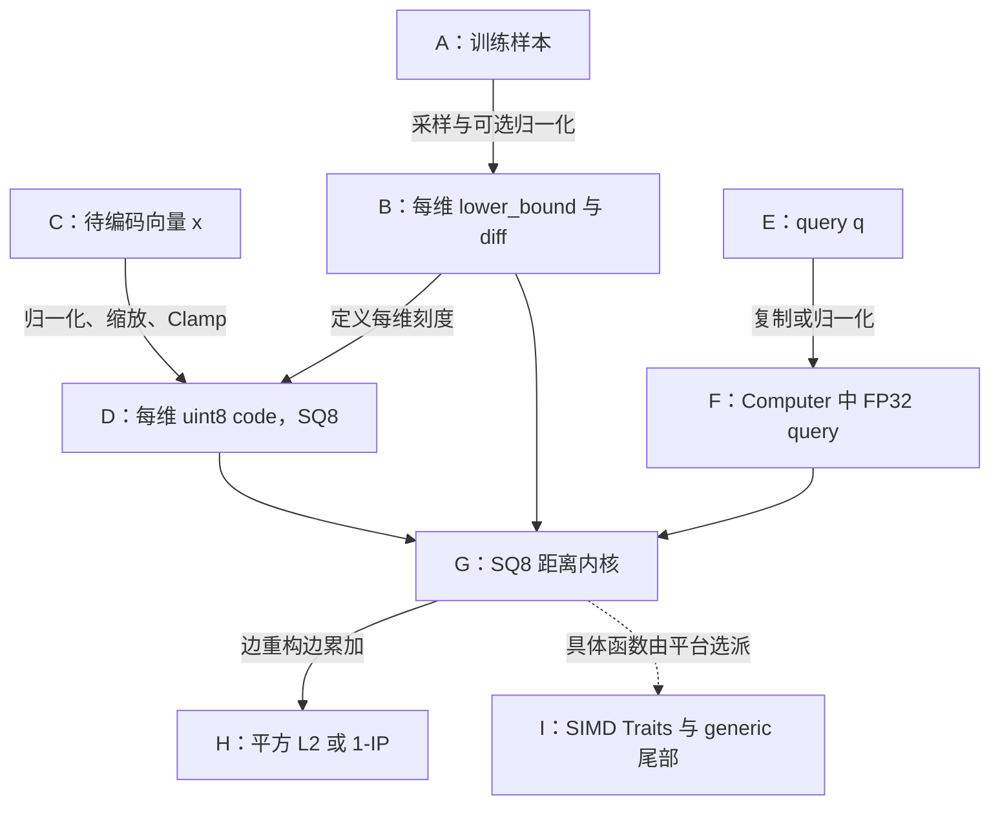

# 从距离定义到机器指令：FP32、SQ8 与 SIMD 深读

[架构目录](README.md) · [字节读取主线](08_storage_byte_path.md) · [存储与量化概览](03_storage_quantization_io.md)

源码基线：`fd363937`。
本章沿“距离约定 → 编码模型 → 查询计算 → SIMD 选派 → 向量化循环”阅读。
先选择 FP32 和普通 SQ8 两个具体实现，不把所有量化器混成同一套公式。

目标是解释一条候选为什么得到这个 float 距离，以及为何同一公式在不同 CPU 上进入不同内核。
源码分析与手算并不等于性能实验；本章列出的测试没有在本子任务中新执行。
本轮主阅读任务的教学程序实际执行了库初始化，相关平台日志观察在第 10 节单独标明。

## 1. 统一“越小越好”，但三种 metric 不是同一回事

| 参数语义 | FP32 距离值 | 优化目标 | 常见误读 |
| --- | --- | --- | --- |
| L2 | `sum((q_i-x_i)^2)` | 距离越小越近 | 结果不是开根号后的欧氏长度 |
| IP | `1-sum(q_i*x_i)` | 点积越大越好 | 不是负点积，也不保证非负 |
| cosine | `1-cos(q,x)` | 夹角越小越好 | 不能忽略构建与查询时的归一化/范数存储 |

以上针对本章追踪的 FP32 量化器。
图搜索器可以按“距离越小越好”管理候选，不必给 IP 另外写一套反向 TopK。
常数 1 不改变 IP 的排序，但会改变输出数值与阈值解释。

源码：[src/quantization/fp32_quantizer.cpp](../../src/quantization/fp32_quantizer.cpp)，`fd363937` 第 165–188 行；以下为连续原文。

```cpp
FP32Quantizer<metric>::ComputeDistImpl(Computer<FP32Quantizer<metric>>& computer,
                                       const uint8_t* codes,
                                       float* dists) const {
    if (metric == MetricType::METRIC_TYPE_IP) {
        *dists = 1.0F - FP32ComputeIP(reinterpret_cast<const float*>(codes),
                                      reinterpret_cast<const float*>(computer.buf_),
                                      this->dim_);
    } else if (metric == MetricType::METRIC_TYPE_COSINE) {
        auto similarity = FP32ComputeIP(reinterpret_cast<const float*>(codes),
                                        reinterpret_cast<const float*>(computer.buf_),
                                        this->dim_);
        if (this->hold_molds_) {
            const auto* mold = reinterpret_cast<const float*>(codes + this->dim_ * sizeof(float));
            similarity /= mold[0];
        }
        *dists = 1.0F - similarity;
    } else if (metric == MetricType::METRIC_TYPE_L2SQR) {
        *dists = FP32ComputeL2Sqr(reinterpret_cast<const float*>(codes),
                                  reinterpret_cast<const float*>(computer.buf_),
                                  this->dim_);
    } else {
        *dists = 0.0F;
    }
}
```

逐段解释：

- 168–171 行：底层 `FP32ComputeIP` 返回点积，量化器在外层做 `1.0F-点积`。
- 172–175 行：cosine 也先算点积；Computer 中 query 已归一化。
- 176–179 行：若数据库向量保存原始分量与范数，需要再除以该向量范数。
- 180 行统一变成越小越好的距离。
- 181–184 行直接调用平方 L2 内核，没有 `sqrt`。

因此当 LLDB 停在 `FP32ComputeIP`，看到的返回值是 similarity。
回到 `ComputeDistImpl` 之后，才是搜索器使用的 distance。
不要把两个层次的局部变量数值放在同一张性能或召回表中比较。

## 2. 手算：同一对向量的三种结果

取非零向量 q=`[3,4]`，x=`[0,5]`。

| 计算步骤 | 数值 |
| --- | --- |
| q·x | `3*0+4*5=20` |
| 平方 L2 | `(3-0)^2+(4-5)^2=10` |
| IP distance | `1-20=-19` |
| q 与 x 的范数 | 都是 5 |
| cosine similarity | `20/(5*5)=0.8` |
| cosine distance | `1-0.8=0.2` |

IP 返回 -19 不是错误；未归一化输入的点积没有上界 1。
如果想用内积检索余弦相似度，必须确保自己的输入变换满足相应条件，不能只更换 API 参数名。

对单位向量，有数学恒等式 `L2平方 = 2*(1-cosine)`。
它说明排序相关，但两种 API 的返回数值和范围阈值依然不同。
浮点归一化与量化后范数误差也会使实际值偏离理想恒等式。

## 3. FP32 也有表示选择，cosine 不必保存原始向量

[FP32Quantizer::EncodeOneImpl](../../src/quantization/fp32_quantizer.cpp) 58–72 行有三条路径。

1. L2/IP：拷贝输入 float，主要 code 为 `dim*4` 字节。
2. cosine 且不保留范数：Normalize 后写入 code，保存单位向量表示。
3. cosine 且 `hold_molds=true`：保存原始 float，并在末尾附加一个 float 范数。

query 在 [ProcessQueryImpl](../../src/quantization/fp32_quantizer.cpp) 145–161 行统一按 cosine 归一化。
所以 hold_molds 的查询计算只需要额外除以数据库一侧范数，不能再重复除一次 query 的原始范数。
`ComputeImpl(code1,code2)` 是编码间距离，hold_molds 时需要同时除两份范数；它与 query-vs-code 的过程不同。

未保留范数时，Decode 读回的是归一化表示，无法仅靠它还原原始向量长度。
FP32 的“32 位”说的是编码精度，不代表每一种 metric 都逐字保留用户输入。

关于零向量也应沿代码确认，不能把理想 cosine 公式直接当输入契约。
[DivScalarImpl](../../src/simd/kernels/scalar_op.h) 37–42 行会把除数 0 换为 1，因此普通 Normalize 的零向量仍是零。
但 hold_molds 路径的后续范数除法是另一段逻辑，不可从 Normalize 的保护推断所有余弦路径都已处理零范数。
本章数值例子使用有限非零向量，以便聚焦正常路径。

## 4. SQ8 的组成：每维一把刻度尺

形象地说，普通 SQ8 给每个维度放一把独立刻度尺。
一条向量不再记录每维任意 FP32 数，而记录这一维落在哪个 0–255 的刻度上。
刻度尺本身是共享模型，不能丢；单独拿到三个 uint8 无法解释它们对应的实际向量。



[查看 PNG 图片](figures/09_quantization_simd-01.png)

<details>
<summary>查看可编辑 Mermaid 源码</summary>



</details>

图中模型是索引级复用对象，Computer 是当前 query 的状态，code 是每条数据库向量的存储。
虚线是实现选派关系，不是把计算结果再发到另一个检索阶段。
本章是普通 `ScalarQuantizer<metric,8>`，不要套用到名字相似的 SQ8Uniform。

| 成员 | 实际定义 | 含义 |
| --- | --- | --- |
| `lower_bound_[d]` | [scalar_quantizer.h](../../src/quantization/scalar_quantization/scalar_quantizer.h) 93 | 第 d 维刻度下端 |
| `diff_[d]` | 同文件 94 | 上下界差值，不是查询残差 |
| `BIT_PER_DIM` | 同文件 | SQ8 为 8；普通 SQ4 为 4 |
| `code_size_` | [scalar_quantizer.cpp](../../src/quantization/scalar_quantization/scalar_quantizer.cpp) 31–32 | bit 数向上对齐到字节后除以 8；SQ8 为 dim 字节 |
| `query_code_size_` | 同文件 33 | `dim*sizeof(float)`，SQ8 查询侧仍保留 FP32 |
| `is_trained_` | Quantizer 基类 | 模型是否已经确定，影响重复 Train |
| `Computer::buf_` | [computer.h](../../src/quantization/computer.h) 97 | 当前 query 的 float 缓冲 |

每维上下界通常是整个量化器的一份模型，不是每条 code 都附带 2*dim 个 float。
真实索引占用仍需加上模型、图边、label、容量余量和可能的精排向量，不能把 `N*dim` 当作索引全部内存。

## 5. 训练：默认不是简单地使用全部数据最小值/最大值

源码：[src/quantization/scalar_quantization/scalar_quantizer.cpp](../../src/quantization/scalar_quantization/scalar_quantizer.cpp)，`fd363937` 第 53–74 行；以下为连续原文。

```cpp
ScalarQuantizer<metric, bit>::TrainImpl(const float* data, uint64_t count) {
    if (data == nullptr) {
        return false;
    }

    if (this->is_trained_) {
        return true;
    }
    bool need_normalize = false;
    if constexpr (metric == MetricType::METRIC_TYPE_COSINE) {
        need_normalize = true;
    }

    ScalarQuantizationTrainer trainer(this->dim_, BIT_PER_DIM);
    trainer.Train(data, count, this->diff_.data(), this->lower_bound_.data(), need_normalize);

    for (uint64_t i = 0; i < this->dim_; ++i) {
        this->diff_[i] -= this->lower_bound_[i];
    }
    this->is_trained_ = true;
    return true;
}
```

53–60 行拒绝空数据指针并避免重复训练。
61–64 行针对 cosine 让 trainer 先归一化训练样本，否则上下界与实际编码分布不一致。
66–67 行把 `diff_` 的地址暂时当作输出上界缓冲。
69–71 行再做 `upper-lower`，此后这个成员才真正表示区间长度。

这个“同一缓冲前后含义变化”很适合在断点里观察。
若在 trainer 返回前后都把 diff 理解为最终步长，就会误判编码公式。
最终每一格的间距是 `diff/255`，diff 本身不是间距。

[scalar_quantization_trainer.h](../../src/quantization/scalar_quantization/scalar_quantization_trainer.h) 35–40 行声明默认模式 `TRUNC_BOUND`。
实现首先采样，最多默认 100000 条；随后按模式计算边界。
[scalar_quantization_trainer.cpp](../../src/quantization/scalar_quantization/scalar_quantization_trainer.cpp) 31–43、89–121、125–145 行值得连续阅读。

普通 SQ8 的截断分支采用 `ignore_rate=0.001`，用两组堆保留接近两端的样本，并从堆顶选上下界。
`ignore_count` 按样本数计算且至少为 1；样本很少时，它可能与真实两端相同。
不要把它描述成“每次严格丢弃固定比例后剩余样本的最小最大值”，要以具体堆大小与样本量推导。

设计动机是让多数常见值获得更细的刻度，减少极端离群值把区间拉得太宽。
代价是落在边界外的值会饱和，离群向量的编码误差可能很大。
数据分布变化后，已有模型不会仅因调用 Add 自动无条件重新学习；Train/ReTrain 与索引构建生命周期必须分开看。

## 6. 编码：缩放、边界处理、截断成整数

源码：[src/quantization/scalar_quantization/scalar_quantizer.cpp](../../src/quantization/scalar_quantization/scalar_quantizer.cpp)，`fd363937` 第 87–110 行；以下为连续原文。

```cpp
ScalarQuantizer<metric, bit>::EncodeOneImpl(const float* data, uint8_t* codes) const {
    float delta = 0;
    uint8_t scaled = 0;
    const float* cur = data;
    Vector<float> tmp(this->allocator_);
    if constexpr (metric == MetricType::METRIC_TYPE_COSINE) {
        tmp.resize(this->dim_);
        Normalize(data, tmp.data(), this->dim_);
        cur = tmp.data();
    }
    memset(codes, 0, this->code_size_);
    for (uint64_t d = 0; d < this->dim_; d++) {
        if (diff_[d] < std::numeric_limits<float>::epsilon()) {
            delta = 1.0F;
        } else {
            delta = 1.0F * (cur[d] - lower_bound_[d]) / diff_[d];
        }
        delta = ClampScalarQuantizationDelta(delta);
        scaled = static_cast<uint8_t>(static_cast<float>(MAX_CODE_PER_DIM - 1) * delta);
        fill_codes(codes, scaled, BIT_PER_DIM, d);
    }

    return true;
}
```

- 90–96 行：cosine 先写临时归一化向量；其他 metric 直接读取输入。
- 97 行清空 code，因为 `fill_codes` 用按位 OR 写入，可支持 SQ4 的同字节打包。
- 99–103 行：一般计算 `(x-lower)/diff`；近乎常量维度的 diff 太小时用 delta=1。
- 104 行：Clamp 负责截断越界值与处理无法正常比较的 delta。
- 105 行：SQ8 中 MAX_CODE_PER_DIM 为 256，结果乘 255 后转换为 uint8。
- 106 行：写到第 d 维对应的 bit 位置；SQ8 每维占一整个字节。

这里用整数转换，不是“四舍五入到最近刻度”。
对正常非负且未上端饱和的 delta，它表现为向下截断。
[ClampScalarQuantizationDelta](../../src/quantization/scalar_quantization/scalar_quantization_utils.h) 19–29 行也不是普通的 `min(max(delta,0),1)`：
当 delta 大于 `0.999F`，直接返回 1；`!(delta>=0)` 时返回 0。
因此最上端附近有特定饱和逻辑，NaN delta 会先被映射为 0，避免未处理就做 uint8 转换。
这只是此处编码规则，不代表整个 API 对任意 NaN 输入有完整检索质量保证。

## 7. 解码与查询：恢复数值可以和距离累加融合

源码：[src/quantization/scalar_quantization/scalar_quantizer.cpp](../../src/quantization/scalar_quantization/scalar_quantizer.cpp)，`fd363937` 第 114–124 行；以下为连续原文。

```cpp
ScalarQuantizer<metric, bit>::DecodeOneImpl(const uint8_t* codes, float* data) {
    for (uint64_t d = 0; d < this->dim_; d++) {
        auto idx = (d * BIT_PER_DIM) / 8;
        auto offset = (d * BIT_PER_DIM) % 8;
        data[d] = static_cast<float>((codes[idx] >> offset) & ((1 << BIT_PER_DIM) - 1)) /
                      (static_cast<float>(MAX_CODE_PER_DIM) - 1.0F) * diff_[d] +
                  lower_bound_[d];
    }

    return true;
}
```

SQ8 公式是 `x_hat = code/255*diff+lower`。
SQ4 共用模板，提取半字节后分母变为 15。
常量维度即使编码为 255，只要 diff 为 0，解码仍是 lower。

查询侧 [ProcessQueryImpl](../../src/quantization/scalar_quantization/scalar_quantizer.cpp) 154–171 行保存 float query，不把 query 也降成 uint8。
这是一个非对称计算：数据库向量被量化，query 保留 float（cosine 时先归一化）。
`ComputeImpl(code1,code2)` 才是两边都量化的另一种计算接口，建图或编码间比较时要辨认清楚。

源码：[src/simd/kernels/sq8_compute.h](../../src/simd/kernels/sq8_compute.h)，`fd363937` 第 113–136 行；以下为连续原文。

```cpp
    V sum = T::zero();
    V inv255 = T::set1(1.0f / 255.0f);

    uint64_t i = 0;
    for (; i + W <= dim; i += W) {
        V code_floats = T::load_u8_as_float(codes + i);
        V query_vals = T::load(query + i);
        V diff_vals = T::load(diff + i);
        V lb_vals = T::load(lower_bound + i);

        V normalized = T::mul(code_floats, inv255);
        V adjusted = T::fmadd(normalized, diff_vals, lb_vals);
        V d = T::sub(query_vals, adjusted);
        sum = T::fmadd(d, d, sum);
    }

    float result = T::reduce_add(sum);

    if constexpr (W > 1) {
        if (i < dim) {
            result += fallback(query + i, codes + i, lower_bound + i, diff + i, dim - i);
        }
    }
    return result;
```

113–114 行准备累加器和 `1/255`。
117–121 行按 SIMD 宽度读取 uint8 code、FP32 query、模型 diff 和 lower。
123–124 行在寄存器里重构这一组 x_hat。
125–126 行马上计算差的平方并累加，不需要先生成完整 dim 维解码数组。
129 行横向求和；131–134 行把剩余维度交给 fallback。

普通 SQ8 的 IP/cosine 查询在量化器外层做 `1-SQ8ComputeIP(...)`。
由于编码重构向量未必还是精确单位长度，量化后的 cosine 近似值不能机械套用理想单位向量的所有数值边界。
搜索和精排的价值之一就是在不同成本的表示之间分工，但精排仍只能处理已有候选。

## 8. 手算：量化误差怎样改变候选排序

构造二维 L2 教学例子，训练样本只有 `[0,-5]` 与 `[10,5]`。
按上述小样本训练逻辑，取 lower=`[0,-5]`、upper=`[10,5]`，所以 diff=`[10,10]`。
每格间距均为 `10/255≈0.039215686`。
以下按理想实数展示公式；实际 FP32 会有末位舍入差异。

query q=`[2,-1]`，两个数据库候选 x=`[2.01,-1.02]`、y=`[2.03,-1]`。

| 项目 | x | y |
| --- | --- | --- |
| 原始平方 L2 | `0.01^2+0.02^2=0.0005` | `0.03^2=0.0009` |
| 第 0 维 delta | `2.01/10=0.201` | `2.03/10=0.203` |
| 第 0 维 code | `uint8(51.255)=51` | `uint8(51.765)=51` |
| 第 1 维 delta | `3.98/10=0.398` | `4/10=0.4` |
| 第 1 维 code | `uint8(101.49)=101` | `uint8(102)=102` |
| 解码近似向量 | `[2,-1.039215686]` | `[2,-1]` |
| SQ8 近似平方 L2 | `≈0.00153787` | `0` |

真实距离中 x 更近；SQ8 距离中 y 更近。
不是 TopK 堆写反了，而是两个候选与 query 的量化误差不同。
如果粗排保留两条、随后用 FP32 精排，能恢复这两条之间的正确顺序。
如果粗排或路由已经丢弃 x，精排不能凭空再发现 x。

对未饱和的一维普通截断，误差通常在一个刻度间距之内；它不是无条件的半格误差。
若输入变成 x0=12，code 会饱和到 255，解码为 10，单维误差达到 2，远大于一格。
因此应该区分模型范围内离散化误差与范围外饱和误差。

用 e=x_hat-x 表示编码误差，L2 近似变化可写成：
`||q-x_hat||²-||q-x||² = -2(q-x)·e+||e||²`。
它可能把距离变大，也可能变小；不能把近似距离一概当作真实距离的上界或下界。

## 9. SIMD 选派先解决“调用哪一个函数”

[fp32_simd.cpp](../../src/simd/fp32_simd.cpp) 22–26 行用宏注册 FP32 的点积、平方 L2 与 Batch4 函数。
外部看到的 `FP32ComputeL2Sqr` 是函数指针变量，由初始化时调用的 helper 选择具体实现。
通常不会在每个维度上重复查询 CPU 能力。

源码：[src/simd/simd_dispatch.h](../../src/simd/simd_dispatch.h)，`fd363937` 第 113–135 行；以下为连续原文。

```cpp
#define VSAG_DEFINE_SIMD_DISPATCH(FnName, FnType)  \
    static FnType Get##FnName() {                  \
        if (SimdStatus::SupportAVX512()) {         \
            VSAG_SIMD_DISPATCH_BODY_AVX512(FnName) \
        }                                          \
        if (SimdStatus::SupportAVX2()) {           \
            VSAG_SIMD_DISPATCH_BODY_AVX2(FnName)   \
        }                                          \
        if (SimdStatus::SupportAVX()) {            \
            VSAG_SIMD_DISPATCH_BODY_AVX(FnName)    \
        }                                          \
        if (SimdStatus::SupportSSE()) {            \
            VSAG_SIMD_DISPATCH_BODY_SSE(FnName)    \
        }                                          \
        if (SimdStatus::SupportSVE()) {            \
            VSAG_SIMD_DISPATCH_BODY_SVE(FnName)    \
        }                                          \
        if (SimdStatus::SupportNEON()) {           \
            VSAG_SIMD_DISPATCH_BODY_NEON(FnName)   \
        }                                          \
        return generic::FnName;                    \
    }                                              \
    FnType FnName = Get##FnName()
```

按顺序尝试 AVX512、AVX2、AVX、SSE、SVE、NEON，最后返回 generic。
顺序表示实现选择优先级，不表示某台机器一定支持左边的 ISA。
每个 `VSAG_SIMD_DISPATCH_BODY_*` 还受相应 `ENABLE_*` 编译宏控制；未编译的符号不会被引用。
所以必须同时看二进制中是否编入、当前运行环境是否支持。

`Support*` 在 [simd_status.h](../../src/simd/simd_status.h) 中结合宏与 cpuinfo 的平台检测。
其中 NEON 的实际判断如下：

源码：[src/simd/simd_status.h](../../src/simd/simd_status.h)，`fd363937` 第 137–145 行；以下为连续原文。

```cpp
    static inline bool
    SupportNEON() {
        bool ret = false;
#if defined(ENABLE_NEON)
        ret = true;
#endif
        ret &= cpuinfo_has_arm_neon();
        return ret;
    }
```

如果编入支持但当前 CPU 不支持，不能选用该指令集。
若 CPU 支持但二进制未编入，同样无法由这份二进制选用该实现。
`generic` 是整个级联的兜底，另有某些专用操作使用不同宏或窄范围选派，不能把此标准宏强加给全部内核。

## 10. 本地 ARM：看构建证据，再看运行观察

本轮读取根目录 `compile_commands.json` 指向的构建数据库，得到以下实际条目特征：

| 翻译单元 | 本地编译参数观察 |
| --- | --- |
| `src/simd/neon.cpp` | `-DENABLE_NEON=1`、`-DENABLE_SVE=1`、目标 `arm64`、`-march=armv8-a` |
| `src/simd/fp32_simd.cpp` | `-DENABLE_NEON=1`、`-DENABLE_SVE=1`、目标 `arm64` |

这些是当前构建产物信息，不是所有 macOS 或所有 VSAG 构建的固定配置。
[CMake 的 SIMD 配置](../../src/simd/CMakeLists.txt) 92–96 行设置 NEON/SVE 源文件编译标志，117–124 行按 DIST_CONTAINS_* 加宏。
[CheckSIMDCompilerFlag.cmake](../../cmake/CheckSIMDCompilerFlag.cmake) 则负责相关编译能力探测与分发配置。

本轮主阅读任务实际运行[教学程序与调试实验](12_debugging_lab.md)，初始化日志观察到以下状态；精简记录见 [observed_results.json](labs/observed_results.json)：

- NEON：`dist_support:Y + platform:Y = using:Y`。
- SVE：`dist_support:Y + platform:N = using:N`。
- AVX 家族：未启用。

这正好说明“编译命令里有 ENABLE_SVE”不能单独证明实际使用 SVE。
初始化日志说明该能力检查结果，也不保证每个专门内核都进入 NEON：特定函数可能有自己的选派，短向量可能走 generic。
不要在这台 ARM 机器上把 AVX512 寄存器示例当成正在执行的路径。

另一个与调试有关的源码事实：SIMD 静态库在 [src/simd/CMakeLists.txt](../../src/simd/CMakeLists.txt) 99–106 行额外指定 `-O3` 等优化。
所以整个项目称为 Debug，不代表每个距离循环都以完全未优化形式执行；某些局部变量不可见或调用被内联是可能的。

## 11. NEON 包装层：同一算法模板配不同 Traits

源码：[src/simd/neon.cpp](../../src/simd/neon.cpp)，`fd363937` 第 122–139 行；以下为连续原文。

```cpp
FP32ComputeIP(const float* query, const float* codes, uint64_t dim) {
#if defined(ENABLE_NEON)
    return simd::ComputeIPImpl<simd::SimdTraits<simd::NeonTag>>(
        query, codes, dim, &generic::FP32ComputeIP);
#else
    return generic::FP32ComputeIP(query, codes, dim);
#endif
}

float
FP32ComputeL2Sqr(const float* query, const float* codes, uint64_t dim) {
#if defined(ENABLE_NEON)
    return simd::ComputeL2SqrImpl<simd::SimdTraits<simd::NeonTag>>(
        query, codes, dim, &generic::FP32ComputeL2Sqr);
#else
    return vsag::generic::FP32ComputeL2Sqr(query, codes, dim);
#endif
}
```

NEON 入口把 `SimdTraits<NeonTag>` 交给统一的 ComputeIP/ComputeL2Sqr 模板。
同时传入 generic 函数，用于维度不足或尾部处理。
没有 ENABLE_NEON 时，包装函数本身也有 generic fallback。

[simd_traits_neon.h](../../src/simd/traits/simd_traits_neon.h) 29–76 行定义：

| 模板抽象 | NEON 实现 | 含义 |
| --- | --- | --- |
| `FloatVec` | `float32x4_t` | 一个向量寄存器放 4 个 float |
| `Width` | 4 | 一次主体迭代的维度宽度 |
| `load` | `vld1q_f32` | 读取连续 4 个浮点数 |
| `sub` | `vsubq_f32` | 并行减法 |
| `fmadd` | `vfmaq_f32` | 乘加累计 |
| `reduce_add` | `vaddvq_f32` | 4 个 lane 横向求和 |

这样距离公式写在共享 kernel 中，平台文件只选择 Traits 和 fallback。
它减少多架构复制公式的机会，但阅读时需要再跳一层，才能看到最终机器内建函数。

## 12. SIMD 主循环与 tail：不要求维度是 4 的倍数

源码：[src/simd/kernels/compute_l2.h](../../src/simd/kernels/compute_l2.h)，`fd363937` 第 48–75 行；以下为连续原文。

```cpp
    uint64_t i = 0;
    for (; i + Stride <= dim; i += Stride) {
        for (int u = 0; u < Unroll; ++u) {
            V diff = T::sub(T::load(query + i + u * W), T::load(codes + i + u * W));
            acc[u] = T::fmadd(diff, diff, acc[u]);
        }
    }

    V sum = acc[0];
    for (int u = 1; u < Unroll; ++u) {
        sum = T::add(sum, acc[u]);
    }

    if constexpr (Unroll > 1) {
        for (; i + W <= dim; i += W) {
            V diff = T::sub(T::load(query + i), T::load(codes + i));
            sum = T::fmadd(diff, diff, sum);
        }
    }

    float result = T::reduce_add(sum);

    if constexpr (W > 1) {
        if (dim > i) {
            result += fallback(query + i, codes + i, dim - i);
        }
    }
    return result;
```

在当前 NEON 包装中，模板默认 `Unroll=1`，W=4，所以 Stride=4。
49–54 行每次读取一组完整宽度，做差、平方并累加到每个 lane。
56–59 行把多个展开累加器合并；默认只有一个。
61–66 行是 Unroll>1 时处理不足完整展开跨度、但仍有一整向量宽度的部分。
68 行做横向求和。
70–73 行把不足一组的剩余维度交给 generic。

更前面的 37–40 行还处理 `dim<W`：直接调用 fallback，不先读一个完整寄存器越过向量边界。
[generic.cpp](../../src/simd/generic.cpp) 105–106 行也复用同一个 kernel，只是 Traits 的宽度为 1。
因此 generic 表示没有该处显式宽 SIMD Traits；编译器仍可能基于优化规则变换生成的机器代码。

手算 dim=6，q=`[1,2,3,4,5,6]`，x 全为 0。

| 阶段 | 索引范围 | 值 |
| --- | --- | --- |
| NEON 主体一次 | 0–3 | 四个 lane 累计 `[1,4,9,16]` |
| 横向求和 | 0–3 | 30 |
| generic tail | 4–5 | `25+36=61` |
| 合并结果 | 0–5 | `30+61=91` |

若 dim=3，则整条向量走 generic fallback。
若候选有 5 条、每条 dim=6，DataCell 的四候选 Batch4/单候选尾部与内核的四维/two-dimension tail 会同时存在。
这两个“4”恰好数值相同，却属于完全不同的循环维度。

## 13. 性能阅读：先定位成本在哪里

同一条距离链可能花时间在读取、量化重构、浮点计算、query 预处理和堆维护上。
SIMD 只能减少其中某些计算成本，无法保证在随机 IO 成为瓶颈时获得相同加速。
SQ8 减少每条记录字节数，但需要读取上下界模型并重构浮点值；收益取决于维度、缓存与访问模式。

SIMD 的乘加、横向归约顺序与 scalar 的逐项相加可能不同。
浮点加法不满足严格结合律，FMA 的舍入也有差异，所以正确性测试通常比较容差，而不是逐 bit 相等。
量化误差、浮点舍入差异、近似搜索漏掉候选，是三类不同原因，排查时应该分别验证。

建议先用 FP32 BruteForce 固定真实候选集合，再比较 SQ8 的同候选距离，最后研究 HGraph/IVF 如何选候选。
只有先固定其中两层，才容易理解第三层的影响。
这是一条后续实验路线，本章没有替用户执行大型基准或根据未测数据声称加速比例。

## 14. 断点与观察变量

| 断点位置 | 重点变量 | 需要回答的问题 |
| --- | --- | --- |
| `ScalarQuantizer::TrainImpl` | `is_trained_,lower_bound_,diff_` | 模型来自何处，trainer 前后 diff 含义是否变化 |
| `ScalarQuantizer::EncodeOneImpl` | `cur[d],delta,scaled` | 是否归一化、越界或发生整数截断 |
| `ScalarQuantizer::DecodeOneImpl` | `codes[d],diff[d],lower[d]` | 能否手算重构值 |
| `ScalarQuantizer::ComputeDistImpl` | `computer.buf_,codes,dists` | 当前是 query-vs-code 还是 code-vs-code |
| `FP32Quantizer::ComputeDistImpl` | metric 与最终 dists | 是否已从 similarity 转成 distance |
| `neon::FP32ComputeL2Sqr` | dim、调用栈 | 标准选派是否到达该包装函数 |
| `ComputeL2SqrImpl` | W、Stride、i、result | 主体与 tail 各处理了多少维 |

运行时可观察函数指针 `vsag::FP32ComputeL2Sqr` 的目标地址，并和符号地址对应。
这比仅观察 ENABLE_NEON 宏更接近“当前标准入口实际会调用谁”。
但模板、内联与 O3 优化可能影响断点命中和局部变量显示，要结合调用栈与反汇编判断。

## 15. 已有测试的阅读入口

下列用例名来自真实源码；本子任务没有重新运行这些用例。

| 文件与测试名 | 对应本章逻辑 |
| --- | --- |
| [fp32_quantizer_test.cpp](../../src/quantization/fp32_quantizer_test.cpp)：`FP32 Compute` | 三种 metric 的量化器计算 |
| 同文件：`FP32 DecodeBatch with hold_molds` | code 比原 float 行多一段范数字段时的解码 |
| [scalar_quantizer_test.cpp](../../src/quantization/scalar_quantization/scalar_quantizer_test.cpp)：`SQ8 Encode and Decode` | 编码、解码与误差容限 |
| 同文件：`SQ8 Compute` | 查询计算与编码间距离的误差 |
| 同文件：`SQ8 Encode handles NaN delta before uint8 cast` | Clamp 在整数转换之前的顺序 |
| [fp32_simd_test.cpp](../../src/simd/fp32_simd_test.cpp)：`FP32 SIMD Compute` | 各实现与 generic 的一致性比较 |
| [sq8_simd_test.cpp](../../src/simd/sq8_simd_test.cpp)：`SQ8 SIMD Compute` | query-vs-code 内核 |
| 同文件：`SQ8 SIMD Compute Codes` | code-vs-code 内核 |
| [normalize_test.cpp](../../src/simd/normalize_test.cpp)：`Normalize Compute` | query 与数据库侧归一化所依赖的公共计算 |

FP32 SIMD Compute 在当前源码列出的维度是 8、16、32、256。
不能仅凭这个测试名声称它覆盖了上面的 dim=6 教学 tail；tail 示例是依据循环条件手算的。
若要后续增加或选择边界实验，应明确覆盖 dim<W、dim%W!=0、批量候选余数等不同边界。

## 16. 继续深入时只替换链中的一个环节

想读 PQ：保留 DataCell→Computer 的外部骨架，把模型与 ComputeDist 换成 PQ 的码本/查表实现。
想读 RaBitQ：先明确基础码、辅助量、变换和重排之间的关系，再阅读专门 kernel 与融合存储。
想优化当前 ARM：先确认热点来自距离函数，再观察被选中的具体 kernel 和实际维度分布。

这些任务共同的入口是本章这条链：
**模型决定 code 含义，Computer 决定 query 状态，距离约定决定排序方向，dispatch 决定函数，Traits 决定指令实现。**
把这五层分别解释清楚，才不会把检索误差、量化误差和 CPU 优化混为一谈。
