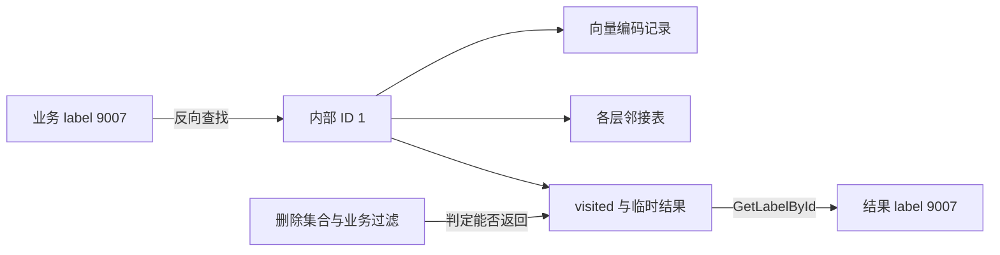

# 10：标签、过滤与索引生命周期——为什么这些逻辑决定搜索正确性

[架构导航](README.md) · [接口与 Dataset](06_api_factory_dataset.md) · [生命周期概览](04_filter_lifecycle_concurrency.md) · [HGraph 路由](../indexes/hgraph/traversal_walkthrough.md)

基线为 `fd363937`。
本章以普通稠密 HGraph、普通单向量 BruteForce 为主线；WARP、融合 RaBitQ、重复压缩与其他索引只在明确标注时讨论。
“源码事实”是可逐行核对的行为；“工程分析”是设计解释。
手算状态表和建议实验均不是已运行结果。

## 1. 先分清四个编号或状态

| 名称 | 例子 | 含义 |
| --- | --- | --- |
| 外部 label | 101、9007、205 | 业务提供的稳定 ID |
| 内部 ID | 0、1、2 | 图、visited、编码访问使用的编号 |
| 删除集合 | `{1}` | 内部 ID 1 暂时不能返回，不代表它的邻接或编码已消失 |
| 物理编码槽 | 一条记录的存储位置 | 普通路径常与内部 ID 对应，dedup 等模式可另有映射 |

请不要把外部业务 ID 直接当成 visited 下标。
也不要将内部 ID 的稳定性视为公开承诺：强制删除会移动末尾记录。



[查看 PNG 图片](figures/10_labels_filters_lifecycle-01.png)

<details>
<summary>查看可编辑 Mermaid 源码</summary>



</details>

这是一张角色关系图，不是完整的内存布局。
`LabelTable` 维护身份转换，Searcher 维护候选，DataCell 维护数据，它们必须在新增、删除、搬移中保持一致。

## 2. 从 Build 到返回业务 ID 的真实主线

```text
IndexImpl<BruteForce>::Build/Add
  BruteForce::Add
    claim_slot(label)
      LabelTable::CheckLabel
      分配 next inner_id、扩容、LabelTable::Insert
    写入编码

BruteForce::SearchWithRequest
  create_search_filter
    删除集合过滤 + InnerIdWrapperFilter(业务过滤)
  扫描内部 ID、评分、进入结果堆
  pack_search_result / pack_knn_result
    GetLabelById(inner_id) → 业务 ID
```

HGraph 复用 label 身份层，但中间的数据组织要加上多层构图和图遍历。
因此 BF 能通过搬移编码压紧槽位，HGraph 同样搬移时还要修复图中的引用。

## 3. LabelTable 维护的不是单独一张 map

| 成员/方法 | 作用 | 阅读时的状态约束 |
| --- | --- | --- |
| `label_table_` | 内部 ID → label | 返回结果与遍历评分适配依赖它 |
| `label_remap_` | label → 内部 ID | 可配置实现；可在 immutable 时关闭 |
| `deleted_ids_` | 被标记删除的内部 ID | 与 label 是否仍存在是两件事 |
| `delete_ids_mutex_` | 删除集合锁 | 不是所有 LabelTable 操作的总锁 |
| `total_count_` | 表的记录计数 | 不自动等于索引对外存活数 |
| `source_id_table_` | 额外来源信息 | 不等同于 label，用途和持久化开关另查 |
| `TryGetIdByLabel` | 可失败的反向查询 | `return_even_removed` 改变删除后的可见性 |

源码：[label_table.h](../../src/impl/label_table/label_table.h)、[label_table.cpp](../../src/impl/label_table/label_table.cpp)。

## 4. 插入与查重：先看真实锁范围

源码：[src/algorithm/bruteforce/bruteforce.cpp](../../src/algorithm/bruteforce/bruteforce.cpp)，基线 `fd363937` 第 133–151 行。以下为连续原文，可能是函数的一部分。

```cpp
std::optional<InnerIdType>
BruteForce::claim_slot(int64_t label, const AttributeSet* attr) {
    InnerIdType inner_id;
    {
        std::scoped_lock add_lock(this->label_lookup_mutex_, this->add_mutex_);
        if (this->label_table_->CheckLabel(label)) {
            return std::nullopt;
        }
        inner_id = this->total_count_.load();
        ++this->total_count_;
        this->resize(total_count_.load());
        this->label_table_->Insert(inner_id, label);
    }
    std::shared_lock global_lock(this->global_mutex_);
    if (use_attribute_filter_ && attr != nullptr) {
        this->attr_filter_index_->Insert(*attr, inner_id);
    }
    return inner_id;
}
```

这里在同一个锁作用域中检查 label 是否有效存在、领取内部 ID、增加计数、扩容和登记映射。
已存在返回 `nullopt`，上层会把失败记录反馈给调用者。
退出该作用域之后才获取全局读锁，处理属性插入。

工程分析：这些步骤需要作为相关状态一起维护，否则两个并发 Add 可能给同一业务 label 分到两个位置。
但仅凭这段不能推断整个 Build 是事务，也不能保证任意中途异常都会回滚所有组件；应继续读上层写入和异常处理。

`LabelTable::Insert` 在 [label_table.h](../../src/impl/label_table/label_table.h) 第 51–61 行做三件事：更新可选反向映射、写入正向数组、递增表计数。
它自己并未在这一段包住全局 label 锁，调用者的锁纪律很重要。

## 5. 标记删除：身份还在，可见性变化

源码：[src/impl/label_table/label_table.cpp](../../src/impl/label_table/label_table.cpp)，基线 `fd363937` 第 126–149 行。以下为连续原文，可能是函数的一部分。

```cpp
uint32_t
LabelTable::MarkRemove(const std::vector<LabelType>& labels) {
    std::vector<InnerIdType> ids;
    ids.reserve(labels.size());
    for (const auto& label : labels) {
        InnerIdType id;
        if (this->use_reverse_map_) {
            id = this->get_id_by_label_with_reverse_map(label);
        } else {
            id = this->get_id_by_label_with_label_table(label);
        }
        if (id != INVALID_ID) {
            ids.push_back(id);
        }
    }
    uint32_t removed_count = 0;
    std::scoped_lock wlock(delete_ids_mutex_);
    for (const auto& id : ids) {
        if (this->deleted_ids_.insert(id).second) {
            ++removed_count;
        }
    }
    return removed_count;
}
```

源码事实：先把给定 label 查成内部 ID，再在删除集合锁内执行集合插入。
返回的是“本次新插入删除集合的个数”；重复删除同一个 ID 不应重复累计。
没有找到的 label 不进入 `ids`。
这里没有搬移编码，也没有改邻接表。

`TryGetIdByLabel(label,false)` 会把已删除 ID 当成失败；传 true 时允许维护操作找到它。
强制删除会使用 true，所以“先标记，再物理清理”仍能定位那条记录。

### 一个手算状态例子

| 操作 | 正向表 | 删除集合 | total_count | delete_count | 对外存活数 |
| --- | --- | --- | --- | --- | --- |
| 插入三个点 | `[101,9007,205]` | `{}` | 3 | 0 | 3 |
| MARK_REMOVE 9007 | 仍是 `[101,9007,205]` | `{1}` | 3 | 1 | 2 |
| 再 MARK_REMOVE 9007 | 仍不变 | `{1}` | 3 | 1 | 2 |

普通 HGraph 的 `GetNumElements()` 是 `total_count - delete_count`；BF 使用同样思想并加上非负保护，见 [hgraph.h](../../src/algorithm/hgraph/hgraph.h) 第 149–156 行和 [bruteforce.h](../../src/algorithm/bruteforce/bruteforce.h) 第 84–93 行。
因此遍历扫描范围、存活数量、分配容量不能混为一个数字。

## 6. 用户过滤和删除过滤怎样接起来

源码：[src/algorithm/inner_index_interface.cpp](../../src/algorithm/inner_index_interface.cpp)，基线 `fd363937` 第 1108–1138 行。以下为连续原文，可能是函数的一部分。

```cpp
FilterPtr
InnerIndexInterface::create_search_filter(const FilterPtr& user_filter,
                                          bool use_extra_info_filter) const {
    auto deleted_filter = this->label_table_->GetDeletedIdsFilter();
    FilterPtr wrapped_user_filter = nullptr;
    if (user_filter != nullptr) {
        if (use_extra_info_filter && this->extra_infos_ != nullptr) {
            wrapped_user_filter =
                std::make_shared<ExtraInfoWrapperFilter>(user_filter, this->extra_infos_);
        } else {
            wrapped_user_filter =
                std::make_shared<InnerIdWrapperFilter>(user_filter, *this->label_table_);
        }
    }

    // Avoid CombinedFilter when only one filter is present to preserve
    // GetValidIds() / FilterDistribution() capabilities of the inner filter.
    if (deleted_filter == nullptr && wrapped_user_filter == nullptr) {
        return nullptr;
    }
    if (deleted_filter == nullptr) {
        return wrapped_user_filter;
    }
    if (wrapped_user_filter == nullptr) {
        return deleted_filter;
    }
    auto combined_filter = std::make_shared<CombinedFilter>();
    combined_filter->AppendFilter(deleted_filter);
    combined_filter->AppendFilter(wrapped_user_filter);
    return combined_filter;
}
```

普通用户过滤器检查业务 label，而图搜索持有的是内部 ID，所以先包一层 `InnerIdWrapperFilter`。
extra-info 模式走另一个适配器，传入的信息形态不一样。
删除过滤器已经在内部 ID 空间工作，不能再做一次外部 label 转换。

只有一个过滤器时直接返回它；两个都存在才创建 CombinedFilter。
源码注释明确解释了原因：保留单个过滤器的 `GetValidIds()` / `FilterDistribution()` 能力。
工程分析：包装不只是函数调用成本，还会影响搜索规划能否看见过滤器的额外信息。

源码：[src/impl/filter/inner_id_wrapper_filter.h](../../src/impl/filter/inner_id_wrapper_filter.h)，基线 `fd363937` 第 23–40 行。以下为连续原文，可能是函数的一部分。

```cpp
class InnerIdWrapperFilter : public Filter {
public:
    InnerIdWrapperFilter(const FilterPtr filter_impl, const LabelTable& label_table)
        : filter_impl_(filter_impl), label_table_(label_table){};

    [[nodiscard]] bool
    CheckValid(int64_t inner_id) const override {
        return filter_impl_->CheckValid(label_table_.GetLabelById(inner_id));
    }

    [[nodiscard]] float
    ValidRatio() const override {
        return filter_impl_->ValidRatio();
    }

    [[nodiscard]] Distribution
    FilterDistribution() const override {
        return filter_impl_->FilterDistribution();
```

这段只转换 `CheckValid` 的 ID 输入，`ValidRatio` 与分布信息直接委托给用户过滤器。
所以看到回调参数为 1 时，先确认自己断在转换前还是转换后。
如果业务 label 是 9007，普通过滤器最终应看到 9007；看到内部 1 的通常是搜索器或删除过滤器。

## 7. 过滤无效不等于不能路过这个节点

对普通 HGraph，要分别观察“进入候选队列”和“进入结果堆”。
以下是普通 BasicSearcher 的有限距离分支：

源码：[src/impl/searcher/basic_searcher.cpp](../../src/impl/searcher/basic_searcher.cpp)，基线 `fd363937` 第 850–875 行。以下为连续原文，可能是函数的一部分。

```cpp
            if (top_candidates->Size() < ef || lower_bound > dist ||
                (mode == RANGE_SEARCH && dist <= inner_search_param.radius)) {
                candidate_set->Push(-dist, cur_id);
                //                flatten->Prefetch(candidate_set->Top().second);
                if (check_func(cur_id)) {
                    top_candidates->Push(dist, cur_id);
                } else if (reasoning != nullptr) {
                    reasoning->RecordFilterReject(cur_id);
                }
                if (inner_search_param.consider_duplicate and not use_custom_distance) {
                    const auto duplicate_ids = graph->GetDuplicateIds(cur_id);
                    for (const auto& item : duplicate_ids) {
                        if (check_func(item)) {
                            top_candidates->Push(dist, item);
                        }
                    }
                }

                if constexpr (mode == KNN_SEARCH) {
                    if (top_candidates->Size() > ef) {
                        if (reasoning != nullptr) {
                            reasoning->RecordEviction(top_candidates->Top().second, hops);
                        }
                        top_candidates->Pop();
                    }
                }
```

只要满足候选距离/预算条件，先将节点加入候选队列；`check_func` 通过后才进入结果堆。
因此某个业务过滤失败的点仍可能作为中间路由节点继续展开。
这是保留图连通性的一个手段，不能称为“搜完以后再统一过滤”。

不过这里也不能反向推广成“所有无效点都一定展开”。
`visit` 中的 FilterSearchSkipStrategy、MCI、融合路径等会改变访问策略。
本段只证明普通有限距离分支将路由候选资格与最终结果资格分开。

BruteForce 则没有借某个点连接其他点的需要；它在评分前检查过滤：

源码：[src/algorithm/bruteforce/bruteforce.cpp](../../src/algorithm/bruteforce/bruteforce.cpp)，基线 `fd363937` 第 524–545 行。以下为连续原文，可能是函数的一部分。

```cpp
        local_query_context.track_distance_evaluations = false;
        for (InnerIdType i = start; i < end; ++i) {
            if (attr_filter != nullptr and not attr_filter->CheckValid(i)) {
                if (reasoning != nullptr) {
                    reasoning->RecordFilterReject(i);
                }
                continue;
            }
            if (ft == nullptr or ft->CheckValid(i)) {
                if (use_custom_distance) {
                    custom_inner_ids.push_back(i);
                    custom_labels.push_back(this->label_table_->GetLabelById(i));
                    if (custom_inner_ids.size() == request.distance_batch_size_) {
                        flush_custom_batch();
                    }
                } else {
                    float dist = 0.0F;
                    inner_codes_->Query(&dist, computer, &i, 1, &local_query_context);
                    ++dist_cmp_local;
                    if (reasoning != nullptr) {
                        reasoning->RecordVisit(i, dist, 0);
                    }
```

源码事实：属性过滤先判断，接着判断组合过滤器，允许的点才进普通距离计算或自定义评分批次。
工程分析：全量扫描中跳过无效点不会破坏到其他槽位的访问路径，因此可以直接节省这些评分。
这正是“相同 Filter API，各算法执行含义不同”的具体例子。

### 过滤回调的常见误读

- `Filter::CheckValid` 的 true 表示合法；Bitset 的无效位语义需看对应适配器，不能照搬。
- 不要根据头文件 `enable_filter_` 注释判断 HGraph/BF 普通请求是否消费 filter；实际代码直接读取 `request.filter_`。
- `ValidRatio` 是策略输入，不是能返回多少结果的强保证。
- 查询期间修改回调背后的业务数据，可能使多次判定观察到不同集合；索引内部锁不自动保护用户回调对象。

## 8. BF 强制删除：把末尾记录搬过来

源码：[src/algorithm/bruteforce/bruteforce.cpp](../../src/algorithm/bruteforce/bruteforce.cpp)，基线 `fd363937` 第 329–355 行。以下为连续原文，可能是函数的一部分。

```cpp
        const auto last_inner_id = static_cast<InnerIdType>(current_total - 1);
        Vector<float> data(allocator_);
        if (inner_id < last_inner_id) {
            data.resize(dim_);
            GetVectorByInnerId(last_inner_id, data.data());
        }
        bool was_mark_removed = this->label_table_->IsRemoved(inner_id);
        this->label_table_->ForceRemove(label, inner_id);

        if (inner_id < last_inner_id) {
            this->inner_codes_->InsertVector(data.data(), inner_id);
            this->label_table_->Move(last_inner_id, inner_id);
            if (this->extra_infos_ != nullptr) {
                this->extra_infos_->Move(last_inner_id, inner_id);
            }
        }

        if (was_mark_removed and this->delete_count_.load(std::memory_order_relaxed) > 0) {
            this->delete_count_.fetch_sub(1, std::memory_order_relaxed);
        }
        this->total_count_.fetch_sub(1);
        delete_count++;
    }
    if (delete_count != 0) {
        this->shrink_to_fit();
    }
    return delete_count;
```

对于前述 `[101,9007,205]`，物理删除 inner 1 后，末尾 inner 2 的向量写到 inner 1，label 205 的反向映射也必须改到 1。
此时对外返回仍然是 205，变化的是内部位置。
如果被删记录此前已标记删除，还要扣减 delete_count，避免同一条记录被扣两次。

状态应变为：正向有效区间 `[101,205]`，total 2，delete_count 0，存活 2。
如果搬来的末尾记录本身已标记删除，`LabelTable::Move` 还会迁移它的删除位；不能简单清空目标位就结束。

源码边界：[bruteforce.cpp](../../src/algorithm/bruteforce/bruteforce.cpp) 第 300–307 行限制了多向量模式只支持 MARK_REMOVE；普通非多向量开启属性过滤时不支持这条 Remove。
本节不是对所有 BruteForce 配置的强删承诺。

## 9. HGraph 强制删除：邻接引用也要修复

源码：[src/algorithm/hgraph/hgraph_modify.cpp](../../src/algorithm/hgraph/hgraph_modify.cpp)，基线 `fd363937` 第 188–208 行。以下为连续原文，可能是函数的一部分。

```cpp
uint32_t
HGraph::force_remove_one(int64_t label) {
    InnerIdType inner_id;
    {
        std::shared_lock lock(this->label_lookup_mutex_);
        bool found = false;
        std::tie(found, inner_id) = this->label_table_->TryGetIdByLabel(label, true);
        if (not found) {
            return 0;
        }
    }
    if (inner_id == this->entry_point_id_) {
        this->find_new_entry_point();
    }

    graph_force_remove_one(inner_id, basic_flatten_codes_, bottom_graph_);

    for (const auto& route_graph : route_graphs_) {
        graph_force_remove_one(inner_id, basic_flatten_codes_, route_graph);
    }
    InnerIdType swap_id = this->total_count_.load() - 1;
```

HGraph 先找到包括已标记记录在内的内部 ID。
若它是入口点，需要先尝试找替代入口。
然后在底层图和每个上层图执行 `graph_force_remove_one`，最后才确定要搬来的末尾 ID。
后续第 210–237 行处理标签、`move_id`、删除计数和最后一个节点清空后的入口状态。

工程分析：图里有其他节点指向内部 ID；移动一个 ID 不只影响记录数组，还影响这些入边、出边和入口。
所以强制删除成本不能用“把最后一个元素覆盖过去”概括。

本基线的门槛在 [hgraph_modify.cpp](../../src/algorithm/hgraph/hgraph_modify.cpp) 第 33–57 行：

- 要启用 `support_force_remove`。
- 融合 RaBitQ datacell 的相关配置明确拒绝强制删除。
- 取 `force_remove_mutex_` 独占锁后逐项删除。
- 删除完成后的 shrink 对内存不足做 best effort 处理；删除成功不意味着所有容量必定都已收缩。

## 10. 生命周期：谁拥有状态，什么时候可以改变

普通使用流程可以按以下顺序阅读：

```text
创建：参数、DataCell、标签表、能力初始化
  → Build/Add：存储、身份映射、算法结构形成
  → Search：临时请求、Computer、visited、堆与结果
  → MARK_REMOVE：逻辑可见性改变
  → FORCE_REMOVE：结构修复与槽位回收（配置支持时）
  → Serialize：按具体格式写出可持久化部分
  → 新的空实例 Deserialize/Load：恢复组件与元数据
```

公共 `IndexImpl` 在 Add/Build/Remove 等入口检查不可变状态；各算法还会施加自身能力限制。
`LabelTable::SetImmutable` 会关闭反向映射并 Reset remap，后续必要查找可以退化为扫描正向表。
这解释了 immutable 不只是“布尔值变成 true”，它还可能改变内存组织和查询锁路径。

### 序列化不能仅看函数名字就推断全部状态都保留

源码：[src/impl/label_table/label_table.h](../../src/impl/label_table/label_table.h)，基线 `fd363937` 第 180–197 行。以下为连续原文，可能是函数的一部分。

```cpp
    void
    Serialize(StreamWriter& writer) const {
        StreamWriter::WriteVector(writer, label_table_);
    }

    void
    Deserialize(LvalueOrRvalue<StreamReader> reader) {
        StreamReader::ReadVector(reader, label_table_);
        if (use_reverse_map_) {
            this->label_remap_.Clear();
            this->label_remap_.Reserve(label_table_.size());
            for (InnerIdType id = 0; id < label_table_.size(); ++id) {
                this->label_remap_.InsertOrAssign(label_table_[id], id);
            }
        }

        this->total_count_.store(label_table_.size());
    }
```

这里的 `LabelTable::Serialize` 只写正向 label 数组；读入后可以重建反向 map 和总计数。
**源码审阅边界：本基线此处没有写入 `deleted_ids_`。**
普通 BF 的 Serialize 在 [bruteforce.cpp](../../src/algorithm/bruteforce/bruteforce.cpp) 第 692–711 行写编码、标签与基础 footer；HGraph 的普通路径在 [hgraph_serialize.cpp](../../src/algorithm/hgraph/hgraph_serialize.cpp) 第 287–313、407–444 行写各组件及基础信息。
这些所审阅路径中未见 MARK_REMOVE 删除集合的对应持久化字段，不能在学习材料里宣称“删除标记一定会在加载后保留”。
BF 反序列化末尾从 `GetAllDeletedIds().size()` 重算计数，也不能单独证明 writer 已保存删除集合。

为避免只看一个函数就下结论，本章还实际执行了独立恢复实验：三条 FP32/L2/dim=4 记录，先 MARK_REMOVE，再 Serialize 成 BinarySet，再在新建空实例上 Deserialize。
实验使用本地 `build/src/libvsag.1.0.0.dylib`，程序见 [verify_mark_remove_roundtrip.cpp](labs/verify_mark_remove_roundtrip.cpp)。
HGraph 配置为 `max_degree=8, ef_construction=32, build_thread_count=1, use_reorder=false`；BF 使用普通默认 FP32 存储。

在当前 Mac 的已建 Debug 库上，可以按下列命令复现；环境参数的含义见 [12 的编译说明](12_debugging_lab.md)：

```bash
cd /Users/lzh/Desktop/code/vsag
clang++ -std=c++17 -O0 -g -Wall -Wextra \
  -mmacosx-version-min=26.3 \
  -isystem /Users/lzh/Desktop/code/vsag/include \
  learning_doc/system_architecture/labs/verify_mark_remove_roundtrip.cpp \
  -L /Users/lzh/Desktop/code/vsag/build/src -lvsag \
  -Wl,-rpath,/Users/lzh/Desktop/code/vsag/build/src \
  -o /tmp/vsag-mark-remove-roundtrip
/tmp/vsag-mark-remove-roundtrip
```


实际输出的四条状态为：

```text
brute_force marked count=2 removed=1 exists9007=0 results=101:1,205:4,
brute_force restored count=3 removed=0 exists9007=1 results=9007:0,101:1,205:4,
hgraph marked count=2 removed=1 exists9007=0 results=101:1,205:4,
hgraph restored count=3 removed=0 exists9007=1 results=9007:0,101:1,205:4,
```

这表明在本次普通 BinarySet 恢复配置中，标记删除没有保留下来：恢复后 9007 再次存在并被返回。
程序退出 0 表示演示完成，不表示这个语义通过了预期正确性检查；本轮没有修改 VSAG 实现。
此结论不扩展到未执行的历史格式、streaming、其他索引或所有参数组合。
它也是一个源码学习方法的例子：先追踪 writer/reader，再用最小可复现实验区分“我以为会保留”和“实际恢复了什么”。

HGraph 还有普通 footer、历史格式与 streaming 分支；source_id 等附加块可能由开关控制。
结构、标签、编码、量化训练状态、元数据版本都需要匹配，单独保留向量无法恢复原图。

## 11. 并发边界：锁分别保护什么

源码：[src/algorithm/hgraph/hgraph_search.cpp](../../src/algorithm/hgraph/hgraph_search.cpp)，基线 `fd363937` 第 555–575 行。以下为连续原文，可能是函数的一部分。

```cpp
    std::shared_lock<std::shared_mutex> force_remove_rlock;
    std::shared_lock<std::shared_mutex> shared_lock;
    if (!this->immutable_.load(std::memory_order_acquire)) {
        if (this->support_force_remove()) {
            force_remove_rlock = std::shared_lock<std::shared_mutex>(this->force_remove_mutex_);
        }
        shared_lock = this->acquire_global_read_lock();
    }
    const auto element_count = GetNumElements();
    if (element_count == 0) {
        return make_empty_dataset_with_stats(stats);
    }
    k = std::min(k, element_count);
    const auto* raw_query = use_custom_distance ? nullptr : get_data(query);
    QueryComputerPool query_computer_pool(raw_query, &stats);
    if (not use_custom_distance) {
        ctx.computer_pool = &query_computer_pool;
    }
    if (this->entry_point_id_ == INVALID_ENTRY_POINT) {
        return make_empty_dataset_with_stats(stats);
    }
```

普通可变 HGraph 搜索在支持强删时先持有强删读锁，再获得 global 读锁。
immutable 情况跳过该外层锁路径。
获取锁后再次读取存活数并处理空索引/无效入口，不能用调用前的 GetNumElements 替代这里的判断。

`acquire_global_read_lock` 还关注物理编码 resize 是否 pending，见 [hgraph.h](../../src/algorithm/hgraph/hgraph.h) 第 440–447 行。
这不是一个简单的“搜索全程只有一把读锁”的实现。

| 锁或状态 | 本章查到的主要保护对象 | 不能由它推出的保证 |
| --- | --- | --- |
| HGraph `force_remove_mutex_` | 强删与相关查询路径互斥 | 任意操作组合都等价于数据库事务 |
| `global_mutex_` | 全局结构/扩容等读取边界 | 用户传入向量数组和回调自动线程安全 |
| `label_lookup_mutex_` | 标签查找/修改协作 | LabelTable 每个方法内部都自带这个锁 |
| `delete_ids_mutex_` | 删除集合读取与写入 | 所有 query 从开始到结束看见完全相同的过滤快照 |
| 邻接表相关锁 | 搜索读取邻居与修改邻居协作 | 访问一个节点即可无锁查看所有图 |
| 原子 count/immutable | 单个状态发布与读取 | 多个原子和数组天然构成完整快照 |

工程分析：并发正确性来自操作锁顺序、发布时机和数据结构约束共同成立。
阅读时记录“拿锁前读了什么、锁内改了什么、解锁后还有什么动作”，比把所有 mutex 名字抄出来更有用。
序列化若没有明确并发快照契约，应在学习实验中先停止写入再进行，避免把格式问题和并发状态混在一起。

## 12. 断点：跟踪同一个 label 的一生

| 断点函数 | 推荐观察变量 | 目标 |
| --- | --- | --- |
| `BruteForce::claim_slot` | label、inner_id、total_count | 看业务 ID 如何领取槽位 |
| `LabelTable::Insert` | 正向表、remap | 两个方向是否对应 |
| `LabelTable::MarkRemove` | ids、deleted_ids、removed_count | 重复删除为何不重复计数 |
| `InnerIdWrapperFilter::CheckValid` | inner_id、GetLabelById | 判断回调使用哪个 ID 空间 |
| `BasicSearcher::search_impl` | candidate_set、top_candidates、check_func | 无效节点能否参与路由 |
| `BruteForce::Remove` | last_inner_id、was_mark_removed | 末尾搬移与双计数调整 |
| `HGraph::force_remove_one` | entry_point_id、swap_id | 图修复与入口变化 |
| `LabelTable::Move` | from、to、from_removed | 搬迁是否保持删除状态 |
| `BruteForce::Deserialize` | label_table、delete_count | 恢复后到底有哪些状态存在 |

## 13. 用真实测试把边界固定下来

以下为源码中已有的 TEST_CASE 名称，本章没有声称本轮运行了它们。

| 文件 | TEST_CASE | 适合验证的阅读结论 |
| --- | --- | --- |
| [label_table_test.cpp](../../src/impl/label_table/label_table_test.cpp) | `LabelTable Basic Operations` | 标签、反向映射与删除可见性 |
| [label_table_test.cpp](../../src/impl/label_table/label_table_test.cpp) | `LabelTable Move` | 包含 `Move preserves removed state` SECTION |
| [label_table_test.cpp](../../src/impl/label_table/label_table_test.cpp) | `LabelTable Concurrent MarkRemove` | 并发删除计数与重叠 label |
| [inner_id_wrapper_filter_test.cpp](../../src/impl/filter/inner_id_wrapper_filter_test.cpp) | `InnerIdWrapperFilter Basic Test` | 内部 ID 到业务 label 的适配 |
| [test_brute_force.cpp](../../tests/test_brute_force.cpp) | `(PR) BruteForce Force Remove Reclaims Storage` | 普通 BF 强删后存储变化 |
| [test_hgraph_remove.cpp](../../tests/test_hgraph_remove.cpp) | `HGraph ForceRemove Requires support_force_remove` | 配置门槛 |
| [test_hgraph_remove.cpp](../../tests/test_hgraph_remove.cpp) | `HGraph ForceRemove MarkRemoved Elements` | 先标记后强删 |
| [test_hgraph_stale_entry_point.cpp](../../tests/test_hgraph_stale_entry_point.cpp) | `HGraph stale entry point after tail force-remove (small)` | 入口点与末尾搬移的回归场景 |

阅读测试时既看 REQUIRE，也看它构造的参数：是否开启 support_force_remove、是否并发、是否启用属性或重复模式。
一个配置的测试通过，不代表其他所有组合拥有同样的删除、并发和持久化能力。
