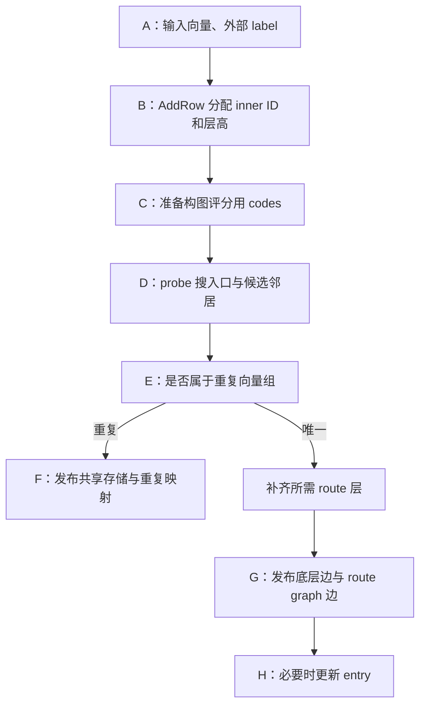

# 11｜HGraph 的图怎样构造、插入与维护

[返回系统架构](README.md) · [查询请求管线](07_query_request_pipeline.md) · [HGraph 结构与遍历](../indexes/hgraph/traversal_walkthrough.md)

源码基线：`fd363937`。查询是在既有图上选路，构图则要决定这些路为什么存在。
本章先跟普通 NSW 插入，再理解层高、启发式选边、反边维护、批量 ODescent 与并发边界。
融合 RaBitQ、缓存构图、去重存储作为有明确入口的变体说明，不把它们混成默认行为。
文中“源码事实”来自当前分支；动机解释属于工程分析，不能当作算法严格证明。

## 1. 先抓住一次插入的四种状态



[查看 PNG 图片](figures/11_hgraph_build_mutation-01.png)

<details>
<summary>查看可编辑 Mermaid 源码</summary>



</details>

这张图按职责排列；实际 storage 的准备/发布时机依赖去重与优化构建配置。
不能据此假定“所有 codes 都是在 probe 后才写入”。
普通非去重路径在 probe 前插入持久 codes；去重路径需要先知道代表节点才能绑定共享 slot。

| 状态 | 代表成员/结构 | 不是同一个计数 |
|---|---|---|
| 外部记录身份 | `label_table_`、`AddRow.input_idx/inner_id` | 用户 label 可以不连续 |
| 向量表示 | `basic_flatten_codes_`、`high_precise_codes_`、`raw_vector_` | 存储精度与构图评分精度可能不同 |
| 图拓扑 | `bottom_graph_`、`route_graphs_`、`entry_point_id_` | 图中的唯一代表节点不一定等于逻辑记录数 |
| 重复/共享存储 | duplicate tracker、`code_slot_map_` | 多个逻辑 ID 可以共享一个 physical slot |

读构图首先要问“这一行在改哪种状态”，否则容易把 resize、插入 codes、插边都当成一件事。

## 2. Build 并不等于每个点都固定走同一插入函数

入口 [`IndexImpl::Build/Add`](../../src/index/index_impl.h#L82)
先检查 immutable 与输入 Dataset，内部异常仍由 SAFE_CALL 转换成外部 Error。
`HGraph::Build` 要求索引为空；`Add` 则调用 `add_impl` 执行增量添加。

源码：[src/algorithm/hgraph/hgraph_build.cpp](../../src/algorithm/hgraph/hgraph_build.cpp#L163)，基线行号 **163–188**；以下为连续原文摘录。

```cpp
    std::vector<int64_t> ret;
    const bool using_build_cache = this->has_loaded_cache();
    if (using_build_cache) {
        this->check_fused_mutation_supported("Build with imported cache");
        if (this->using_dedup_storage()) {
            throw VsagException(ErrorType::INVALID_ARGUMENT,
                                "HGraph deduplicate_storage does not support build_with_cache");
        }
        // A previously exported cache has been imported via ImportCache().
        // Take the accelerated build path that warm-starts neighbours from
        // the cache and refines them, instead of building from scratch.
        ret = this->build_with_cache(data);
    } else {
        auto optimized_result = this->try_optimized_build(data);
        if (optimized_result.has_value()) {
            ret = std::move(optimized_result.value());
        } else if (graph_type_ == GRAPH_TYPE_VALUE_NSW) {
            ret = this->add_impl(data);
        } else {
            ret = this->build_by_odescent(data);
        }
    }
    if (use_elp_optimizer_) {
        elp_optimize();
    }
    if (this->mci_parameters_.enabled and
```

这里的先后关系是：导入缓存优先；否则先尝试优化构建，再按 graph_type 分 NSW 与 ODescent。
`try_optimized_build` 成功不意味着换了另一种图算法：
[`hgraph_fast_build.cpp:110`](../../src/algorithm/hgraph/hgraph_fast_build.cpp#L110)
的 session 内部仍按 graph_type 调 `add_impl` 或 `build_by_odescent`，提交编码构建会话。
因此“选择构图算法”与“优化构图用的编码访问”是两条配置维度。

构建完成后可执行 ELP 边优化，以及在相应条件下构建 MCI 伴随结构。
如果研究 Build 总成本，要把训练、编码、插边/批量优化以及这些后处理都算进去。
本章先关闭缓存、融合、去重、ELP、MCI，从最短可解释路径读起，再逐项打开。

## 3. add_impl 的准备阶段：一批数据先变成 AddBatch

[`add_impl`](../../src/algorithm/hgraph/hgraph_build.cpp#L317)
先处理 MCI 添加互斥与 force-remove 读锁，然后执行：

1. `validate_add_data`：检查维度、输入数据指针，融合编码还有有限值要求。
2. `prepare_add_context`：确定去重、临时 SQ8、并行 Add；空索引时采样并训练 codes。
3. `prepare_graph_read_codes`：确定构图阶段实际读哪种向量表示。
4. `prepare_add_batch`：过滤冲突 label，分配 inner ID，登记 label/来源 ID，采样层高。
5. `prepare_temporary_graph_read_codes`：必要时将本批向量先装入临时构图表示。
6. `insert_add_batch`：准备编码并对各 AddRow 执行逻辑节点插入。

`prepare_add_context` 中训练受 `add_mutex_` 保护；非空索引通常复用已有模型。
对于需要临时 SQ8 的非空 Add，若没有 raw vectors 会直接拒绝，而不是假装能恢复原始数据。
学习量化时要回到这里看模型训练的时机，不要认为 Add 每来一个向量都重新训练量化器。

源码：[src/algorithm/hgraph/hgraph_build.cpp](../../src/algorithm/hgraph/hgraph_build.cpp#L437)，基线行号 **437–462**；以下为连续原文摘录。

```cpp
    }
    context.first_empty_add = context.train_data != nullptr;
    return context;
}

HGraph::AddBatch
HGraph::prepare_add_batch(const DatasetPtr& data) {
    AddBatch batch(this->allocator_);

    auto total = data->GetNumElements();
    const auto* labels = data->GetIds();
    const auto* source_id = data->GetSourceID();
    for (int64_t j = 0; j < total; ++j) {
        {
            std::shared_lock label_lock(this->label_lookup_mutex_);
            auto [found, _] = this->label_table_->TryGetIdByLabel(labels[j]);
            if (found) {
                batch.failed_ids.emplace_back(labels[j]);
                continue;
            }
        }

        InnerIdType inner_id;
        {
            std::scoped_lock lock(this->add_mutex_);
            inner_id = this->get_unique_inner_ids(1).at(0);
```

第一段共享 label 锁用于发现已有外部 label，冲突 label 放进 `failed_ids` 并跳过。
成功行在 add 锁内取得唯一 inner ID，需要时扩大逻辑容量和 `total_count_`。
紧接着 464–481 行再登记 label 和 source ID，采样 `row.level`，写入 `batch.rows`。
`input_idx` 保留输入位置，后续才能正确关联这行向量、extra_info 和 attributes。

这也说明 `Add` 的返回值不是新节点 ID 列表，而是添加失败的外部 label 列表。
外层返回“成功的 expected”仍可能包含非空 failed_ids；调用者应分别检查两层含义。
并发调试时不要把当前 `total_count_` 理解成“所有新邻接表都已经完全发布”，
因为准备 batch 和插图是不同阶段。

## 4. 构图用的距离，为什么可能不同于查询粗排距离

[`prepare_graph_read_codes`](../../src/algorithm/hgraph/hgraph_build.cpp#L488)
默认指向 `basic_flatten_codes_`，随后按配置切换：

| 情况 | 构图读 codes | 工程原因 |
|---|---|---|
| 需要临时 SQ8、首次空 Add、无 raw | 本次训练的 temporary SQ8 Flatten | 避免只靠低位 RaBitQ 编码完成构图 |
| 需要临时 SQ8、有 raw | `raw_vector_` | 已有更直接的构图数据来源 |
| 有独立 precise reorder 且非 build_by_base | `high_precise_codes_` | 让边的选择依据较高精度表示 |
| 去重存储首次构建且命中该后续分支 | logical-ID 索引的临时 Flatten | 避免构图热点反复 Resolve slot |
| 其他 | `basic_flatten_codes_` | 直接复用持久编码 |

表格按代码的 if/else 顺序理解，不是所有符合条件的项同时生效。
“精排 codes”不只在查询重排使用，它也可能参与建立图的 pairwise 距离。
这解释了为什么只改查询精排参数，无法修复构图时已经删掉的导航边。

## 5. 层高的含义：level=-1 是只进入底层

源码：[src/algorithm/hgraph/hgraph.h](../../src/algorithm/hgraph/hgraph.h#L312)，基线行号 **312–319**；以下为连续原文摘录。

```cpp
    /// Sample a random level from the exponential distribution for a new node.
    int
    get_random_level() {
        std::uniform_real_distribution<double> distribution(0.0, 1.0);
        double r = -log(distribution(level_generator_)) * mult_;
        return static_cast<int>(r);
    }

```

调用方保存的是 `get_random_level()-1`，所以不要直接把返回 r 的整数部分当 route_graph 数组下标。
`mult_=1/log(bottom_graph_->MaximumDegree())` 在
[`hgraph.cpp:136`](../../src/algorithm/hgraph/hgraph.cpp#L136) 初始化。
在理想连续均匀分布模型下，指数采样让高层节点更少；这是分层稀疏的来源。

| 保存的 `row.level` | 底层 | route_graphs_[0] | route_graphs_[1] | route_graphs_[2] |
|---|---|---|---|---|
| -1 | 有 | 无 | 无 | 无 |
| 0 | 有 | 有 | 无 | 无 |
| 1 | 有 | 有 | 有 | 无 |
| 2 | 有 | 有 | 有 | 有 |

同一 inner ID 在不同层有不同邻接表，而向量数据可以复用。
层高不是聚类类别，不是按向量距离挑选“中心”，也不是每个点只属于唯一层。
小数据集完全可能只有底层，教学程序只有几个点时不应该强行期待上层存在。
成员中的固定随机引擎 seed 有利于控制采样，但并行调度与数据顺序仍会影响整张图，
不能仅凭 seed 就声称并行 Build 的邻接结果逐字节确定。

## 6. NSW 插入先 probe，再 publish

源码：[src/algorithm/hgraph/hgraph_build.cpp](../../src/algorithm/hgraph/hgraph_build.cpp#L675)，基线行号 **675–698**；以下为连续原文摘录。

```cpp
    auto needs_update_structure = this->unique_add_needs_structure_update(level);
    if (not needs_update_structure) {
        add_lock.unlock();
    }

    auto rlock = this->acquire_global_read_lock();

    auto param = make_search_param();
    auto probe = this->probe_graph_for_add(data, level, inner_id, param, context.graph_read_codes);
    if (this->publish_duplicate_if_found(probe, inner_id, context)) {
        return false;
    }

    if (this->unique_add_needs_structure_update(level)) {
        rlock.unlock();
        std::scoped_lock<std::shared_mutex> wlock(this->global_mutex_);
        this->publish_unique_under_unique_global_lock(data, level, inner_id, param, probe, context);
        return true;
    }

    this->publish_unique_under_shared_global_lock(
        data, level, inner_id, param, probe, context, rlock);
    return true;
}
```

这段是 `insert_one_logical_point` 的后半部。
前面已经准备必要 codes，并初始化 `param.ep=entry_point_id_、ef=1、topk=1`。
`add_mutex_` 在需要改变层结构时保留独占，否则尽早释放，让普通插点有机会并发进行。
global 读锁下完成 probe；发现重复时先发布重复关系并返回，不再给重复点新造整套导航边。

唯一点若要建第一张图或新增 route 层，则释放 global 读锁，取得 global 独占锁后发布。
如果结构无需扩展，就在共享 global 锁下发布，邻接表的改动另外用节点锁保护。
这里用“两次检查结构是否要更新”应对 probe 前后状态变化；
不要把它简化成函数最开头判断一次就永远不会再检查。

[`probe_graph_for_add`](../../src/algorithm/hgraph/hgraph_build.cpp#L817) 的实际主线：

1. 对比新节点层高更高的 route 层，自上向下做小预算路由，更新 `param.ep`。
2. 将 `param.ef` 和 `param.topk` 改为 `ef_construct_`。
3. 开启 duplicate 支持时设置 find_duplicate 和距离阈值等字段。
4. 底图非空时搜底图；检测到重复就返回代表 ID。
5. 否则从搜索结果移除 `id==inner_id`，得到连接候选。

这一实现并不是简单照搬某段经典 HNSW 伪代码：
probe 先获取底层候选，随后 publish 底层，再由
`publish_unique_to_route_graphs` 对 `j=0..level` 的 route 层搜索并连接。
应按当前文件的真实执行顺序解释，而不是把所有层都想象成一次从顶到底边搜边连。

## 7. 邻居选择：为什么不能只保留最近 M 个

`ef_construct_` 控制构建搜索的候选保留宽度及停止条件，并非总访问点数或距离计算次数；`graph->MaximumDegree()` 控制“最终能留多少边”。
两者分别影响候选质量与邻接预算；把 ef 调大不意味着每个节点最终能无限增加度数。

源码：[src/impl/pruning_strategy.cpp](../../src/impl/pruning_strategy.cpp#L101)，基线行号 **101–126**；以下为连续原文摘录。

```cpp

    while (not queue_closest->Empty()) {
        if (return_list.size() >= max_size) {
            break;
        }
        std::pair<float, InnerIdType> current_pair = queue_closest->Top();
        float float_query = -current_pair.first;
        queue_closest->Pop();
        bool good = true;

        for (const auto& second_pair : return_list) {
            float curdist =
                pairwise_distance.PairwiseDistance(second_pair.second, current_pair.second);
            if (alpha * curdist < float_query) {
                good = false;
                break;
            }
        }
        if (good) {
            return_list.emplace_back(current_pair);
        }
    }

    for (const auto& current_pair : return_list) {
        edges->Push(-current_pair.first, current_pair.second);
    }
```

进入这段前，候选已转换成从近到远弹出的队列。
`float_query` 是当前候选到新节点的距离；`curdist` 是当前候选到已选邻居的距离。
当 `alpha*curdist < float_query`，当前候选被视作已选邻居能够覆盖的方向而不保留。
这是局部几何启发式，目的是在有限边数下减少冗余方向，不是保证全图最短路的证明。

函数 89–91 行还有一个经常被漏掉的短路：`edges->Size()<max_size` 时直接返回。
因此候选不足预算时不会执行后面的几何剪枝；等于预算时仍会进入启发式判断。
最终度数可以小于 max_size，参数表达上限，并不要求必须填满。

手算例采用 L2 **平方距离**，仅演示剪枝函数，不是完整索引的合法参数配置。
新节点 P=(0,0)，候选 A=(1,0)、B=(2,0)、C=(0,2)、D=(-3,0)，
教学边预算 M=3、alpha=1，候选数 4，因此不会走不足预算的早退。

| 候选 | 到 P 距离 | 与已选点的关键比较 | 决定 |
|---|---:|---|---|
| A | 1 | 无已选点 | 留 A |
| B | 4 | d(A,B)=1，1<4 | 删除 B |
| C | 4 | d(A,C)=5，5<4 不成立 | 留 C |
| D | 9 | d(A,D)=16、d(C,D)=13，均不小于9 | 留 D |

B 比 D 更近，却因为方向与 A 重叠而被剪掉。
C 与 B 距离同为 4；无论先处理二者中的谁，这组坐标在上述比较下仍得到 A/C/D。
教学 M=3 小于当前外部参数的最小值 4（见 [hgraph_param_mapping.cpp:356](../../src/algorithm/hgraph/hgraph_param_mapping.cpp#L356)），不要把它复制成真实创建参数。

## 8. 正边和反边不是一次无条件对称赋值

源码：[src/impl/pruning_strategy.cpp](../../src/impl/pruning_strategy.cpp#L140)，基线行号 **140–167**；以下为连续原文摘录。

```cpp
    if (top_candidates->Size() > max_size) {
        throw VsagException(
            ErrorType::INTERNAL_ERROR,
            "Should be not be more than max_size candidates returned by the heuristic");
    }

    Vector<InnerIdType> selected_neighbors(allocator);
    selected_neighbors.reserve(max_size);
    while (not top_candidates->Empty()) {
        selected_neighbors.emplace_back(top_candidates->Top().second);
        top_candidates->Pop();
    }

    InnerIdType next_closest_entry_point = selected_neighbors.back();

    graph->InsertNeighborsById(cur_c, selected_neighbors);

    for (auto selected_neighbor : selected_neighbors) {
        if (selected_neighbor == cur_c) {
            throw VsagException(ErrorType::INTERNAL_ERROR,
                                "Trying to connect an element to itself");
        }

        LockGuard lock(neighbors_mutexes, selected_neighbor);

        Vector<InnerIdType> neighbors(allocator);
        graph->GetNeighbors(selected_neighbor, neighbors);

```

第一步对新点 P 的候选做启发式裁剪，写入 P 自己的邻接表。
然后逐个处理 selected_neighbor，在对应节点锁下读原邻接表。
如果邻居未满，将 P 加入邻居的表；满了则把“旧邻居 + P”一起重新剪枝。

源码：[src/impl/pruning_strategy.cpp](../../src/impl/pruning_strategy.cpp#L174)，基线行号 **174–200**；以下为连续原文摘录。

```cpp
        if (sz_link_list_other < max_size) {
            neighbors.emplace_back(cur_c);
            graph->InsertNeighborsById(selected_neighbor, neighbors);
        } else {
            // finding the "weakest" element to replace it with the new one
            float d_max = pairwise_distance.PairwiseDistance(selected_neighbor, cur_c);

            auto candidates = std::make_shared<StandardHeap<true, false>>(allocator, -1);
            candidates->Push(d_max, cur_c);

            for (uint64_t j = 0; j < sz_link_list_other; j++) {
                candidates->Push(
                    pairwise_distance.PairwiseDistance(selected_neighbor, neighbors[j]),
                    neighbors[j]);
            }

            select_edges_by_heuristic(candidates, max_size, distance_provider, allocator, alpha);

            Vector<InnerIdType> cand_neighbors(allocator);
            while (not candidates->Empty()) {
                cand_neighbors.emplace_back(candidates->Top().second);
                candidates->Pop();
            }

            graph->InsertNeighborsById(selected_neighbor, cand_neighbors);
        }
    }
```

反向更新是以 **旧节点作为中心** 重新判断几何覆盖，不能复用以 P 为中心的剪枝结果。
因此 P→A 存在并不保证 A→P 一定保留，函数名 mutually connect 表达双向更新尝试，
不等于最终图严格无向。
将图画成无向边只是直观示意；追代码必须尊重每个节点独立的出边表。

`selected_neighbors.back()` 作为这个辅助函数的返回值，表示所选邻居中靠近的一项。
但本章的 `publish_unique_to_bottom_graph` 和 route 发布调用没有使用其返回值来更新全局 entry。
全局入口更新由结构发布函数决定，不能看到函数返回 next_closest_entry_point 就认为入口被替换了。

## 9. 谁更新 entry，什么时候新建层

[`unique_add_needs_structure_update`](../../src/algorithm/hgraph/hgraph_build.cpp#L764)
检查底图为空，或者新节点 level 不小于当前 route_graphs_ 的层数。
`ensure_route_graphs_for_level` 补齐缺少的稀疏层。
在 global 独占锁下，先准备需要的层与 storage，再发布底层和 route 边，最后按条件更新 entry。

一个可手动跟踪的例子：

| 插入 | 假定采样层高 | 插入前 route 层数 | 结构结果 | entry 是否更新 |
|---|---:|---:|---|---|
| P0 | -1 | 0 | 底图加入首节点，route 仍空 | 是，P0 |
| P1 | -1 | 0 | 只更新底图邻接 | 否 |
| P2 | 1 | 0 | 新建 route[0]、route[1] | 是，P2 |
| P3 | 0 | 2 | 底图和 route[0] 加入 P3 | 否 |
| P4 | 2 | 2 | 新建 route[2]，各适用层加入 P4 | 是，P4 |

该表是给定 level 序列的结构推演，不代表固定 seed 对这五次输入一定产生该序列。
入口更新依据层结构，而不是每次寻找“离数据总体均值最近的点”。

## 10. ODescent：批量迭代改邻居，不是反复调用 Add 的别名

HGraph 的 `build_by_odescent` 先整理合法输入索引、分配 ID、准备 codes，
并按采样层高收集各 route 层的 ID 子集。
底图调用一次 ODescent::Build；上层对各自 ID 子集分别 Build，再 SaveGraph。
底层使用 bottom 的 max degree，上层构建预算设置为其一半。

源码：[src/impl/odescent/odescent_graph_builder.cpp](../../src/impl/odescent/odescent_graph_builder.cpp#L47)，基线行号 **47–69**；以下为连续原文摘录。

```cpp
    this->prepare_build_flatten();
    Vector<std::mutex>(data_num_, allocator_).swap(points_lock_);
    Vector<UnorderedSet<uint32_t>> old_neighbors(allocator_);
    Vector<UnorderedSet<uint32_t>> new_neighbors(allocator_);
    old_neighbors.resize(data_num_, UnorderedSet<uint32_t>(allocator_));
    new_neighbors.resize(data_num_, UnorderedSet<uint32_t>(allocator_));
    for (int i = 0; i < data_num_; ++i) {
        old_neighbors[i].reserve(odescent_param_->max_degree);
        new_neighbors[i].reserve(odescent_param_->max_degree);
    }
    init_graph(graph_storage);
    {
        for (int i = 0; i < odescent_param_->turn; ++i) {
            sample_candidates(old_neighbors, new_neighbors, odescent_param_->sample_rate);
            update_neighbors(old_neighbors, new_neighbors);
            repair_no_in_edge();
        }
        if (pruning_) {
            prune_graph();
            add_reverse_edges();
        }
    }
    return true;
```

ODescent 初始化一张工作图，然后按 `turn` 次循环执行采样候选、更新邻居、修复无入边节点。
开启 pruning 时再做 prune_graph 和 add_reverse_edges，最后由调用方保存到实际 graph datacell。
`old_neighbors/new_neighbors` 表示迭代中的候选状态，不是 HGraph 的上层和底层。

| 对比点 | NSW Add 主线 | ODescent Build 主线 |
|---|---|---|
| 输入视角 | 当前图中插入一个/一批新点 | 一批目标节点一起优化邻居 |
| 候选来源 | 从入口沿现有图搜索 | 初始工作图与多轮候选采样/邻居更新 |
| 主要状态 | AddRow、probe、逐节点发布 | 工作 graph_、old/new candidates |
| 并行机会 | 普通插点与准备编码 | 分块并行的批量图操作 |
| 内存压力 | 插入候选、临时编码、并行任务 | 额外工作图与迭代候选集合 |
| API 关系 | Add 始终走 add_impl | Build 按 graph_type 选择 |

工程上，批量方法有机会利用全批候选互相改进，但需要维护更多构建期状态。
哪种更快、召回更好取决于数据、参数和实现分支；本章没有用结构推断代替基准实验。

## 11. Add 的锁：要按保护对象读，不要笼统说线程安全

| 锁 | 在这条路径的用途 | 阅读边界 |
|---|---|---|
| `mci_add_mutex_` | MCI 开启时串行组织 Add 与 clique 更新 | 不是所有 HGraph Add 都持有 |
| `force_remove_mutex_` 共享锁 | 协调强制删除与 Add | 依 support_force_remove 条件 |
| `add_mutex_` | 训练/ID容量准备及需要改层结构的插入协调 | 普通插入会尽早释放相应锁 |
| `label_lookup_mutex_` | 查重、登记/读取标签映射 | 与邻接表锁不同 |
| `global_mutex_` | 保护整体结构稳定性与扩展 | probe 共享、结构发布独占 |
| `neighbors_mutex_` | 修改/读取单个节点邻接表 | 底图和 route 的真实调用点要一起看 |
| `persistent_codes_mutex_` | 持久编码写入组织 | 图锁不等于 codes 写锁 |
| `physical_code_resize_mutex_` | 去重物理 slot 扩容 single-flight | 只在共享存储分支相关 |

新增边时，调用者在 `publish_unique_to_bottom_graph` 持有新点节点锁，
辅助函数再对旧邻居加锁；不要看到 LockGuard 就自行改造锁顺序。
当前代码还有缓存构图等其他路径，它们的批量更新方式与锁边界不同，需独立追踪。
本章给出的是读现有实现的锁地图，不据此承诺所有 API 任意组合都可无约束并发。

去重物理扩容还可能先释放 global 读锁、确保物理容量、重新加读锁再发布。
先准备完整 codes，后发布 logical-ID 到 slot 的绑定，是理解可见性的关键。
修改这部分代码前，必须把读者何时能 Resolve 到 slot 与何时能读完整编码一起验证。

## 12. 异常收尾与“事务回滚”是两回事

`insert_add_batch` 可以把 AddRow 投递到线程池，正常路径调用 `wait_all_futures`。
该函数逐个 future.get，保存首个异常，但仍继续等待其余任务，再重新抛出首个异常。
这样不会因为第一个失败就让同批其他后台任务无人收尾。

源码：[src/algorithm/hgraph/hgraph_build.cpp](../../src/algorithm/hgraph/hgraph_build.cpp#L97)，基线行号 **97–115**；以下为连续原文摘录。

```cpp
static void
wait_all_futures(std::vector<std::future<void>>& futures) {
    std::exception_ptr first_exception = nullptr;
    for (auto& future : futures) {
        if (not future.valid()) {
            continue;
        }
        try {
            future.get();
        } catch (...) {
            if (not first_exception) {
                first_exception = std::current_exception();
            }
        }
    }
    if (first_exception) {
        std::rethrow_exception(first_exception);
    }
}
```

另有 `HGraphBuildTaskGuard` 析构再次等待尚有效的 futures，并吞掉析构阶段异常。
它的目的在于守住任务生命周期，不能推导成失败时撤销所有 codes、labels、edges。
准备 batch 时已登记部分状态，执行插点时也可能逐步修改邻接表；
当前这条链没有展示覆盖整批 Add 的统一 undo log 或完整原子回滚。
因此遇到异常应检查具体错误及索引状态，不能把 expected 失败自动解释为“索引完全没变化”。

普通重复 label 的 failed_ids 是明确的业务处理路径；编码失败、内存失败或 worker 异常是另一类失败。
两者在 API 层表现、部分完成状态和后续恢复方式都不同。

## 13. 从实际测试进入，再做定点调试

| 实际 TEST_CASE 名称 | 源码位置 | 建议观察 |
|---|---|---|
| `Pruning Strategy Select Edges With Heuristic` | [src/impl/pruning_strategy_test.cpp:39](../../src/impl/pruning_strategy_test.cpp#L39) | alpha、候选/已选邻居、pairwise 距离 |
| `ODescent Build Test` | [src/impl/odescent/odescent_graph_builder_test.cpp:50](../../src/impl/odescent/odescent_graph_builder_test.cpp#L50) | 全量与 ID 子集构图 |
| `HGraph Add exact duplicate keeps duplicate label searchable` | [src/algorithm/hgraph/hgraph_add_test.cpp:300](../../src/algorithm/hgraph/hgraph_add_test.cpp#L300) | 重复逻辑 label 与图代表 |
| `HGraph deduplicate_storage batch Add supports internal parallel add` | [src/algorithm/hgraph/hgraph_add_test.cpp:1269](../../src/algorithm/hgraph/hgraph_add_test.cpp#L1269) | batch 发布和并发 Add |
| `HGraph deduplicate_storage physical growth is single-flight` | [src/algorithm/hgraph/hgraph_add_test.cpp:1335](../../src/algorithm/hgraph/hgraph_add_test.cpp#L1335) | physical_code_capacity 和扩容锁 |
| `HGraph deduplicate_storage skips duplicate external labels without binding storage` | [src/algorithm/hgraph/hgraph_add_test.cpp:635](../../src/algorithm/hgraph/hgraph_add_test.cpp#L635) | label 冲突与 slot 绑定的区分 |

先从 [`调试实验章`](12_debugging_lab.md) 的小数据程序观察 Build/Add 外部行为，
再在 `prepare_add_batch`、`insert_one_logical_point`、`probe_graph_for_add`、
`select_edges_by_heuristic`、`publish_unique_under_unique_global_lock` 放断点。
建议记录 `row.input_idx/inner_id/level`、`entry_point_id_`、`route_graphs_.size()`、
`param.ep/ef/topk`、`probe.duplicate_id`、候选堆大小与 `selected_neighbors`。
这比一上来钻 SIMD 更直接地回答“图为什么长这样”。

建议实验一：固定输入和串行配置，仅提高 ef_construction，比较候选集合和最终边，而不只看耗时。
建议实验二：保留同一组剪枝候选，仅改变 alpha，记录被覆盖淘汰的点。
建议实验三：在同数据上分别 Build NSW/ODescent，比较每个节点邻接与查询召回。
这三项是后续学习实验，本文没有声称已执行。

读完应能解释：节点为什么出现在某些层、谁决定出边、反边为什么可能不保留、
全局入口何时变化，以及为什么构图用的精度、查询用的精度与物理存储不是同一件事。
